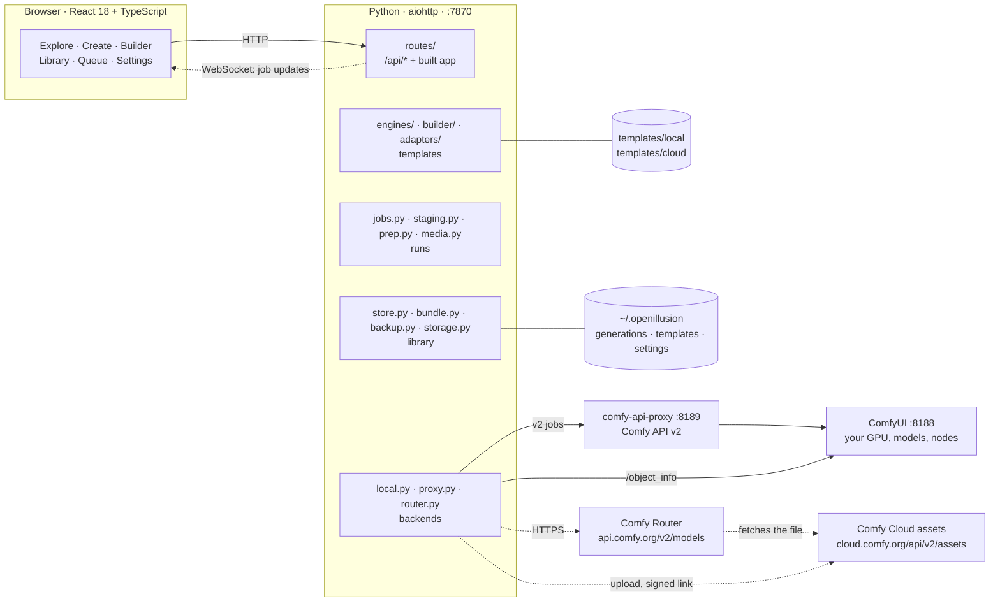
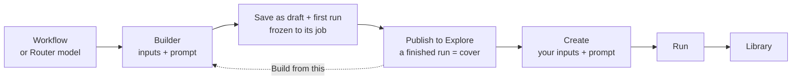
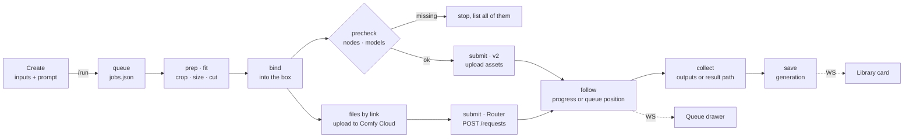

# Architecture

How OpenIllusion is put together: where the code is, what one run does, where things
are kept, and the API. What each screen does is in [docs/APP.md](docs/APP.md); the
template file, the Builder and the cloud models in [docs/TEMPLATES.md](docs/TEMPLATES.md).

## System map

One Python process serves both the web app and its API on `:7870`. The browser
only ever talks to that port. The API key and the proxy token are never written
to disk by the server: the browser holds them (`localStorage`) and sends them with
each request; the server keeps them in memory until it stops and never sends them back.

`proxy.py` starts comfy-api-proxy as a child process when it isn't running. Your
own templates in `~/.openillusion/templates` override shipped templates with the
same id, so editing in the app never changes the repo.

## Code map

Where to look when you change something.

At the root: `server/`, `ui/`, `templates/` (shipped `local/` and `cloud/` templates),
`schema/` (the generation format), `tests/`, and `Dockerfile` with `docker-compose.yml`
(the app in a container: the UI built in a Node stage, served by the Python server as a
non-root user, the home folder in a volume, ComfyUI reached on the host by
`OPENILLUSION_COMFYUI_URL`, which `settings.load` takes as the address until one is saved).

**Server** (`server/`, Python, `python -m server`):

| File | What it does |
| --- | --- |
| `server.py` · `__main__.py` | Start-up: `python -m server [--host] [--port] [--open]`. Claims the home folder (`server.lock`: a second server on the same home refuses to start, so no run is resumed twice), deletes secrets an older version wrote to disk, resumes interrupted jobs (a cloud run waits for the key until a browser sends it), keeps comfy-api-proxy up in front of a live ComfyUI (checked every 15 s), cleans scratch and old trash every 6 h, refuses cross-origin writes (`_same_origin`), sets nosniff, no-referrer, no framing and a strict CSP on every response (`_headers`), and takes the key and proxy token from the `X-Comfy-Key` and `X-Comfy-Proxy-Token` headers (`_secrets`). |
| `routes/` | Every `/api/*` route (see [API](#api)), the WebSocket, and the built app, one module per area: `system` (app, socket, status, settings, key, local check), `templates`, `builder`, `generations` (uploads, compose, run, jobs), `library` (generations, trash, storage, re-run, export, import), `backup` (back up, restore); shared helpers in `common`. Thin: it checks input and calls the modules below. |
| `engines/` | Templates, in layers: `build` (fill a workflow or cloud body; `materialize` swaps media tokens for file data), `contract` (the `Engine` record; load and upgrade template files), `covers` (covers, samples, clip limits, whether the lead input is a before), `results` (`result_media` finds the image or video in an answer). `__init__` keeps the registry (`ENGINES`, `get`, `describe`), editing (edit/duplicate/delete/reset, and `adopt_run`: a run's prompt, settings and files as the template's defaults, baked into its workflow or body) and `compose` (the request a run sends), and re-exports the rest. |
| `builder/` | The Builder, in layers: `workflow` (read a dropped file, `read_workflow`; UI graph to API graph, `ui_to_api`), `analysis` (detect inputs, prompt, settings and result nodes, `analyze`), `assemble` (`assemble_local`, `assemble_cloud`, `preset` and `cloud_preset` for Build from this, `save`). `__init__` re-exports them. |
| `adapters/` | `__init__.py` reads and checks adapter files and puts a request together from one (`parse`, `check`, `assemble`, `pick_model`) and the result settings a job asks for (`settings_for`, `write_setting`, `setting_field`). One `*.json` per cloud model. |
| `staging.py` | A run before it starts: `prepare_generation` (spec → generation folder: inputs cropped, sized and copied, running manifest), `input_plans` (what prep will do, for Create), `resolve_asset`, and what a finished generation carries (`recipe_manifest`, `workflow_file`). |
| `jobs.py` | The queue: `_run_inner` (cloud: upload files by link, materialize, submit, poll, collect), `_run_local` (upload, precheck, submit, follow events), saving results. |
| `router.py` | Comfy Router client: submit, status, collect, sync run, cancel, download. |
| `local.py` | `ComfyV2` (Comfy API v2: upload assets, jobs, events; used for comfy-api-proxy and for Comfy Cloud assets) and `ComfyUI` (`/object_info`, precheck of nodes and models). |
| `proxy.py` | Starts and stops comfy-api-proxy. |
| `prep.py` · `media.py` | Crop and size inputs; turn a shape and a step into an output size (`canvas_size`, `fit_dims`); image/video/audio helpers (probe, transcode, poster, data URIs, recipes in PNG/MP4). Photos, clips and sounds (MP3, WAV, M4A, AAC, OGG, FLAC) upload alike; a run cuts a sound and writes it as MP3. |
| `edit.py` | The media editor's work: `edit` (turn, flip, crop, size, cut, frame rate, mute → a new upload) and `normalize` (TIFF, BMP, AVIF, GIF, MKV, AVI, WMV, MPEG, WMA, AIFF, OPUS… become PNG, MP4 or MP3 on upload; an animated GIF becomes a clip). |
| `fit.py` | Which adapter role a template's file fills (`role`; where two roles share a place, Seedance's Reference video and Video to edit, the one whose `with` the request carries), what a model takes in each file (`fit`: sides, shape, MB, seconds, total, fps) and how a photo or clip's plan and a clip's span change to meet it. `staging.fitted` applies it to a run. |
| `store.py` · `generation.py` | The library: one folder per generation with `generation.json` (pydantic `Manifest`), indexed in SQLite with full-text search; trash. |
| `bundle.py` · `archive.py` | Export a generation as a zip, import one back; the checks every zip from outside passes first (`archive.files`: paths stay inside, allowed types, count and size caps); `archive.put` writes an entry undated. |
| `scrub.py` | Files as they leave: EXIF and GPS, PNG text and time, mp4 and WebM dates, ID3, RIFF and FLAC tags cut out or zeroed in place, never re-encoded (a photo its EXIF turns is turned for real first). |
| `template_pack.py` | One template as a `.illusion` (`illusion.json` with a sha256 per file, `template.json`, `media/`, `cover/`): `export`, `is_pack` (a template's, not a generation's), `install` (checked like any zip from outside, every media name must be in the package, the template must load before anything moves in). |
| `backup.py` | Whole-library backups (`.illusionbackup`): `create`, `inspect` (what a restore would add), `restore` (merge). See [Backups](#backups). |
| `usage.py` | When each template was last run and how often (`usage.json`), for Recently used and Most used; a run of several variants counts once; with no file yet it starts from the library's runs. |
| `folders.py` | The folder picker's side: a folder's folders (no files, hidden ones out), Home and its media folders, the drives (Windows) or `/`, and making a new folder. A browser can't hand a page a folder's path, so `components/FolderPicker.tsx` walks the server's disk through it; in Docker that is the container's. |
| `settings.py` · `storage.py` · `paths.py` | Settings (on disk) and the secrets (in memory, `remember`); disk usage and cleanup; home folder paths, what each entry is (`TIERS`), and `write_atomic`. See [Storage](#storage). |

**UI** (`ui/src/`, React + Vite):

| File | What it does |
| --- | --- |
| `lib/api.ts` | Every API call and its types. Start here. |
| `lib/store.ts` | App state (zustand): the open studio's inputs, prompt and sounds, one unsent draft per template, Open in Create and Use these inputs (`loadGeneration`). |
| `lib/spec.ts` · `fields.ts` | Studio state → the run spec the server composes (`toSpec`); which inputs a template shows; a prompt as the model gets it, names swapped for tokens (`sentAs`). |
| `lib/route.ts` · `live.ts` · `query.ts` | Hash routes; the WebSocket feed of job updates; React Query setup. |
| `App.tsx` · `components/Shell.tsx` · `Palette.tsx` | Layout, rail and tab bar, drops anywhere on the page (files from outside only: a drag that starts on the page, like selected text, is ignored; a page with inputs of its own takes media through `usePageDrop`), Ctrl K palette. |
| `screens/*` | One file per screen; see [The app](docs/APP.md#the-app-screen-by-screen). |
| `screens/builder/` | Builder: Local workflow and Comfy Router tabs, three steps with Back, the checklist, save and first run (`Builder.tsx`); the start step and model cards (`Start.tsx`), the template's numbered sections and the workflow's missing nodes and models (`Sections.tsx`, `SourceCheck`), output size and settings with Ask/Lock (`Settings.tsx`), the side panel: Create's view, the checklist, Run (`Rail.tsx`), row state from a workflow or preset (`model.ts`). On Router: job cards built from the adapter's sets or `models` (`modes.ts`), inputs grouped by role (each role's limits as pills counted across its files, **Fit all to spec**, a card per sample with Edit, Replace, Remove), a sentence on what the run makes, and the same `set`/`needs`/`models` checks as the server. |
| `screens/create/` | Create: the page (`CreateStudio.tsx`; the stage shows the picked input in the editor, or the run), input cards, the inline editor and the edits made just before Run (`Inputs.tsx`), the canvas (`Canvas.tsx`), prompt and Run (`Panel.tsx`), this template's runs (`History.tsx`). |
| `components/Studio.tsx` · `Refs.tsx` · `Trimmer.tsx` · `ABPlayer.tsx` | Create's parts: template seeding, `useRunner` (with a `prepare` step before the run), uploads, clip and sound trimming (filmstrip or wave; past the model's length hatched), before/after player. |
| `components/MediaEditor.tsx` | The one editor for photos, clips and sounds: `Editor` (inline on Create's stage), `MediaSheet` (the Builder's sheet, saves a new file), `MediaThumb` (a file as its edits leave it), `FitLine` ("Fits Kling", "Run crops it to 5:2"). |
| `lib/edits.ts` | The editor's logic, no UI: the `Edits` a file carries, what they make (`outOf`), the model's limits as checks and a file's one-line status, Fit to spec (a port of `fit.plan`), and the ops sent to `/api/media/edit`. |
| `components/ui.tsx` · `oi.tsx` · `bits.tsx` · `sprite.ts` | Shared pieces: buttons, segmented tabs, fields, spinners; page head, header chips (`KeyStat`, `GpuStat`), sideways-scrolling rows, media; the icon sprite (`<I n>`). |
| `styles/` | The only styling: `base.css` tokens and reset, `common.css`/`fields.css` shared pieces, one stylesheet per area, `responsive.css` for phones. |

**Folders:**

| Path | What lives there |
| --- | --- |
| `templates/local/` | Shipped workflow templates (Qwen 2.1 photo edits and Create a photo; MiniMax H3 Create a video, Create a video Turbo, H3 T2V Turbo, Animate a photo, Character swap), plus `media/` (samples and covers) |
| `templates/cloud/` | Shipped Router templates, each one run for real first: Text to Image (Seedream 5.0 Pro, GPT Image 2, Grok Imagine Image 2.0), Text to Video (Veo 3.1 Fast), Swap two people, Multi character swap, Character Swap and Dancing Animal (Seedance 2.5), Swap character and Text to Video (Kling 3 Omni), Reference to Video and Text to Video (Wan 3.0). Samples and covers in `media/`, all generated here |
| `docs/media/` | The README's demo thumbnail and screenshots, taken from the running app |
| `tests/` | pytest suite; Router, Comfy Cloud and ComfyUI are faked with `httpx.MockTransport` |
| `schema/` | `generation.v1.json` (`python -m server.gen_schema`) |
| `~/.openillusion/` | The home folder; see [Storage](#storage) |

## A template's life

The Builder's first run is a Create run (below): saving makes the template a draft
and opens it in Create, running once; Publish there puts it on Explore.

## One run, end to end

The generation id doubles as the job id and the idempotency key on both backends.
A run that was in flight when the server restarted is picked up again, not
submitted twice.

- **prep** crops and sizes each input once, in Python, for both kinds. Size is
  chosen per input on Create and defaults to the input's own size. Caps are 3 MP
  for photos and 1.5 MP for video; Settings can lift them.
- **fit** then makes every file one the model takes (`staging.fitted`, from the
  adapter's `fit`): the middle cropped to the shapes allowed, scaled up or down
  into the side and pixel limits, clips and sounds cut to the longest allowed
  (from where their trim starts, and to what a `total` leaves), frame rate
  resampled, photos re-encoded and clips given the bitrate that keeps each file
  under its MB limit and the request under its inline limit. Sounds always go as
  MP3. Too short is the one thing it can't fix: nothing is made up, the run is
  refused with the reason. Create lists every change before the run ("Image 2:
  cropped to 5:2, scaled up to 750×300 to fit Kling 3 Omni") and shows the sizes
  the model gets; the Builder shows each role's limits.
- **bind** writes files and the prompt where the template's inputs point: node
  inputs for local, media tokens in the request for cloud (`engines.materialize`).
  Seeds the box marks as random are re-rolled.
- **files by link** (cloud) uploads each input the request takes as a link, once
  per run; see [Files by link](docs/TEMPLATES.md#files-by-link).
- **precheck** (local) compares the workflow with ComfyUI's `/object_info` and
  lists every missing node and model at once. ComfyUI's own validation stops at
  the first one.
- **collect** takes the save node's outputs (local), or reads the template's
  result paths in Router's answer (cloud). Router results expire after 24 h, so
  they are downloaded straight away.

## Storage

**Rule: permanent data is files; SQLite only holds what can be rebuilt.** A generation
is a folder you can open, zip or drag into ComfyUI; the search index is rebuilt from
the folders whenever it's missing or its layout changes. Anything new the app keeps for
good (boards, collections, notes) goes in the home folder as files too, so a backup stays
a copy of known folders.

The home folder is `$OPENILLUSION_HOME`, or `~/.openillusion`. `paths.TIERS` says what
each entry is; a test fails when the app writes something it doesn't list.

| Tier | Entries | Backed up | Cleaned |
| --- | --- | --- | --- |
| library | `generations/`, `templates/`, `covers/`, `trash/`, `settings.json`, `usage.json` | yes (trash optional) | trash after 7 days |
| machine | `index.sqlite`, `jobs.json`, `proxy-state/`, `proxy.log`, `server.lock` | no | never |
| scratch | `uploads/`, `cache/` | no | on their own after 30 days unused (Builder drafts: 1 day), or from Settings → Storage |

`outputs/` is the default export folder: the user's files, not the app's.

- **Whole or nothing.** Every JSON file the app keeps (`generation.json`, settings,
  templates, `.shelf`, the queue) goes through `paths.write_atomic`: temp file,
  fsync, rename. A crash leaves the old file, never half of one.
- **Secrets off the server's disk.** The server never writes the key or the proxy
  token. The browser keeps them in `localStorage` and sends them as headers; the server
  holds them in memory, so after a restart the first request from the app brings them
  back, and a resumed cloud run waits until then. Forget clears both.
  `COMFY_API_KEY` in the server's environment still works. `settings.migrate` deletes the `secrets.json` (and
  any key in `settings.json`) an older version wrote.
- **The queue file** (`jobs.json`) is written when a run changes state, not on progress:
  progress and previews only go to open pages over the WebSocket.
- **The index** carries `PRAGMA user_version` (`store.INDEX_VERSION`); a different
  version drops it and reindexes the folders.
- **Edited shipped templates** name the shipped samples and covers as
  `shipped:local/media/<file>`, not a path on this machine, so they work on any install.
- **Cleaning itself.** Every 6 hours (and at start-up) `storage.auto_clean` removes scratch
  nobody has used, and old trash goes. Showing an upload on a page or running it restarts
  its clock (`storage.touch`), so a draft left open in Create keeps its files.
- **One server per home** (`server.lock`, see `server.py`).

### What leaves without dates

Anything that goes to someone else goes as it is, without when it was made or what it came from.
A backup is the exception: it is yours, so it keeps everything.

- **A generation** (`.illusion`, recipe link, the recipe inside a result file) goes out as
  `generation.shareable`: no `created`, `lineage`, `starred` or `outcome`, no machine path, and
  its id swapped for `share_id`, a hash of it (a ULID starts with the time it was made). The
  same id every time, so adding your own share back still finds the original (`store.mine`) and
  becomes a fork of it.
- **A template** (`.illusion`) has no export date and no `draft`; use counts stay in `usage.json`.
- **Every file in either**: through `scrub.clean`, so a photo's EXIF date and GPS, a clip's
  creation time and a sound's tags stay home; zip entries are undated (`archive.UNDATED`).
  An input's checksum is taken after cleaning. Ogg is passed through as it is.

### Backups

Settings → Storage → **Back up** writes `OpenIllusion-<date>.illusionbackup` to
`<output folder>/backups/` (the Backups row in Storage; Download from there too): a zip of the library tier, laid out as `library/<entry>/…`,
with a `backup.json` (format, version, app, counts, and every file's size and sha256).

- **What's left out.** Every machine and scratch entry; the key never
  travels, so a restored install asks for it again. Trash only when asked. A generation a
  run is still writing is skipped and listed (`skipped`).
- **Written safely.** To `<name>.partial`, renamed when complete. Photos and clips are
  stored as they are (already compressed); JSON is deflated.
- **Checked before anything is read** (`backup._open`): it's a backup of a version this
  app understands (newer → refused), `archive.files` passes, every entry is under
  `library/` and one of the library entries, generation ids are real ids, every file has
  a checksum, and the disk has room.
- **Older backups** may hold `library/characters/` and `library/refmods/` (Character Lab,
  now on the `refmod` branch); restore leaves them out (`backup.GONE`).
- **Restore merges, never replaces.** Dropping a backup shows what it would add
  (`inspect`). Restoring then unpacks each generation to a staging folder, checks every
  checksum and the manifest, and moves it in whole; one that fails is listed in
  `damaged` and left out. Generations and templates already here are kept as they are; a
  template that differs from the backup's copy is listed in `kept`. Settings: only keys
  still at their default take the backup's value. Template use (`usage.json`): per
  template, the later last run and the higher count. Then the index is rebuilt.
- **Progress** goes to every open page over the WebSocket as `{"type": "backup" | "restore", "data": {done, total}}` (bytes).
- **Not while running.** Restore is refused while a run is in progress (409); one backup
  or restore at a time.

## API

Everything is under `/api` on `:7870`, same origin only. `lib/api.ts` has a
typed call for each.

| Area | Routes |
| --- | --- |
| Status and setup | `GET status` · `POST local/check` · `POST local/proxy/start` · `POST onboarded` · `GET ws` (job updates) |
| Settings and key | `GET/POST settings` · `POST key/test` · `POST key/forget` |
| Folder picker | `GET folders?path=` (a folder's folders, the places and drives) · `POST folders` (`{parent, name}`: a new folder) |
| Templates | `GET engines` · `PATCH/DELETE templates` · `POST templates/duplicate` · `POST templates/hide` (`{engine, hidden}`: a shipped template off Explore or back) · `POST templates/publish` (`{engine, generation}`: a draft on Explore; the run must be a finished one of it and becomes the cover when it has none) · `GET templates/input` · `GET templates/workflow` · `GET templates/export` (a template's `.illusion`; `POST import` adds one) · `GET/PUT/DELETE cover` (`PUT {engine, generation, reuse?}`: without `reuse`, a run with other inputs than the template answers 409 with `differs`, the inputs it changed; `reuse: true` keeps them as the template's defaults first) |
| Builder | `POST builder/workflow` · `POST builder/from-template` · `GET builder/models` (every adapter) · `POST builder/save` · `DELETE builder/template` |
| Files | `POST upload` (photo, clip or sound; other formats converted) · `GET uploads/{asset}` · `POST frame` (a still from a clip) · `POST media/edit` (`{asset, ops: {rotate, flip, crop, width, height, start, end, fps, mute}}` → a new upload) |
| Runs | `POST compose` (the request, without running) · `POST run` · `GET jobs` · `POST jobs/{id}/cancel` · `POST jobs/{id}/dismiss` · `POST jobs/cancel` · `POST jobs/clear` |
| Library | `GET generations` · `GET facets` · `GET/PATCH/DELETE generations/{id}` · `POST generations/trash` · `GET generations/{id}/file/…`, `/output`, `/workflow`, `/recipe` · `POST generations/{id}/rerun` |
| Trash and storage | `GET trash` · `POST trash/{id}/restore` · `POST trash/restore` · `DELETE trash/{id}` · `POST trash/purge` (picked, for good) · `DELETE trash` · `GET storage` · `POST storage/clean` |
| Backups | `POST backup` (`{trash}`) · `GET backup/file/{name}` · `POST restore` (the file as the body; answers what it would add, with a `token`) · `POST restore/{token}` |
| Share | `GET generations/{id}/export/sizes` · `POST generations/{id}/export` · `GET exports/{name}` · `POST import` · `GET import/{token}/file/…` · `POST import/{token}/commit` · `GET community` |

## RefMods and Character Lab: on the `refmod` branch

Character Lab (people kept as photos plus an H3 RefMod made on your GPU) and RefMod inputs
need more work, so they live on the `refmod` branch, not in this build. Generations made
with a RefMod still open and export with their own copy; a RefMod loader dropped
into the Builder shows its `mod_N` slots as plain settings.

## Status

| # | Phase | State |
| --- | --- | --- |
| — | Local: shipped workflow templates (Qwen Image 2.1, MiniMax H3 so far), every one run on the GPU | done |
| 0 | Comfy Cloud removed as a runner; Router is the cloud | done |
| 1 | Cloud contract: inputs + prompt, file form per input, result paths, base64 and byte results | done |
| 2 | Cloud badge, key gate, Local/Cloud filter on Explore | done |
| 3 | Builder Router tab, first run, a result as cover | done |
| 4 | Adapters for five models; saving freezes the inputs; generic schema detection removed | done |
| 5 | Every mode of every model: roles, adapter format v2 (`set` lists, `with`/`drop`, `models`, path lists, audio), files by link | built, tested against fakes |
| 5b | Settled design: mode tabs per Router model, Back through the Builder's steps, design rules written down | done |
| 6 | First real run of each model and mode with a key; fix what Router refuses | shipped templates run for real on Seedream 5.0 Pro, GPT Image 2, Grok Imagine Image 2.0, Veo 3.1 Fast, Kling 3 Omni, Wan 3.0 and Seedance 2.5 (files by link included); Nano Banana 2.1, FLUX 2 Max and the modes no shipped template uses still only against fakes |
| 7 | Storage: safe writes, secrets off disk, one server per home, scratch that cleans itself, `.illusionbackup` back up and merge-restore | built, tested on throwaway homes |
| 8 | Inputs fitted to each model: published per-file limits in adapters (`fit`, `media_mb`); runs crop, scale, cut, resample and re-encode to them; Create lists the changes | built, tested against fakes |
| 9 | Dataset prep, per file: one workbench editor for every photo, clip and sound (inline on Create's stage, a sheet in the Builder), file cards that say whether the model takes each file, the model's limits as pills with Fit to spec and the Builder's Fit all; any common format converted on upload | built, tested; batch editing next |
| 11 | Result settings: shape, size, length, resolution, sound and quality for every Router model (adapter `settings`) and the shipped create templates; Create's shape tiles and size steps; the Builder's Output size and Settings for both tabs; a saved template is a draft until a finished run of it is published from Create | built, tested; cloud values unchecked against real runs |

## Known weak spots

| | Area | What | Fix |
| --- | --- | --- | --- |
| med | Cloud | Each shipped cloud template has run for real, but Nano Banana 2.1, FLUX 2 Max and the modes no shipped template uses (first and last frame, extend, style, video edit on Kling and Wan) have only run against fakes. Combination rules (`set`) the docs don't state are guesses on the safe side. | Phase 6 |
| low | Files by link | Works with a plain key (Kling and Seedance clips go this way); how long the signed link lives is unmeasured, so each run uploads again. | Measure, then reuse uploads within that time |
| med | Moderation | Seedance refuses some runs as moderated with no reason given; realistic faces in the inputs seem to trip it. The run shows Moderated. | None in the app; the provider decides |
| med | Backups | Only run on small throwaway libraries. Time, disk room and progress on a library of many GB, and a restore across machines, are untested. | Back up and restore a real library into a fresh `OPENILLUSION_HOME` |
| low | Proxy | The proxy token is passed to comfy-api-proxy on the command line (`--token`), so it shows in the process list to anyone on the machine. | Pass it by environment or a private file |
| med | Settings | Settings values come from Router's schemas and docs; only the ones the shipped templates use have met a real run. Veo's aspect still applies with a first frame. A Builder's size readout uses a 16 px grid, so a template based on a 32 px one can open a few pixels off. | Phase 6 |
| med | Limits | Fits are read from docs, never from a refusal. Seedance's per-file numbers come second-hand; Kling's "720–2160 px" for clips is read as both sides. | Phase 6: correct any fit a real refusal disagrees with |
