<p align="center">
  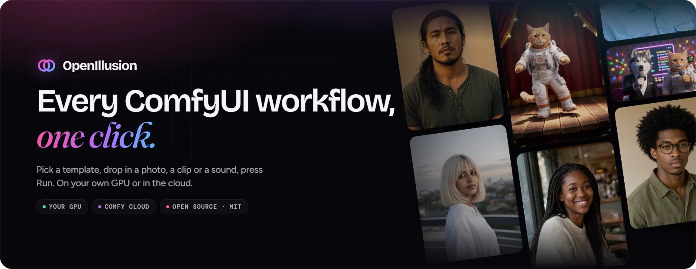
</p>

<p align="center">
  &nbsp;
  <b>OpenIllusion turns ComfyUI workflows into one-click templates.</b><br>
  Pick a template, drop in a photo, a clip or a sound, press Run. No nodes, no wires.
</p>

<p align="center">
  <a href="https://github.com/GETHUK-BIGEMPEROR/OpenIllusion/actions/workflows/check.yml"></a>
  <a href="LICENSE"></a>
  
  
  <br>
  
  
  
  
  
</p>

<p align="center">
  <a href="#quick-start"><b>Quick start</b></a> ·
  <a href="docs/media/demo.mp4"><b>Watch the demo</b></a> ·
  <a href="#what-it-does">What it does</a> ·
  <a href="#screenshots">Screenshots</a> ·
  <a href="#setup">Setup</a> ·
  <a href="#docs">Docs</a>
</p>

<p align="center">
  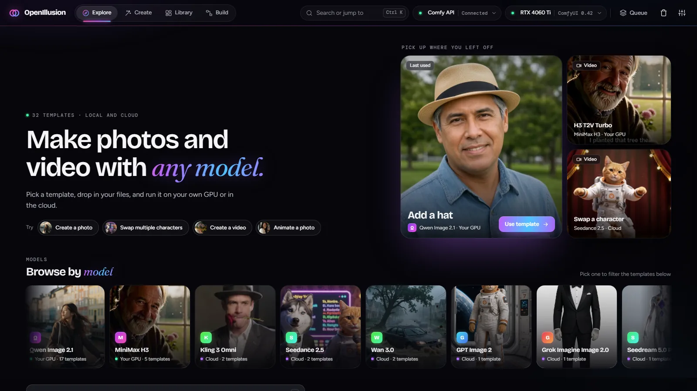
</p>

## Quick start

```powershell
git clone https://github.com/GETHUK-BIGEMPEROR/OpenIllusion.git
cd OpenIllusion
.\start.bat        # Windows; or double-click start.bat
./start.sh         # macOS and Linux
```

One command installs, builds and opens http://127.0.0.1:7870. First run asks **Use my
GPU** (your ComfyUI on `:8188`) or **Use cloud** (a Comfy API key, no GPU needed).
Explore's **Runs on** and **Ready to run** filters then show what your setup can run.
Readiness checks connections and local requirements, not free VRAM or cloud credit.
Docker, the models each template needs and troubleshooting: [Setup](#setup).

## What it does

<table>
<tr>
<td width="33%" valign="top">
<b>🎬 Video and photos on your GPU</b><br>
Through the ComfyUI you already run. Put a character from a photo into a clip, animate a
photo, make video with sound from words (MiniMax H3); make or edit a photo: a hat, new
hair, a new background, relight, restore (Qwen Image 2.1). <b>22 ship.</b>
</td>
<td width="33%" valign="top">
<b>☁️ Premium models in the cloud</b><br>
Same app, same way, on <a href="https://docs.comfy.org/development/comfy-router/reference.md">Comfy Router</a>
with your key: Seedance 2.5, Kling 3 Omni, Veo 3.1, Wan 3.0, Seedream 5.0, GPT Image 2,
Grok Imagine. <b>12 ship</b>, for anyone without a GPU.
</td>
<td width="33%" valign="top">
<b>🧩 Your workflows, as templates</b><br>
Drop any ComfyUI workflow: the app finds its inputs, prompt and settings. Run it once and
it's a template on Explore. Any model or custom node your ComfyUI has.
<a href="#your-own-workflows">More</a>
</td>
</tr>
<tr>
<td valign="top">
<b>✂️ Files fitted to the model</b><br>
Crop, cut, resize and change the frame rate in one editor that shows the model's
limits, before the run. The original always stays.
</td>
<td valign="top">
<b>🗂️ Every result keeps its recipe</b><br>
Inputs, prompt, settings and the exact workflow, so any run can be compared with its
input, run again, exported or backed up. Edit a template's defaults any time.
</td>
<td valign="top">
<b>📦 A template is one file</b><br>
Export <code>.illusion</code> and anyone with the app drops it in: checked first, never runs code,
never carries your key. <a href="#share-a-template-the-illusion-file">More</a>
</td>
</tr>
</table>

Open source under the [MIT license](LICENSE). No account, no analytics, your library is
plain files on your machine. Entered in Comfy's
[Open Source Higgsfield](https://comfy.org/open-source-higgsfield/) contest
([Contest entry](#contest-entry)).

## Demo

<p align="center">
  <a href="docs/media/demo.mp4">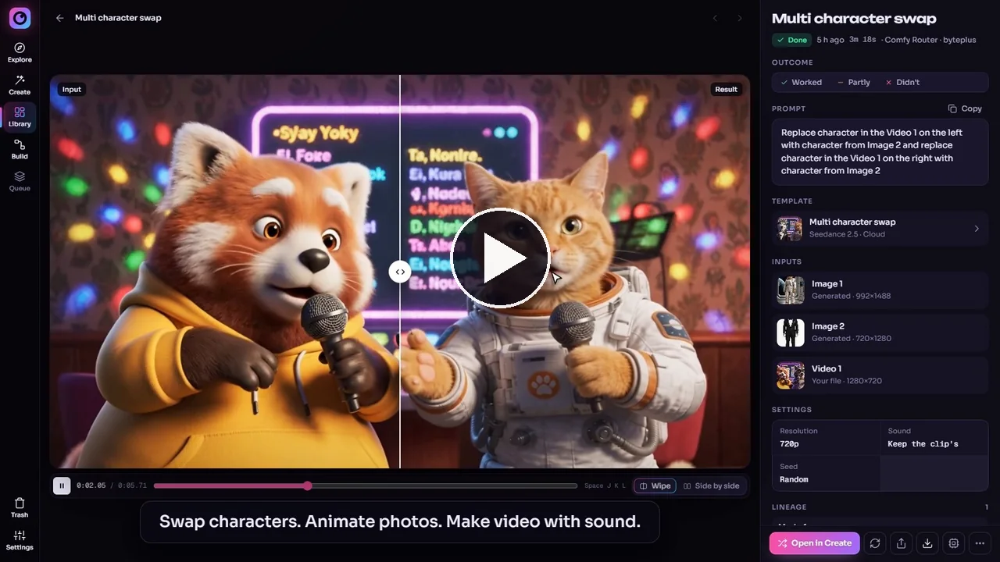</a><br>
  <sub><b><a href="docs/media/demo.mp4">Watch the demo</a></b> (1:35): Explore, building a template from a ComfyUI workflow and from a cloud model, MiniMax H3 live on a 16 GB GPU, and sharing it as one <code>.illusion</code> file.</sub>
</p>

## Screenshots

<table>
<tr>
<td width="50%" valign="top">
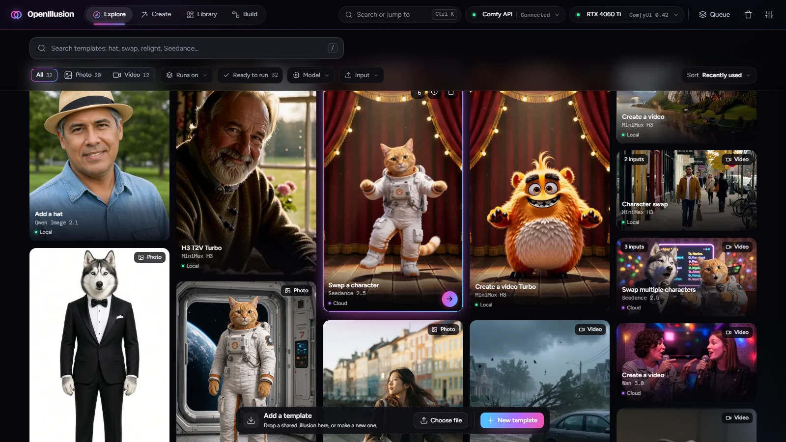<br>
<b>Explore.</b> Every template on one wall, each shown by a real result it made. Browse by model, search, filter by photo or video, where it runs and whether it's ready to run.
</td>
<td width="50%" valign="top">
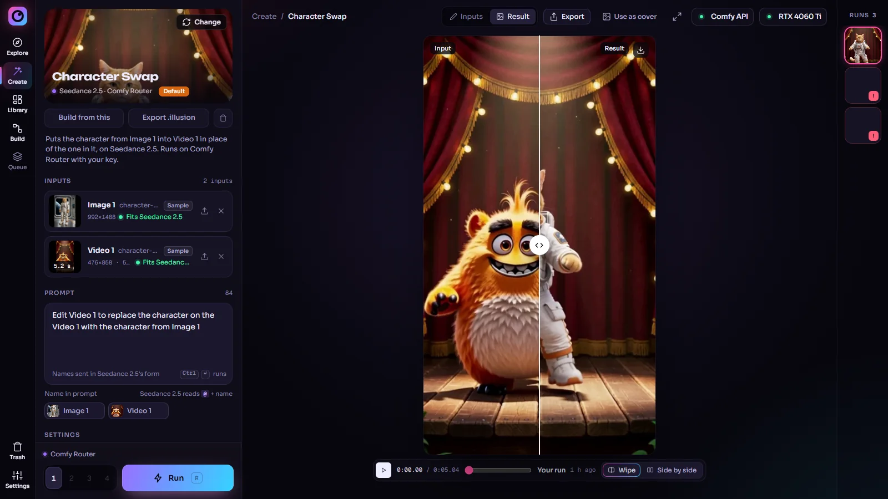<br>
<b>Create.</b> Inputs, prompt and settings on the left; your run against its input on the stage, side by side or as a wipe; every earlier run in the rail.
</td>
</tr>
<tr>
<td valign="top">
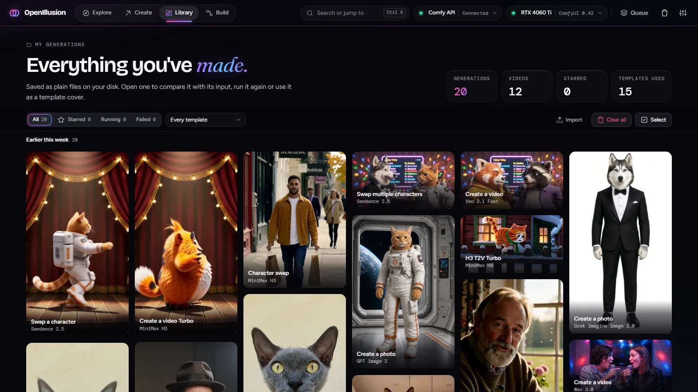<br>
<b>Library.</b> Every run, newest first, as plain files on your disk. Starred, running, failed, by template; clear, select, import.
</td>
<td valign="top">
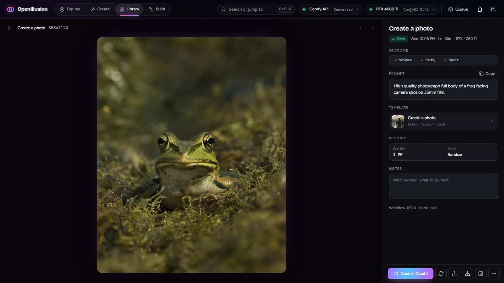<br>
<b>A run.</b> The result with its recipe: prompt, template, settings, outcome and notes. Open in Create, re-run, share, download.
</td>
</tr>
<tr>
<td valign="top">
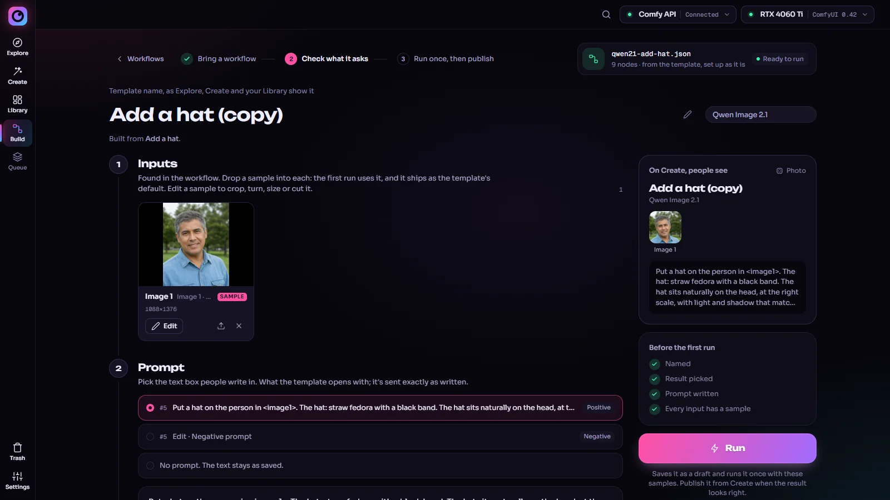<br>
<b>Build, local.</b> Any ComfyUI workflow: it finds the inputs, the prompt and the output settings.
</td>
<td valign="top">
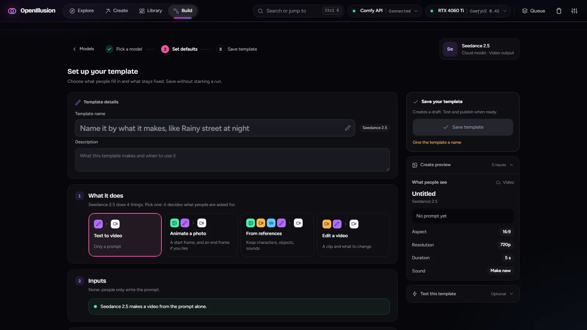<br>
<b>Build, cloud.</b> Any Comfy Router model: pick what it does, and Create asks only for that.
</td>
</tr>
</table>

<p align="center">
  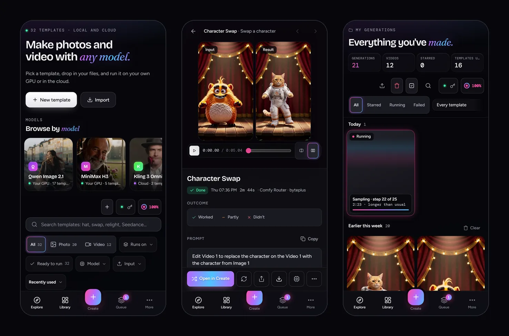<br>
  <sub><b>On your phone.</b> The same app, laid out for touch: a tab bar, the status chips in each page's header, runs followed live.</sub>
</p>

## Docs

This page is what the app is and how to run it. The rest:

| Doc | What's in it |
| --- | --- |
| [docs/APP.md](docs/APP.md) | Every screen and what it does; the design rules |
| [ARCHITECTURE.md](ARCHITECTURE.md) | System and code map, one run end to end, storage and backups, the API, status and weak spots |
| [docs/TEMPLATES.md](docs/TEMPLATES.md) | The template file, the Builder, Comfy Router models and their adapters, adding a model |
| [CONTRIBUTING.md](CONTRIBUTING.md) | Running it for development, tests, conventions |

## Using it

**Run.** Explore shows every template by a real result it made; search it, filter by
photo or video, model and input, sort by recently or most used. A template opens in
Create with its sample files and prompt already in, so Run works first and you change
things after. Up to 4 variants a run, one seed each.

**Fit your files to the model.** Each input card says whether the model takes the file
as it is. One editor for photos, clips and sounds crops, turns, resizes, cuts, changes
the frame rate and the sound, with the model's limits as pills on top (green fits,
orange a run changes it, red can't run) and **Fit to spec** for all of it at once. The
original always stays.

**Watch it run.** A local run shows its sampler step, node and preview frames live, with
time left from its own pace; the GPU pill shows memory and what's running. A cloud run
shows its stage and counts against how long that template usually takes. One Queue holds
both: Running, Up next, Needs attention. A failed run says what to fix.

**Compare.** Every result sits against the input it was made from, side by side or as a
wipe you drag across, photos and clips alike (two clips loop in step).

**Keep everything.** The Library has every run with its whole recipe: files, prompt,
settings, and the workflow or request it ran. Star, add notes, re-run, or **Open in
Create** to load it all back. Deleted runs wait 7 days in Trash. Settings → Storage backs
the whole library up to one `.illusionbackup`; restoring one adds what's missing and
never overwrites what you have.

**Turn a run into the template.** **Use as cover** makes any finished run the template's
cover. If that run used other files or settings, it can make them the template's
defaults too, written into its workflow or request, so the workflow you download makes
what the cover shows.

**Yours, on your machine.** No account, no analytics. The app talks to your ComfyUI and,
for cloud runs, to Comfy with your key; nothing else unless you add a community index.
The key stays in your browser; the server never saves it. Nothing is installed or
downloaded into ComfyUI. The app listens on `127.0.0.1` unless you say otherwise. Your
library is plain files in one folder.

**Keys.** Ctrl K opens a palette for templates and results, `/` jumps to search, R runs,
1–4 jump between Explore, Create, Library and Build.

## Your own workflows

The app isn't tied to the models it ships with. If a workflow runs in your ComfyUI, it can
become a one-click template: any model, LoRA or custom node your ComfyUI has.

1. **Build → Local workflow**, then drop the workflow: a `.json` saved or exported from
   ComfyUI (UI or API format), or a PNG, WebP or MP4 that ComfyUI made, which carries it.
2. The Builder reads it against your ComfyUI. Each file loader (photo, clip or sound)
   becomes Image 1, Video 1, Audio 1; a text box becomes the prompt; a size or length
   becomes a setting. You choose which settings Create asks for and which stay fixed.
3. Run it once. That run is the test: Publish puts the template on Explore with the
   result as its cover, and Export `.illusion` shares it (see
   [Share a template](#share-a-template-the-illusion-file)).

The workflow runs untouched: sampler, steps, LoRAs and the seed mode stay as you saved
them. Before every run the app checks your ComfyUI and lists any missing nodes or models;
it never installs anything. A template's result is a photo or a video, so a workflow that
only saves audio, a 3D model or text can't be one yet. Details:
[Making a template](docs/TEMPLATES.md#making-a-template-builder).

Cloud templates are built the same way under **Build → Comfy Router**: pick a model, pick
what it does (text to video, first frame, references…), run it once. Nine Router models
have adapters: Seedance 2.5, Kling 3 Omni, Veo 3.1 Fast and Wan 3.0 for video; Seedream 5.0
Pro, GPT Image 2, Grok Imagine Image 2.0, Nano Banana 2.1 and FLUX 2 Max for photos (the
last two ship no template yet). [Adding a model](docs/TEMPLATES.md#adding-a-model) covers the rest.

## Share a template: the `.illusion` file

**Export .illusion** (in Create's header, or a template's details) puts one template in
one file. It's a zip; this is the shipped Add a hat, exported as is:

```
add-a-hat.illusion                   530 KB
├── illusion.json                    format, version, the template's id and name,
│                                    and a size and sha256 for every file below
├── template.json                    the template: its inputs, prompt, settings,
│                                    and the whole ComfyUI workflow it runs
└── media/
    ├── man-park.jpg                 the sample Image 1 it opens with
    └── cover-add-hat.webp           its cover
```

A cloud template holds the Router model and its request instead of a workflow. A cover
you set yourself rides along in `cover/`.

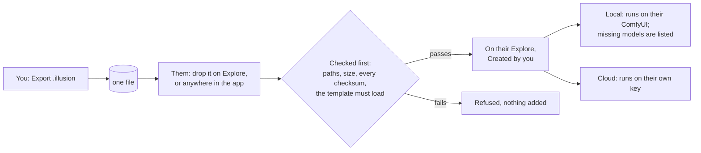

- **Nothing runs on import.** The file is only read and checked; it lands in their
  templates folder as theirs, under a new id if they already have one with that id
  (importing Add a hat next to the shipped one makes `local/qwen21-add-hat-2`).
- **What it never carries:** your API key, your library or other runs, when it was
  exported, how often you used it, or the Builder's working state. Every file is cleaned
  as it leaves: a photo's EXIF date and GPS, a clip's creation time, a sound's tags.
- **What they still need:** for a local template, the same models and nodes in their
  ComfyUI (the app lists any missing, with links); for a cloud one, a Comfy API key.

Local templates also export as a plain ComfyUI workflow `.json`, for ComfyUI itself.

**Results travel the same way.** Export on any finished run makes a `.illusion` of the
result with its recipe: Light (smaller files), Full (original files, the driving clip,
the workflow) or Recipe only. Dropped on anyone's OpenIllusion it lands in Library →
Imported, and Open in Create runs it again. A PNG or MP4 the app made can carry its
recipe inside it too.

## Setup

Windows, macOS or Linux. The app is a small Python server with a web page; ComfyUI does
the GPU work. Install it with Python (1a) or run it in Docker (1b), then add the models
(2) and, for cloud templates, a key (3).

**You need**

- [ComfyUI](https://github.com/comfyanonymous/ComfyUI) recent enough to have the MiniMax
  H3 and Qwen Image 2.1 nodes (ComfyUI Desktop works too), running on `http://127.0.0.1:8188`.
  Another address can be set in Settings → Your GPU. Built and tested with ComfyUI 0.42 on
  an RTX 4060 Ti 16 GB; both setups were also checked from a fresh clone against a stock
  ComfyUI 0.43 with no custom nodes. Only for local templates: cloud ones need no GPU.
- Disk for the models of the templates you want (below). A Comfy API key only for cloud templates.
- For 1a: Python 3.10 or newer, Node.js 18 or newer, git. For 1b: Docker with Compose.

**1a · Install with Python**

Get the code (or download the ZIP from GitHub and unzip it), then start it:

```powershell
git clone https://github.com/GETHUK-BIGEMPEROR/OpenIllusion.git
cd OpenIllusion
.\start.bat        # Windows; or double-click start.bat
./start.sh         # macOS and Linux
```

That's the install and the start, and it's the same every time. The first start makes a
Python environment in `.venv`, installs into it, builds the app's page, and opens
http://127.0.0.1:7870; it takes a few minutes. Later starts skip what's already done and
open in seconds. Keep the window open while you use the app; close it to stop. Starting
again while it runs just opens the browser on it.

On first start the app checks the ComfyUI on this machine and counts the templates whose
models are in it, then opens Explore. It starts comfy-api-proxy (Comfy API v2) on `:8189`
itself, from the app's own `.venv`; nothing goes into ComfyUI. Options, after `start.bat`
or `start.sh`: `--update` (get the latest version first), `--port 7871`, `--no-open`,
`--host` (default `127.0.0.1`; anything else lets other machines spend your credits).

By hand, the same steps are `python -m venv .venv`, `.venv\Scripts\python -m pip install -e .`
(`.venv/bin/python` on macOS and Linux), `npm --prefix ui ci`, `npm --prefix ui run build`,
then `.venv\Scripts\python -m server --open`.

**1b · Or run it in Docker**

```bash
git clone https://github.com/GETHUK-BIGEMPEROR/OpenIllusion.git
cd OpenIllusion
docker compose up --build -d
```

Open http://127.0.0.1:7870. The container holds the app only: ComfyUI and its models
stay where they are, and the app reaches the ComfyUI on your machine at
`host.docker.internal:8188` (set by `OPENILLUSION_COMFYUI_URL` in `docker-compose.yml`;
Settings → Your GPU changes it later). Your library lives in the `openillusion-home` volume,
not in the container, so `docker compose up --build -d` after a `git pull` keeps it.
The port is published on `127.0.0.1` only. If the app says ComfyUI isn't answering, ComfyUI
is listening on its own loopback only: start it with `--listen` (Linux needs this), and keep
port 8188 closed to your network in the firewall. Cloud-only use needs no ComfyUI at all.

**2 · Put the models in ComfyUI.** Each template lists what it's missing (with download
links) before it runs; the app never downloads models. Into ComfyUI's `models/` folders:

| File | Folder | Size | Used by |
| --- | --- | --- | --- |
| [minimax_h3_fl2va_pruned_int8_convrot](https://huggingface.co/Comfy-Org/MiniMax-H3/resolve/main/diffusion_models/minimax_h3_fl2va_pruned_int8_convrot.safetensors) | `diffusion_models` | 21 GB | Create a video, H3 T2V Turbo, Animate a photo |
| [minimax_h3_fl2v_turbo_4step_v1.0_768p_comfyui_bf16](https://huggingface.co/Comfy-Org/MiniMax-H3/resolve/main/loras/minimax_h3_fl2v_turbo_4step_v1.0_768p_comfyui_bf16.safetensors) | `loras` | 2 GB | Create a video, H3 T2V Turbo, Animate a photo |
| [minimax_h3_ref2va_pruned_int8_convrot](https://huggingface.co/Comfy-Org/MiniMax-H3/resolve/main/diffusion_models/minimax_h3_ref2va_pruned_int8_convrot.safetensors) | `diffusion_models` | 21 GB | Character swap |
| [h3_character_swap_pro4500_1000](https://huggingface.co/akatz-ai/MiniMax-H3-Character-Swap-LoRA/resolve/main/h3_character_swap_pro4500_1000.safetensors) | `loras` | 0.2 GB | Character swap |
| [qwen3vl_32b_minimax_h3_int8_convrot](https://huggingface.co/Comfy-Org/MiniMax-H3/resolve/main/text_encoders/qwen3vl_32b_minimax_h3_int8_convrot.safetensors) | `text_encoders` | 27 GB | every H3 template |
| [minimax_h3_video_vae_int8_convrot](https://huggingface.co/Comfy-Org/MiniMax-H3/resolve/main/vae/minimax_h3_video_vae_int8_convrot.safetensors) | `vae` | 2.8 GB | every H3 template |
| [minimax_h3_audio_vae_fp32](https://huggingface.co/Comfy-Org/MiniMax-H3/resolve/main/vae/minimax_h3_audio_vae_fp32.safetensors) | `vae` | 0.6 GB | every H3 template |
| [qwen_image_2.1_int8_convrot](https://huggingface.co/Comfy-Org/Qwen-Image-2.1/resolve/main/diffusion_models/qwen_image_2.1_int8_convrot.safetensors) | `diffusion_models` | 7.3 GB | every photo template |
| [qwen3vl_8b_int8_convrot](https://huggingface.co/Comfy-Org/Qwen-Image-2.1/resolve/main/text_encoders/qwen3vl_8b_int8_convrot.safetensors) | `text_encoders` | 9.4 GB | every photo template |
| [qwen_image_2.1_vae_bf16](https://huggingface.co/Comfy-Org/Qwen-Image-2.1/resolve/main/vae/qwen_image_2.1_vae_bf16.safetensors) | `vae` | 0.7 GB | every photo template |

Restart ComfyUI (or press Check again in the app) after adding files.

**3 · Cloud templates (optional).** Paste a Comfy API key in Settings → Cloud. The
browser keeps it; the server never saves it. A headless server can take it from `COMFY_API_KEY`.

**Update.** `start.bat --update` (or `./start.sh --update`): it pulls the latest version,
reinstalls what changed and starts. With Docker, `git pull` then `docker compose up --build -d`.
Your library is not in the repo and stays.

**Where your things are.** Everything you make (results, templates you build, settings,
uploads, the trash) is in one home folder: `~/.openillusion`, or the folder
`OPENILLUSION_HOME` names. Settings → Storage shows its size and makes a `.illusionbackup`.
Never the API key: that stays in the browser.

**If something's off**

| What you see | Do this |
| --- | --- |
| "another server is already using …" at start | One server per home folder. Use the running one, or start a second with its own `OPENILLUSION_HOME`. |
| start says Python or Node.js is needed | Install the one it names (it prints the link, and on Windows the `winget` line), open a new window, start again. |
| Port 7870 is taken | `start.bat --port 7871` (Docker: change the left side of `127.0.0.1:7870:7870`). |
| "ComfyUI isn't answering" | Start ComfyUI, or set its address in Settings → Your GPU, then Check again. |
| "Your ComfyUI runs on CPU" | ComfyUI was started with `--cpu` (or its torch has no GPU build). Runs still go, but photo and video templates would take hours: restart ComfyUI without `--cpu`. |
| "Comfy API v2 isn't running" | `pip install comfy-api-proxy` into the same `.venv`; its log is `proxy.log` in the home folder. |
| A template lists missing nodes or models | Install those into ComfyUI (Manager's Install Missing, or the links in the table above), restart ComfyUI, Check again. The app never installs anything. |
| Cloud Run says to add a key | Settings → Cloud. |
| A blank page after an update | Start with `start.bat` (it rebuilds the page), or `npm --prefix ui run build`, then reload. |

## The idea

Three rules hold everywhere, local and cloud, in the Builder and on Create.

**1 · A template is a black box.** Behind every template sits one thing the app
never edits: a ComfyUI workflow, or a Router model's request. Sampler, steps,
LoRAs and the seed mode stay as their author saved them. A random seed is
re-rolled each run; a fixed seed stays fixed.

**2 · Inputs, a prompt and the result's settings go in.** Inputs have no names: they
are Image 1, Image 2, Video 1, Audio 1, and the prompt says what each one is for.
There is one prompt, with no hidden text added; a cloud model gets "Image 1" in its
own form (see [Naming files in the prompt](docs/TEMPLATES.md#naming-files-in-the-prompt)). Then the
settings every generator has, where no input already decides them: the result's
shape and size, its length, resolution, sound (see [Settings](docs/TEMPLATES.md#settings-what-people-choose-about-the-result)).
Anything else is the box's business.

**3 · A template is frozen to its job.** A built template asks for exactly the
inputs its first run used, all required, so it does the same job every time. It
is saved as a **draft** (`"draft": true` in its file): Create has it, Explore doesn't.
Create's header says so, whether it has been tested (a finished run), and has
**Publish**, which takes a finished run (the one on the stage, else the latest), makes
it the cover when there is none, and puts the template on Explore. Untested templates
can't be published. Drafts wait in the Queue, under Drafts. Every
shipped template ships with its cover. A cover is shown beside the input it was made
from: setting one keeps a copy of that run's lead photo or clip (`covers/<id>.before.*`),
and a shipped cover pairs with the shipped samples. A photo cover is made from the full
result (up to 1600 px), not its 960 px poster, so it is as sharp as the input beside it.

The two kinds differ only in where the box comes from and who knows its inputs:

| | Local | Cloud |
| --- | --- | --- |
| The box | A ComfyUI workflow (API format) | A Router model id plus its native JSON request |
| Its inputs come from | **Detection**: loaders, text boxes and save nodes in the workflow | **An adapter**: a hand-written JSON file per model |
| Which ones | Any workflow that runs in ComfyUI | Only models with an adapter |
| What it can do | Whatever the workflow does | Every mode the model has: text-only, first frame, first + last frame, references, edit… The inputs you fill pick the mode. |
| Freeze | Built in: the workflow's loaders are fixed and each needs a file | At save: the template keeps the mode its run used |
| Runs through | `local.py` → comfy-api-proxy `:8189` → your ComfyUI | `router.py` → `api.comfy.org/v2/models/{provider}/{model}`; files by link via `cloud.comfy.org/api/v2/assets` |
| Cost | Free, on your GPU | Paid per run; usage is in your Comfy dashboard (OpenIllusion shows no prices) |
| Progress | Live: sampler step, node, preview frames, time left from the pace so far | Stage and queue position; time counted against how long this template usually takes (never a made-up percent) |
| When it fails | Missing nodes and models are listed, never installed; ComfyUI's errors pass through | Router's errors pass through |

Detection works for workflows because ComfyUI's node types are one shared
vocabulary. Router has none: in its own words, "each model accepts its own native
request body and returns its own native result". Guessing inputs from schemas
breeds endless bugs, so every cloud model gets an adapter, written by hand from
its Router docs.

## The templates it ships

Each one was run for real before it shipped. Local ones need the
models in [Setup](#setup); cloud ones need a Comfy API key.

| Template | Model | Runs | Takes | Makes |
| --- | --- | --- | --- | --- |
| Create a video | MiniMax H3 | Your GPU | words | video with sound, full model, 20 steps |
| Create a video Turbo | MiniMax H3 | Your GPU | words | video with sound, turbo LoRA, 6 steps |
| H3 T2V Turbo | MiniMax H3 | Your GPU | words | video with sound, 6 steps |
| Animate a photo | MiniMax H3 | Your GPU | a photo (first frame) | video with sound |
| Character swap | MiniMax H3 | Your GPU | a clip and a photo | the clip with the photo's character |
| Create a photo | Qwen Image 2.1 | Your GPU | words | photo |
| Add a hat, Add glasses, New hair, Makeup, Expression, Outfit swap, Holding a product | Qwen Image 2.1 | Your GPU | a photo (two for outfit and product) | the photo, edited |
| Background swap, Relight, Season & weather, Recolor, Remove anything, Restyle, Restore & colorize, Product shot, Remove background | Qwen Image 2.1 | Your GPU | a photo | the photo, edited |
| Create a photo | Seedream 5.0 Pro, GPT Image 2, Grok Imagine Image 2.0 | Cloud | words | photo |
| Create a video | Veo 3.1 Fast, Kling 3 Omni, Wan 3.0 | Cloud | words | video with sound |
| Animate a reference photo | Wan 3.0 | Cloud | a photo | video with sound |
| Swap a character | Kling 3 Omni | Cloud | a clip and a photo | the clip with the photo's character |
| Swap a character | Seedance 2.5 | Cloud | a clip and a photo | the clip with the photo's character in place of its own |
| Swap two people, Swap multiple characters | Seedance 2.5 | Cloud | a clip and two photos | the clip with both people swapped |
| Make an animal dance | Seedance 2.5 | Cloud | a clip and a photo | the clip with the photo's animal |

Make your own from any ComfyUI workflow or Router model in Build
([docs/TEMPLATES.md](docs/TEMPLATES.md#making-a-template-builder)).

## Contest entry

| | |
| --- | --- |
| Contest | [Open Source Higgsfield](https://comfy.org/open-source-higgsfield/) by Comfy, build period 10/15 to 10/30/2026 |
| Categories | Best Overall, Most Innovative |
| What it is | A working app on top of ComfyUI that lets anyone run, and make, their own one-click templates: pick one, drop in photos, clips or sounds, press Run |
| License | MIT ([LICENSE](LICENSE)) |
| Setup | [Setup](#setup) below: install, the models each template needs, start |
| Model bonus | **Built with MiniMax H3** |
| Comfy Developer Platform | Comfy API (local runs through comfy-api-proxy) and Comfy Router (cloud runs) |
| Workflow files | Every local template in [templates/local/](templates/local/) carries its full ComfyUI workflow (API format) under `workflow`; the app also exports any of them as a plain workflow `.json` for ComfyUI |
| Demo video | [docs/media/demo.mp4](docs/media/demo.mp4) (1:35) |

**MiniMax H3 is the core model.** Every video template that runs on your own GPU runs
MiniMax H3 through ComfyUI's built-in H3 nodes: Create a video (the full model, 20 steps),
Create a video Turbo and H3 T2V Turbo (from words) and Animate a photo (photo as first
frame), all video with sound on H3 FL2VA, the last three with its turbo LoRA; and
Character swap (H3 Ref2VA with a character swap LoRA). The
local photo templates (Qwen Image 2.1) make and fix the stills those videos start from.
The cloud templates (Comfy Router, your key) are there beside them for people with no GPU.

**What's new in it:**

- **Templates as black boxes.** Any ComfyUI workflow becomes a template with only
  numbered inputs, one prompt and the output settings any generator has (shape, size,
  length); the app detects them and runs the workflow untouched. A new template is a
  draft until a run of it works; Publish then puts it on Explore with that result as
  its cover. See [The idea](#the-idea).
- **Files fitted to the model.** Each input card says whether the model takes the file
  as it is; one editor crops, cuts, resizes and resamples to fit before the run. See the
  Edit a file row in [The app](docs/APP.md#the-app-screen-by-screen).
- **Recipes travel with results.** Every result keeps its inputs, workflow and settings;
  export, import, Open in Create and whole-library backups carry them.
- **A template is one file.** Export `.illusion` and anyone with the app drops it in; it is
  checked before anything is added and never runs code. See
  [Share a template](#share-a-template-the-illusion-file).

Credits and the full stack: [Built with](#built-with).

## Built with

| Part | What |
| --- | --- |
| Server | Python 3.10+, [aiohttp](https://docs.aiohttp.org/), SQLite (a derived index; your library is plain files) |
| Page | React 18, TypeScript, Vite, TanStack Query, Radix UI; plain CSS, fonts bundled so nothing loads from the web |
| Your GPU | [ComfyUI](https://github.com/comfyanonymous/ComfyUI) through comfy-api-proxy (Comfy API v2) |
| Cloud | [Comfy Router](https://docs.comfy.org/development/comfy-router/reference.md) with your Comfy API key |
| Models | MiniMax H3 and Qwen Image 2.1 by Comfy-Org; the [MiniMax H3 Character Swap LoRA](https://huggingface.co/akatz-ai/MiniMax-H3-Character-Swap-LoRA) by akatz-ai |
| Checks | pytest for the server, Playwright for the app on desktop and phone, on every push |

## Brand

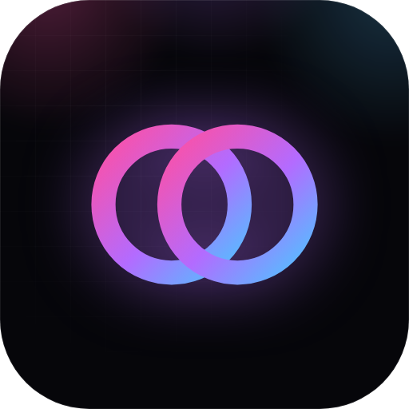

**The mark** is two rings that overlap: what you put in and what comes out, one shape.
It is drawn in the app's one accent, the neon gradient.

| | |
| --- | --- |
| Files | [`logo.svg`](docs/media/logo.svg) (the mark), [`icon.png`](docs/media/icon.png) (512 px app icon), [`banner.webp`](docs/media/banner.webp), [`social-preview.png`](docs/media/social-preview.png) (1280×640, for link previews) |
| Gradient |  pink →  violet →  cyan |
| Ink |  background,  text |
| Type | **Bricolage Grotesque** for headings, **Figtree** for text, *Fraunces italic* for the one accented word in a headline, `DM Mono` for numbers and ids |
| Wordmark | `OpenIllusion`, one word, capital O and I |

The full look, motion included, is in [docs/APP.md](docs/APP.md#design-rules).

## License

[MIT](LICENSE), © 2026 GETHUK-BIGEMPEROR. Models, LoRAs and node packs the templates use are not
part of this repo and keep their own licenses.

<p align="center">
  <br>
  <br>
  <sub><b>OpenIllusion</b> · every ComfyUI workflow, one click</sub>
</p>
