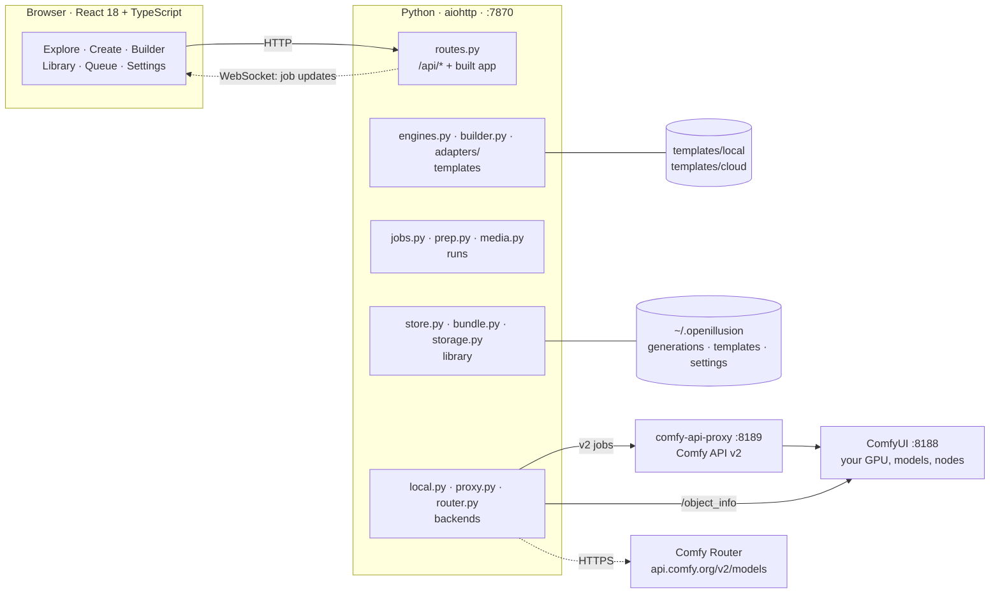
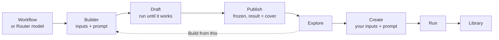
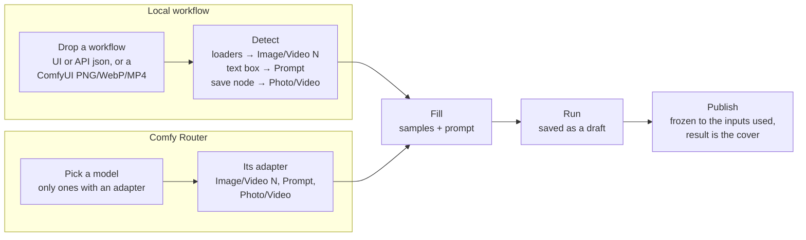
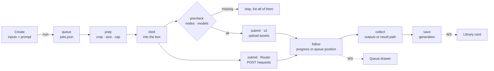

# OpenIllusion

A template studio for ComfyUI, made as simple as Higgsfield: pick a template, drop
in your images or videos, edit the prompt, press Run, get a result.

- **Local** runs a ComfyUI workflow on your own GPU through Comfy API v2.
- **Cloud** runs one of a few premium models (Nano Banana, GPT Image, Seedance,
  Kling, Veo) on
  [Comfy Router](https://docs.comfy.org/development/comfy-router/reference.md),
  billed to your Comfy API key.

This README is the project's central document. It describes what the app does
and how it is built, and it changes in the same commit as the code it describes.

## The idea

Three rules hold everywhere, local and cloud, in the Builder and on Create.

**1 · A template is a black box.** Behind every template sits one thing the app
never edits: a ComfyUI workflow, or a Router model's request. Sampler, steps,
LoRAs, sizes, a model's own settings and the seed mode stay as their author
saved them. A random seed is re-rolled each run; a fixed seed stays fixed.

**2 · Only inputs and a prompt go in.** Inputs have no names: they are Image 1,
Image 2, Video 1, and the prompt says what each one is for. There is one prompt,
sent exactly as written, with no hidden text added.

**3 · A template is a run that worked.** A template is published from a real run,
and that run's result is its cover. Publishing freezes it: the template asks for
exactly the inputs that run used, all required, so it does the same job every
time. Nothing ships or shows on Explore without a result of its own.

The two kinds differ only in where the box comes from and who knows its inputs:

| | Local | Cloud |
| --- | --- | --- |
| The box | A ComfyUI workflow (API format) | A Router model id plus its native JSON request |
| Its inputs come from | **Detection**: loaders, text boxes and save nodes in the workflow | **An adapter**: a hand-written file per supported model |
| Which ones | Any workflow that runs in ComfyUI | Only models with an adapter (five today) |
| Freeze | Built in: the workflow's loaders are fixed and each needs a file | At publish: one model takes many optional files, and the files sent decide what it does |
| Runs through | `local.py` → comfy-api-proxy `:8189` → your ComfyUI | `router.py` → `api.comfy.org/v2/models/{provider}/{model}` |
| Cost | Free, on your GPU | Paid; a price quote shows above Run |
| Progress | Live percentage | Queue position only |
| When it fails | Missing nodes and models are listed, never installed; ComfyUI's errors pass through | Router's errors pass through |

Detection works for workflows because ComfyUI's node types are one shared
vocabulary. Router has no shared vocabulary: every model has its own request
format, so guessing inputs from specs would breed endless bugs. Hence adapters,
and few of them.

## System map

One Python process serves both the web app and its API on `:7870`. The browser
only ever talks to that port. The API key and the proxy token never leave the
server.



`proxy.py` starts comfy-api-proxy as a child process when it isn't running. Your
own templates in `~/.openillusion/templates` override shipped templates with the
same id, so editing in the app never changes the repo.

| Path | What lives there |
| --- | --- |
| `server/` | Python backend (`python -m server`) |
| `server/adapters/` | One JSON adapter per supported Router model |
| `ui/` | React + Vite app; `npm run build` writes it into `server/static` |
| `templates/local/` | Shipped workflow templates, plus `media/` (samples and covers) |
| `templates/cloud/` | Shipped Router templates, once one has run for real (none yet) |
| `tests/` | pytest suite |
| `schema/` | `generation.v1.json` (`python -m server.gen_schema`) |
| `~/.openillusion/` | `generations/`, `trash/`, `templates/`, `covers/`, `uploads/`, `cache/`, `outputs/`, `index.sqlite`, `settings.json` |

## A template's life



A draft run and a Create run go through the same pipeline (below); the Builder
is Create with the template still open for editing.

## Making a template (Builder)

The Builder has two tabs, **Local workflow** and **Comfy Router**. They differ
only in the first step, where the input list comes from; after that the steps are
the same.



- **Detect** is `builder.analyze`: UI-format workflows are converted to API format
  and subgraphs flattened, then every loader becomes a required input. Step *Run*
  is `builder.assemble_local`.
- **An adapter** lists every file its model takes, as Image N or Video N. You
  fill the ones you want; on Router the files you send decide what the model
  does (a photo makes an edit, a first + last frame makes an in-between).
- **Publish** needs a result. Samples you dropped become the template's defaults.
  With a fixed seed, Create hides variants and Re-run, because every run would
  give the same result.

## One run, end to end

The generation id doubles as the job id and the idempotency key on both backends.
A run that was in flight when the server restarted is picked up again, not
submitted twice.



- **prep** crops and sizes each input once, in Python, for both kinds. Size is
  chosen per input on Create and defaults to the input's own size. Caps are 3 MP
  for photos and 1.5 MP for video; Settings can lift them.
- **bind** writes files and the prompt where the template's inputs point: node
  inputs for local, JSON paths in the request for cloud. Seeds the box marks as
  random are re-rolled.
- **precheck** (local) compares the workflow with ComfyUI's `/object_info` and
  lists every missing node and model at once. ComfyUI's own validation stops at
  the first one.
- **collect** takes the save node's outputs (local), or reads the template's
  result path in Router's answer (cloud). Router results expire after 24 h, so
  they are downloaded straight away.

## The template contract

One contract for both kinds: `inputs` (Image N / Video N, one prompt, each with a
`bind`), a `mode` (`edit` makes a photo, `motion` makes a video), a required
`label`, and a cover. Then the box.

A local template, trimmed:

```jsonc
{
  "format": "openillusion.template", "version": 2,
  "id": "local/qwen21-add-hat",
  "mode": "edit",
  "label": "Add a hat · Qwen Image 2.1",
  "inputs": [
    { "key": "image:1", "type": "image", "required": true,
      "default": "media/man-park.jpg", "bind": [["11", "image"]] },
    { "key": "prompt", "type": "text", "required": true,
      "default": "Put a hat on the person in <image1>…", "bind": [[ … ]] }
  ],
  "workflow": { /* API format, untouched */ }
}
```

A cloud template, trimmed:

```jsonc
{
  "format": "openillusion.template", "version": 2,
  "kind": "cloud", "id": "cloud/fox-clip",
  "mode": "motion",
  "label": "Fox clip · Veo 3.1 Fast",
  "model": "veo/veo-3.1-fast-generate-001",
  "inputs": [
    { "key": "image:1", "type": "image", "required": true,
      "bind": [["instances", 0, "image"]] },
    { "key": "prompt", "type": "text", "required": true,
      "default": "…", "bind": [["instances", 0, "prompt"]] }
  ],
  "body": { "instances": [{ "prompt": "…",
            "image": { "bytesBase64Encoded": "{{image:1|b64}}", "mimeType": "{{image:1|mime}}" } }],
            "parameters": { "sampleCount": 1 } },
  "result": [["response", "videos", "*", "bytesBase64Encoded"]]
}
```

- **`body`** is the cloud box: the adapter's starting request, cut down at publish
  to the inputs the run used. A template carries its own copy, the way a local
  template carries its workflow, so a later change to an adapter never changes a
  published template.
- **Media tokens** say how a file goes into the body: `uri` (data URI), `b64`
  (bare base64), `mime` (its MIME type) or `url` (a public link).
- **`result`** lists paths into Router's answer; the first one holding a URL or
  base64 wins, and `*` stands for any list index. It comes from the adapter. If
  none of them holds one (an adapter written from the docs can miss), any image or
  video link in the answer is taken, then any long base64 string.
- **While building**, the body holds only the inputs you filled: the adapter adds
  each one where it goes, and refuses pairs the model can't take together (Seedance
  takes frames or references, not both; a last frame needs a first frame). The
  rest of the request is the model's defaults.

## Cloud = Comfy Router

Cloud means premium partner models called on Comfy Router and billed to your
Comfy key. **Comfy Cloud**, the hosted ComfyUI, is a different product and is
shelved: it would bring a second node and model inventory, a second queue and a
second billing story.

What makes Router hard to do generically:

- **Requests:** each partner's own schema, not a unified one. The request also
  picks the operation: adding an image to an image model makes it an edit, which
  is billed differently.
- **Files:** some fields take a URL, some base64, some an item in a tagged list.
  Requests are capped at 100 MiB, about 75 MB of media once base64-encoded.
- **Answers:** a rehosted URL (valid 12–24 h), a provider URL, inline base64
  (Veo), or raw bytes. There is no common envelope.

### Adapters

An adapter is a hand-written JSON file in `server/adapters/`, one per model. It
says:

- **Inputs:** every file the model takes, as Image N or Video N; where each goes
  in the request, and in what form (data URI, bare base64 + MIME type, or an item
  added to a list, such as Seedance's `content[]` with its `role`).
- **Prompt:** where it goes.
- **Body:** the starting request, with the model's own settings.
- **Result:** where the image or video sits in the answer.
- **Mode:** whether the model makes photos or video.

| Model | Makes | How files go in |
| --- | --- | --- |
| `vertexai/gemini-nano-banana-2.1` (Nano Banana) | Photo, create and edit | `contents[].parts[]`, `inlineData {data, mimeType}` |
| `openai/gpt-image-2` | Photo, create and edit | `image[]`, data URIs, up to 4 |
| `byteplus/dreamina-seedance-2-0-260128` (Seedance 2.0) | Video + audio | `content[]` items with a `role`: first frame, last frame, reference |
| `kling/kling-v3-omni` (Kling 3 Omni) | Video | `image_list[]`, bare base64, with `type` first or end frame |
| `veo/veo-3.1-fast-generate-001` (Veo 3.1 Fast) | Video + audio | `instances[]`: `image`, `lastFrame`, `referenceImages[]` as `{bytesBase64Encoded, mimeType}` |

Inputs are photos only for now: Seedance and Kling take reference clips as public
URLs only, which a local app can't give them. A model's fast, lite or pro variant
reuses its adapter once its spec is checked to match. Adding a model means writing its adapter and running it for real. The run
itself has no per-model code: *bind* and *collect* read the template, which got
everything from the adapter.

### Partner nodes

Your ComfyUI also has around 300 **partner nodes** (`api_node: true`), which call
the same paid models from inside a workflow using your key. `jobs.py` passes the
key in `extra_data`, so a local workflow template can use premium models today,
with no adapter: the workflow is the box. Router templates are for when you want
the model on its own, with no workflow around it.

## Status

| # | Phase | State |
| --- | --- | --- |
| — | Local: 20 workflow templates (Qwen Image 2.1, MiniMax H3), every one run on the GPU | done |
| 0 | Comfy Cloud removed; Router is the cloud | done |
| 1 | Cloud contract: inputs + prompt, file form per input, result paths, base64 and byte results | done |
| 2 | Cloud badge, key gate, Local/Cloud filter on Explore | done |
| 3 | Builder Router tab, draft run, publish. Its generic spec detection (`analyze_schema`, the editable Request, result path learned on first run) is replaced in 4 | done |
| 4 | Adapters for the five models; Router tab lists only them; publish freezes the inputs; generic detection removed | done |
| 5 | First real run of each adapter with a key; switch on checked variants | needs credits |

## Known weak spots

| | Area | What | Fix |
| --- | --- | --- | --- |
| high | Cloud | Router has only run against fakes. Adapters are written from the docs, never checked against a real `openapi.json` or a real answer. Fields that only take a public URL can't be fed from a local app. | Phase 5 |
| high | Job state | The queue lives in one process's memory, mirrored to `jobs.json`. Two servers on one home folder would both resume the same jobs. | Lock file in the home folder |
| med | Dead code | `prompt_with_boxes`, `box_rows`, `boxes_in_crop` and `role_sentences` remain in `engines.py`, and specs still carry `boxes: []`. | Delete them and their tests |
| med | Big files | `engines.py` 1206 lines, `routes.py` 1052, `builder.py` 918, `jobs.py` 777 | Split routes by area; split engines into contract / bind / covers |
| med | Input order | Builder lists inputs in loader order, but Create uses the template's order. | Save inputs in the order Builder showed them |
| low | Stray folder | An empty `openillusion/` folder sits at the repo root. | Delete it |
| low | Explore chips | The tag row runs off-screen when there are many tags. | Scroll the row, or cap it |

## Run

PowerShell, from the repo root:

```powershell
py -m venv .venv
.venv\Scripts\python -m pip install -e .[dev]
npm --prefix ui install
npm --prefix ui run build
.venv\Scripts\python -m server --open
```

The app serves on http://127.0.0.1:7870. Local runs need ComfyUI on `:8188`; the
app starts comfy-api-proxy on `:8189` itself. Cloud runs need a Comfy API key,
added in Settings.

## Develop

```powershell
.venv\Scripts\python -m server --port 7870      # backend
npm --prefix ui run dev                          # Vite on :5178, HMR, proxies /api to :7870
.venv\Scripts\python -m pytest -q                # tests
npx --prefix ui tsc -p ui/tsconfig.json --noEmit # typecheck
.venv\Scripts\python -m server.gen_schema        # regenerate schema/generation.v1.json
```

When a change alters the architecture, the contract or a phase, update this
README in the same commit.
