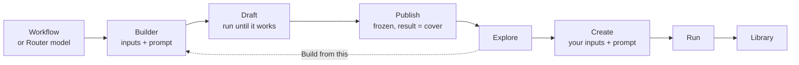
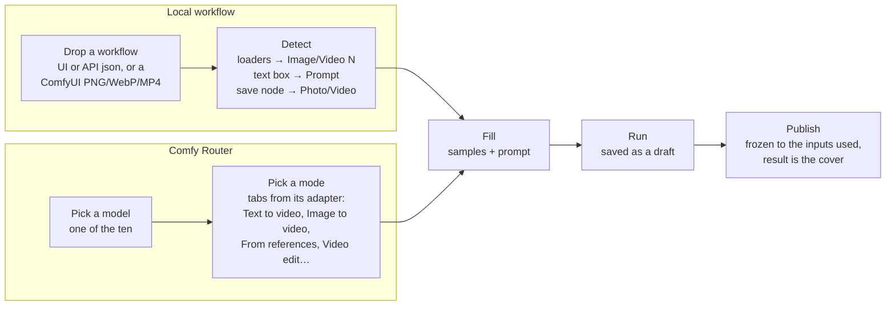
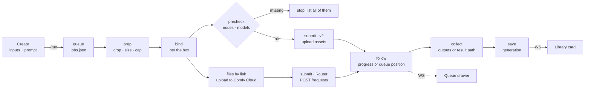
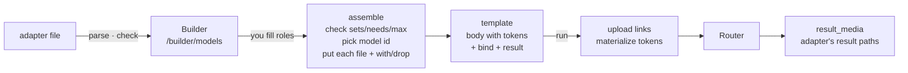

# OpenIllusion

A template studio for ComfyUI, made as simple as Higgsfield: pick a template, drop
in your images, videos or sounds, edit the prompt, press Run, get a result.

- **Local** runs a ComfyUI workflow on your own GPU through Comfy API v2.
- **Cloud** runs one of ten premium models (five that make video, five that make
  photos) on
  [Comfy Router](https://docs.comfy.org/development/comfy-router/reference.md),
  billed to your Comfy API key. A file a model only takes as a link is first
  uploaded to Comfy Cloud's asset store with the same key.

This README is the project's central document and its developer guide. It says
what the app does, how each part works, and how to extend it. It changes in the
same commit as the code it describes.

**Contents:** [The idea](#the-idea) · [The app](#the-app-screen-by-screen) ·
[Design](#design-rules) · [System map](#system-map) · [Code map](#code-map) ·
[API](#api) · [A template's life](#a-templates-life) ·
[Builder](#making-a-template-builder) · [One run](#one-run-end-to-end) ·
[Template contract](#the-template-contract) · [Cloud](#cloud--comfy-router) ·
[Adapters](#adapters) · [Adding a model](#adding-a-model) ·
[Files by link](#files-by-link) · [Status](#status) ·
[Storage](#storage) · [Weak spots](#known-weak-spots) · [Run](#run) · [Develop](#develop)

## The idea

Three rules hold everywhere, local and cloud, in the Builder and on Create.

**1 · A template is a black box.** Behind every template sits one thing the app
never edits: a ComfyUI workflow, or a Router model's request. Sampler, steps,
LoRAs, sizes, a model's own settings and the seed mode stay as their author
saved them. A random seed is re-rolled each run; a fixed seed stays fixed.

**2 · Only inputs and a prompt go in.** Inputs have no names: they are Image 1,
Image 2, Video 1, Audio 1, and the prompt says what each one is for. There is
one prompt, sent exactly as written, with no hidden text added.

**3 · A template is a run that worked.** A template is published from a real run,
and that run's result is its cover. Publishing freezes it: the template asks for
exactly the inputs that run used, all required, so it does the same job every
time. Nothing ships or shows on Explore without a result of its own.

The two kinds differ only in where the box comes from and who knows its inputs:

| | Local | Cloud |
| --- | --- | --- |
| The box | A ComfyUI workflow (API format) | A Router model id plus its native JSON request |
| Its inputs come from | **Detection**: loaders, text boxes and save nodes in the workflow | **An adapter**: a hand-written JSON file per model |
| Which ones | Any workflow that runs in ComfyUI | Only models with an adapter (ten) |
| What it can do | Whatever the workflow does | Every mode the model has: text-only, first frame, first + last frame, references, edit… The inputs you fill pick the mode. |
| Freeze | Built in: the workflow's loaders are fixed and each needs a file | At publish: the template keeps the mode its run used |
| Runs through | `local.py` → comfy-api-proxy `:8189` → your ComfyUI | `router.py` → `api.comfy.org/v2/models/{provider}/{model}`; files by link via `cloud.comfy.org/api/v2/assets` |
| Cost | Free, on your GPU | Paid; a price quote shows above Run |
| Progress | Live percentage | Queue position only |
| When it fails | Missing nodes and models are listed, never installed; ComfyUI's errors pass through | Router's errors pass through |

Detection works for workflows because ComfyUI's node types are one shared
vocabulary. Router has none: in its own words, "each model accepts its own native
request body and returns its own native result". Guessing inputs from schemas
breeds endless bugs, so every cloud model gets an adapter, written by hand from
its Router docs.

## The app, screen by screen

Hash routes keep the app one static page (`lib/route.ts`). The rail on the left
(a tab bar on phones) holds Explore, Create, Library, Build, Queue and Settings;
keys 1–4 jump between the first four, Ctrl K opens the palette.

Every page header ends with two status chips (`KeyStat`, `GpuStat` in
`components/oi.tsx`), each opening a card on click:

| Chip | Says | Card |
| --- | --- | --- |
| **Comfy API** | Connected · No key · Key refused · Can't reach · Checking | The key's last four characters and where it's from, what it's for (Comfy Router, per-run cost, files by link), Check again, Settings. |
| **GPU** (e.g. RTX 4060 Ti · ComfyUI 0.42) | Ready, or a progress ring while a local run goes; hidden when no ComfyUI answers | GPU memory, the run in flight, the queue, ComfyUI and Comfy API v2 addresses. |

| Screen | Route | What you do there | File |
| --- | --- | --- | --- |
| Explore | `#/explore` | Every published template on one wall, photos and videos together. Filter All / Local / Cloud and by tag. Tags sit in their own row under the filters; a long row scrolls sideways with the mouse wheel and fades at whichever edge has more. Click a card to run it in Create; (i) opens the inspector on the right, where name, blurb, prompt ideas and cover are edited in place. Drafts never show here. | `screens/Explore.tsx`, `components/TemplateInspector.tsx` |
| Create | `#/create` (photo), `#/motion` (video) | One studio for both: pick a template, fill its inputs (photo, clip and sound tiles; crop, size, trim), edit the prompt, Run. Cloud templates show a price quote above Run. Drafts live here: tagged Draft in the template menu, with Publish on their results. | `screens/create/`, `components/Studio.tsx`, `Refs.tsx`, `Trimmer.tsx` |
| Library | `#/library` | Every run, newest first, grouped by day. Shelves: My generations, Imported, Community, Trash. Tabs: All, Starred, Active, Failed. | `screens/Library.tsx` |
| Generation | `#/generation/{id}` | One result full screen: before/after player, variants, re-run, remix into Create, notes, export and share. Arrows step through the Library. | `screens/GenerationDetail.tsx`, `ShareSheet.tsx` |
| Build | `#/build`, `#/build?from={template}` | Make a template in three steps; see [Builder](#making-a-template-builder). | `screens/builder/` |
| Queue | drawer | Every run from both studios, grouped by what it needs from you. | `screens/QueueDrawer.tsx` |
| Settings | `#/settings` | Your GPU (ComfyUI and proxy URLs), Output limits, Storage (disk use, clean working copies), Cloud (API key). | `screens/Settings.tsx` |
| Connect | `#/connect` | First run only: check the ComfyUI on this machine, then open Explore. No account. | `screens/Connect.tsx` |
| Import | dialog | A dropped bundle, PNG or MP4 with a recipe, or a link: review, then add to the Library. A dropped ComfyUI workflow goes to Build instead. | `screens/ImportReview.tsx` |

## Design rules

The current design is the settled one. Change it on purpose, and write the change
here in the same commit.

- **Higgsfield-simple.** Each screen has one main action (Use, Run, Publish), in
  yellow. The box's own settings (sampler, steps, model flags) never show.
- **Say what it is, not how it's built.** Inputs read Image 1, Video 1, Audio 1;
  modes read Text to video, Image to video, Video edit. Node ids, field paths and
  model ids appear only as small mono text.
- **Show only what can be used.** A Router model's modes are a row of tabs, and a
  mode shows only its inputs, so you never fill two that can't go together. A
  model with one mode shows no tabs.
- **Status is always in sight.** Whether cloud and local can run is a chip in
  every header, in one or two words; details are a click away, never a page away.
- **Every gate says why.** Run is never greyed out without the reason next to it
  ("Video edit needs a Video to edit", "Give the template a name").
- **Steps you can walk back.** The Builder's steps show where you are; Back sits at
  the top and in the footer, and a finished step is clickable. Leaving asks first
  only when something of yours would be lost (a name, a dropped file).
- **Undo over confirm.** Deleting moves to Trash and the toast offers Undo; a
  confirm dialog is for losing work that can't come back.
- **Live, never polled by you.** Job progress arrives over the WebSocket into the
  Queue drawer and the Library card.
- **Look.** Dark and violet-tinted; one accent, `--yellow`, for the main action
  and the current step; `--mint` done, `--violet` cloud, `--orange` warning,
  `--rose` error. Unbounded for headings, Sora for text, Geist Mono for numbers and
  ids. All styling is plain CSS in `ui/src/styles/` (no utility framework):
  tokens and the reset in `base.css`, shared pieces (buttons, pills, fields,
  notices) in `common.css` and `fields.css`, one stylesheet per area beside them
  (`builder.css`, `studio.css`, `library.css`…), with phone layouts in
  `responsive.css`.

## System map

One Python process serves both the web app and its API on `:7870`. The browser
only ever talks to that port. The API key and the proxy token never leave the
server.


`proxy.py` starts comfy-api-proxy as a child process when it isn't running. Your
own templates in `~/.openillusion/templates` override shipped templates with the
same id, so editing in the app never changes the repo.

## Code map

Where to look when you change something.

**Server** (`server/`, Python, `python -m server`):

| File | What it does |
| --- | --- |
| `server.py` · `__main__.py` | Start-up: `python -m server [--host] [--port] [--open]`. Claims the home folder (`server.lock`: a second server on the same home refuses to start, so no run is resumed twice), moves secrets out of an old `settings.json`, resumes interrupted jobs, keeps comfy-api-proxy up in front of a live ComfyUI (checked every 15 s), cleans scratch and old trash every 6 h, and refuses cross-origin requests (`_same_origin`). |
| `routes/` | Every `/api/*` route (see [API](#api)), the WebSocket, and the built app, one module per area: `system` (app, socket, status, settings, key, local check), `templates`, `builder`, `generations` (uploads, compose, estimate, run, jobs), `library` (generations, trash, storage, re-run, export, import); shared helpers in `common`. Thin: it checks input and calls the modules below. |
| `engines/` | Templates, in layers: `build` (fill a workflow or cloud body; `materialize` swaps media tokens for file data), `contract` (the `Engine` record; load and upgrade template files), `covers` (covers, samples, clip limits), `results` (`result_media` finds the image or video in an answer). `__init__` keeps the registry (`ENGINES`, `get`, `describe`), editing (edit/duplicate/delete/reset) and `compose` (the request a run sends), and re-exports the rest. |
| `builder/` | The Builder, in layers: `workflow` (read a dropped file, `read_workflow`; UI graph to API graph, `ui_to_api`), `analysis` (detect inputs, prompt, settings and result nodes, `analyze`), `assemble` (drafts, `assemble_local`, `assemble_cloud`, `preset`, `save`). `__init__` re-exports them. |
| `adapters/` | `__init__.py` reads and checks adapter files and puts a request together from one (`parse`, `check`, `assemble`, `pick_model`). One `*.json` per cloud model. |
| `staging.py` | A run before it starts: `prepare_generation` (spec → generation folder: inputs cropped, sized and copied, running manifest), `input_plans` (what prep will do, for Create), `resolve_asset`, and what a finished generation carries (`recipe_manifest`, `workflow_file`). |
| `jobs.py` | The queue: `_run_inner` (cloud: upload files by link, materialize, estimate, submit, poll, collect), `_run_local` (upload, precheck, submit, follow events), saving results. |
| `router.py` | Comfy Router client: estimate, submit, status, collect, sync run, cancel, download. |
| `local.py` | `ComfyV2` (Comfy API v2: upload assets, jobs, events; used for comfy-api-proxy and for Comfy Cloud assets) and `ComfyUI` (`/object_info`, precheck of nodes and models). |
| `proxy.py` | Starts and stops comfy-api-proxy. |
| `prep.py` · `media.py` | Crop and size inputs; image/video/audio helpers (probe, transcode, poster, data URIs, recipes in PNG/MP4). Photos, clips and sounds (MP3, WAV, M4A, AAC, OGG, FLAC) upload alike; a sound goes in as it is. |
| `store.py` · `generation.py` | The library: one folder per generation with `generation.json` (pydantic `Manifest`), indexed in SQLite with full-text search; trash. |
| `bundle.py` | Export a generation as a zip, import one back. |
| `settings.py` · `storage.py` · `paths.py` | Settings and `secrets.json`; disk usage and cleanup; home folder paths, what each entry is (`TIERS`), and `write_atomic`. See [Storage](#storage). |

**UI** (`ui/src/`, React + Vite):

| File | What it does |
| --- | --- |
| `lib/api.ts` | Every API call and its types. Start here. |
| `lib/store.ts` | App state (zustand): the open studio's inputs, prompt and sounds, drafts, remix (`loadGeneration`). |
| `lib/spec.ts` · `fields.ts` | Studio state → the run spec the server composes (`toSpec`); which inputs a template shows. |
| `lib/route.ts` · `live.ts` · `query.ts` | Hash routes; the WebSocket feed of job updates; React Query setup. |
| `App.tsx` · `components/Shell.tsx` · `Palette.tsx` | Layout, rail and tab bar, drops anywhere on the page, Ctrl K palette. |
| `screens/*` | One file per screen; see [The app](#the-app-screen-by-screen). |
| `screens/builder/` | Builder: Local workflow and Comfy Router tabs, three steps with Back, draft run, publish (`Builder.tsx`); the start step (`Start.tsx`), the template's sections (`Sections.tsx`), row state from a workflow or preset (`model.ts`). On Router: a mode picker built from the adapter's sets or `models` (`modes.ts`), and the same `set`/`needs`/`models` checks as the server. |
| `screens/create/` | Create: the page (`CreateStudio.tsx`), input tiles (`Inputs.tsx`), the canvas (`Canvas.tsx`), prompt and Run (`Panel.tsx`), this template's runs (`History.tsx`). |
| `components/Studio.tsx` · `Refs.tsx` · `Trimmer.tsx` · `ABPlayer.tsx` | Create's parts: template seeding, input tiles and uploads, clip trimming, before/after player. |
| `components/ui.tsx` · `oi.tsx` · `bits.tsx` · `sprite.ts` | Shared pieces: buttons, segmented tabs, fields, spinners; page head, header chips (`KeyStat`, `GpuStat`), sideways-scrolling rows, media; cost pill; the icon sprite (`<I n>`). |
| `styles/` | The only styling: `base.css` tokens and reset, `common.css`/`fields.css` shared pieces, one stylesheet per area, `responsive.css` for phones. |

**Folders:**

| Path | What lives there |
| --- | --- |
| `templates/local/` | Shipped workflow templates, plus `media/` (samples and covers) |
| `templates/cloud/` | Shipped Router templates, once one has run for real (none yet) |
| `tests/` | pytest suite; Router, Comfy Cloud and ComfyUI are faked with `httpx.MockTransport` |
| `schema/` | `generation.v1.json` (`python -m server.gen_schema`) |
| `~/.openillusion/` | The home folder; see [Storage](#storage) |

## Storage

**Rule: permanent data is files; SQLite only holds what can be rebuilt.** A generation
is a folder you can open, zip or drag into ComfyUI; the search index is rebuilt from
the folders whenever it's missing or its layout changes. Anything new the app keeps for
good (boards, collections, notes) goes in the home folder as files too, so a backup stays
a copy of known folders.

The home folder is `$OPENILLUSION_HOME`, or `~/.openillusion`. `paths.TIERS` says what
each entry is; a test fails when the app writes something it doesn't list.

| Tier | Entries | Backed up | Cleaned |
| --- | --- | --- | --- |
| library | `generations/`, `templates/`, `covers/`, `trash/`, `settings.json` | yes (trash optional) | trash after 7 days |
| machine | `secrets.json`, `index.sqlite`, `jobs.json`, `proxy-state/`, `proxy.log`, `server.lock` | no | never |
| scratch | `uploads/`, `cache/` | no | on their own after 30 days unused (Builder drafts: 1 day), or from Settings → Storage |

`outputs/` is the default export folder: the user's files, not the app's.

- **Whole or nothing.** Every JSON file the app keeps (`generation.json`, settings,
  secrets, templates, `.shelf`, the queue) goes through `paths.write_atomic`: temp file,
  fsync, rename. A crash leaves the old file, never half of one.
- **Secrets apart.** The key and the proxy token live in `secrets.json`, owner-only on
  Linux and macOS, never sent to the browser, never in a generation or a backup.
  `settings.migrate` moves them out of a `settings.json` written before the split.
- **The queue file** (`jobs.json`) is written when a run changes state, not on progress:
  progress and previews only go to open pages over the WebSocket.
- **The index** carries `PRAGMA user_version` (`store.INDEX_VERSION`); a different
  version drops it and reindexes the folders.
- **Edited shipped templates** name the shipped samples and covers as
  `shipped:local/media/<file>`, not a path on this machine, so they work on any install.
- **Cleaning itself.** Every 6 hours (and at start-up) `storage.auto_clean` removes scratch
  nobody has used, and old trash goes. Showing an upload on a page or running it restarts
  its clock (`storage.touch`), so a draft left open in Create keeps its files.
- **One server per home** (`server.lock`, see `server.py`).

Planned: `.illusionbackup`, a zip of the library tier with a `backup.json` of counts and
checksums, restored by merging (existing generations are skipped).

## API

Everything is under `/api` on `:7870`, same origin only. `lib/api.ts` has a
typed call for each.

| Area | Routes |
| --- | --- |
| Status and setup | `GET status` · `POST local/check` · `POST local/proxy/start` · `POST onboarded` · `GET ws` (job updates) |
| Settings and key | `GET/POST settings` · `POST key/test` · `POST key/forget` |
| Templates | `GET engines` · `PATCH/DELETE templates` · `POST templates/duplicate` · `GET templates/input` · `GET templates/workflow` · `GET/PUT/DELETE cover` |
| Builder | `POST builder/workflow` · `POST builder/from-template` · `GET builder/models` (the ten adapters) · `POST builder/save` · `DELETE builder/template` |
| Files | `POST upload` (photo, clip or sound) · `GET uploads/{asset}` · `POST frame` (a still from a clip) |
| Runs | `POST compose` (the request, without running) · `POST estimate` (price) · `POST run` · `GET jobs` · `POST jobs/{id}/cancel` · `POST jobs/{id}/dismiss` · `POST jobs/cancel` · `POST jobs/clear` |
| Library | `GET generations` · `GET facets` · `GET/PATCH/DELETE generations/{id}` · `POST generations/trash` · `GET generations/{id}/file/…`, `/output`, `/workflow`, `/recipe` · `POST generations/{id}/rerun` |
| Trash and storage | `GET trash` · `POST trash/{id}/restore` · `POST trash/restore` · `DELETE trash/{id}` · `DELETE trash` · `GET storage` · `POST storage/clean` |
| Share | `GET generations/{id}/export/sizes` · `POST generations/{id}/export` · `GET exports/{name}` · `POST import` · `GET import/{token}/file/…` · `POST import/{token}/commit` · `GET community` |

## A template's life



A draft run and a Create run go through the same pipeline (below); the Builder
is Create with the template still open for editing.

## Making a template (Builder)

The Builder has two tabs, **Local workflow** and **Comfy Router**, and three
steps shown at the top: 1 bring a workflow or pick a model, 2 fill inputs, 3 run
and publish. The tabs differ only in step 1, where the input list comes from.



- **Detect** is `builder.analyze`: UI-format workflows are converted to API format
  and subgraphs flattened, then every loader becomes a required input. Step *Run*
  is `builder.assemble_local`.
- **Picking a model**: the ten are cards under *Make video* and *Make photos*.
  Each card says what the model **Does** (its mode names, `modeNames`) and what it
  **Takes** (its roles, with the most files each takes, e.g. Reference image ×9),
  both read off the adapter, so a new adapter gets its card for free.
- **An adapter** lists every input its model takes, by role (First frame, Video to
  edit…). The Builder turns its input `set`s (or its `models` routes) into a mode
  picker: Text to video, Image to video, From references, Video edit, Extend a
  video. A mode shows only its inputs; switching drops files from inputs the new
  mode doesn't take. A model with one mode (most image models) shows its inputs
  with no picker. Rules the model breaks are flagged before you run. Step *Run* is
  `builder.assemble_cloud`. Back (top, footer, or step 1) returns to the model or
  workflow list, asking first only if you named the template or dropped a file.
- **Publish** needs a result. Samples you dropped become the template's defaults.
  With a fixed seed, Create hides variants and Re-run, because every run would
  give the same result.

## One run, end to end

The generation id doubles as the job id and the idempotency key on both backends.
A run that was in flight when the server restarted is picked up again, not
submitted twice.



- **prep** crops and sizes each input once, in Python, for both kinds. Size is
  chosen per input on Create and defaults to the input's own size. Caps are 3 MP
  for photos and 1.5 MP for video; Settings can lift them.
- **bind** writes files and the prompt where the template's inputs point: node
  inputs for local, media tokens in the request for cloud (`engines.materialize`).
  Seeds the box marks as random are re-rolled.
- **files by link** (cloud) uploads each input the request takes as a link, once
  per run; see [Files by link](#files-by-link).
- **precheck** (local) compares the workflow with ComfyUI's `/object_info` and
  lists every missing node and model at once. ComfyUI's own validation stops at
  the first one.
- **collect** takes the save node's outputs (local), or reads the template's
  result paths in Router's answer (cloud). Router results expire after 24 h, so
  they are downloaded straight away.

## The template contract

One contract for both kinds: `inputs` (Image N / Video N / Audio N, one prompt,
each with a `bind`), a `mode` (`edit` makes a photo, `motion` makes a video), a
required `label`, and a cover. Then the box.

A local template, trimmed:

```jsonc
{
  "format": "openillusion.template", "version": 2,
  "id": "local/qwen21-add-hat",
  "mode": "edit",
  "label": "Add a hat · Qwen Image 2.1",
  "inputs": [
    { "key": "image:1", "type": "image", "required": true,
      "default": "media/man-park.jpg", "bind": [["11", "image"]] },
    { "key": "prompt", "type": "text", "required": true,
      "default": "Put a hat on the person in <image1>…", "bind": [[ … ]] }
  ],
  "workflow": { /* API format, untouched */ }
}
```

A cloud template, trimmed (Kling 3 Omni, built as a video edit):

```jsonc
{
  "format": "openillusion.template", "version": 2,
  "kind": "cloud", "id": "cloud/rainy-rooftop",
  "mode": "motion",
  "label": "Rainy rooftop · Kling 3 Omni",
  "model": "kling/kling-v3-omni",
  "inputs": [
    { "key": "video:1", "type": "video", "required": true,
      "bind": [["video_list", 0]] },
    { "key": "prompt", "type": "text", "required": true,
      "default": "…", "bind": [["prompt"]] }
  ],
  "body": { "prompt": "…", "mode": "pro",
            "video_list": [{ "video_url": "{{video:1|url}}", "refer_type": "base",
                             "keep_original_sound": "yes" }] },
  "result": [["data", "task_result", "videos", "*", "url"]]
}
```

- **`model`** is the Router model the request goes to. For an adapter that
  spans several model ids (HappyHorse), it is the one the run's inputs picked.
- **`body`** is the cloud box: the adapter's starting request with the run's
  inputs put in and their side effects applied (`with`, `drop`). A template
  carries its own copy, the way a local template carries its workflow, so a later
  change to an adapter never changes a published template.
- **Media tokens** say how a file goes into the body: `uri` (data URI), `b64`
  (bare base64), `mime` (its MIME type) or `url` (a signed link to the file,
  uploaded to Comfy Cloud's assets; see [Files by link](#files-by-link)).
- **`result`** lists paths into Router's answer; the first one holding a URL or
  base64 wins, and `*` stands for any list index. It comes from the adapter. If
  none of them holds one (an adapter written from the docs can miss), any image or
  video link in the answer is taken, then any long base64 string.

## Cloud = Comfy Router

Cloud means premium partner models called on Comfy Router and billed to your
Comfy key. **Comfy Cloud**, the hosted ComfyUI, is not a runner here: it would
bring a second node and model inventory, a second queue and a second billing
story. Only its asset store is used, to give Router a link to your file.

What makes Router hard to do generically:

- **Requests:** each model's own schema, not a unified one.
- **The mode is in the request.** A model has no "image to video" or "edit"
  endpoint: the inputs you send decide. GPT Image 2's docs say it outright:
  presence of `image` "selects the edit operation". Kling marks a video as the one
  to edit with `refer_type: base`; Seedance makes an edit from a reference video
  with `duration: -1`. Some families split modes over several model ids instead
  (HappyHorse `-t2v`, `-i2v`, `-r2v`, `-video-edit`).
- **Files:** some fields take a URL, some base64, some an item in a tagged list.
  Most video and audio fields take a link only. Requests are capped at 100 MiB,
  about 75 MB of media once base64-encoded.
- **Answers:** a rehosted URL (valid 12–24 h), a provider URL, inline base64
  (Veo), or raw bytes. There is no common envelope.

### Roles: one vocabulary for every model

Every adapter names its inputs from the same short list of roles, so the Builder,
the mode names and future models all speak one language. The Comfy hub does the
same internally (`source_videos`, `reference_images`, `first_frame`…).

| Role | Type | Means | Mode it makes | Its `set` |
| --- | --- | --- | --- | --- |
| *(nothing filled)* | | prompt only | Text to video · Text to image | |
| First frame | image | the clip starts on this picture | Image to video | `frames` |
| Last frame | image | the clip ends on it; needs a first frame | First and last frame | `frames` |
| Reference image | image | a character, object or scene to keep | From references | `references` (+ `edit` where the model allows) |
| Style image | image | a look to copy | Style reference | `style` |
| Reference video | video | motion, camera or cuts to follow | From references | `references` |
| Reference audio | audio | a voice, sound or music to use | From references | `references` (+ `edit` on Seedance) |
| Video to edit | video | the clip to change, as the prompt says | Video edit | `edit` |
| Video to extend | video | the clip to carry on from | Extend a video | `extend` |
| Photo | image | an image model's input | Photo edit | none |

The names in the "Mode it makes" column are the ones the app shows: the Builder's
mode tabs (`SET_LABEL` in `builder/modes.ts`, one per set name) and the mode label of a
run. A new set name needs a label there.

A template is frozen to the roles its run used, so "Kling · edit video" and
"Kling · first–last frame" are two templates from one adapter.

### The ten models

Chosen from the October 2026 arena boards and creator round-ups, limited to
models Router serves. Nobody publishes usage counts.

| Adapter | Makes | Roles (max) | Files go in as |
| --- | --- | --- | --- |
| `kling/kling-v3-omni` · Kling 3 Omni | Video | First frame, Last frame, Reference image (4), Reference video, Video to edit | images base64 in `image_list[]`; videos by link in `video_list[]` with `refer_type` `feature` or `base` |
| `byteplus/dreamina-seedance-2-5-260628` · Seedance 2.5 | Video + audio | First frame, Last frame, Reference image (9), Reference video, Reference audio, Video to edit | `content[]` items with a `role`; images and audio as data URIs, video by link |
| `veo/veo-3.1-fast-generate-001` · Veo 3.1 Fast | Video + audio | First frame, Last frame, Reference image (3), Style image, Video to extend | `instances[0]`, `{bytesBase64Encoded, mimeType}` |
| `wan/wan3.0-video` · Wan 3.0 | Video + audio | First frame, Last frame, Reference image (9), Reference video (5), Reference audio (5) | `input.media[]` items `{type, url}`; images as data URIs, video and audio by link |
| `wan/happyhorse-1.1` · HappyHorse | Video | First frame, Reference image (9), Video to edit | `input.media[]`; the inputs pick the model id (`-t2v`, `-i2v`, `-r2v`, or `happyhorse-1.0-video-edit`) |
| `openai/gpt-image-2` · GPT Image 2 | Photo | Photo (4) | `image[]`, data URIs |
| `vertexai/gemini-nano-banana-2.1` · Nano Banana 2.1 | Photo | Photo (4) | `contents[0].parts[]`, `inlineData` |
| `byteplus/seedream-5-0-pro-260628` · Seedream 5.0 Pro | Photo | Photo (9) | `image[]`, data URIs |
| `bfl/flux-2-max` · FLUX 2 Max | Photo | Photo (9) | `input_image`, `input_image_2` … `input_image_9`, base64 |
| `xai/grok-imagine-image-2.0` · Grok Imagine Image 2.0 | Photo | none: text to image only | — |

Not yet: masks (GPT Image inpainting, Veo insert/remove), Kling `element_list`,
Seedance drafts, Wan effect templates.

## Adapters

An adapter is a hand-written JSON file in `server/adapters/`, named
`provider__model.json`, one per model (or model family). `adapters.parse` checks
it when the server starts; a broken adapter stops the server with a message that
names the file and the field.

### The file

```jsonc
{
  "model": "kling/kling-v3-omni",       // Router id; with "models" below, any id for the family
  "name": "Kling 3 Omni",                // shown in the Builder
  "makes": "video",                      // "video" or "photo"
  "body": {                              // the request every run starts from: the model's own
    "prompt": "", "mode": "pro",         //   settings, no file tokens
    "duration": "5", "aspect_ratio": "16:9"
  },
  "prompt": ["prompt"],                  // where the prompt goes
  "inputs": [ /* one per role, below */ ],
  "result": [["data", "task_result", "videos", "*", "url"]],   // where the output sits in the answer
  "models": [ /* optional: one adapter, several model ids, below */ ]
}
```

Each input:

```jsonc
{
  "role": "Video to edit",               // from the roles table
  "type": "video",                       // image | video | audio
  "at": ["video_list", "+"],             // path into body; "+" appends to a list
  "value": { "video_url": "{{$|url}}", "refer_type": "base", "keep_original_sound": "yes" },
  "max": 1,                              // files this role takes (1–9; above 1, "at" ends in "+"
                                         //   or lists one path per file)
  "set": ["edit"],                       // which modes it belongs to (below)
  "needs": "First frame",                // a role that must be filled too
  "with": [[["sound"], "off"]],          // when filled: set these paths in the body
  "drop": [["duration"], ["aspect_ratio"]]   // when filled: remove these paths
}
```

- **Paths** are lists of keys and list indexes. `"+"` as the last step appends to
  a list, made if missing. For a model that takes numbered fields instead of a
  list, `at` can list one path per file: FLUX's
  `[["input_image"], ["input_image_2"], …]`.
- **Tokens** in `value`: `{{$|uri}}` data URI, `{{$|b64}}` bare base64,
  `{{$|mime}}` the file's MIME type, `{{$|url}}` a link (uploaded first). Each
  token stands alone in its string. `$` becomes the input's slot (`image:1`) when
  a template is put together; the file goes in at run time.
- **`set`** says which inputs go together. Every filled input must share at least
  one set with every other; inputs without `set` go with anything. Kling: First
  and Last frame are `["frames"]`, Reference image is `["references", "edit"]`,
  Reference video `["references"]`, Video to edit `["edit"]`. So a reference image
  can join an edit, but a first frame can't. Each set name is also a mode tab in
  the Builder, labelled from `SET_LABEL` (`frames` → Image to video).
- **`needs`**: Last frame needs First frame.
- **`with` / `drop`** are the request's side effects of a role. Seedance's Video
  to edit sets `duration` to `-1` (edits keep the clip's length); Kling's drops
  `duration` and `aspect_ratio`; Veo's Video to extend sets
  `parameters.task` to `extend`.
- **`models`** (optional): when a family splits its modes over several model ids,
  list them with the roles each takes. A run goes to the first one that takes
  every filled role; the template keeps that id.

  ```json
  "models": [
    { "model": "wan/happyhorse-1.1-t2v", "takes": [] },
    { "model": "wan/happyhorse-1.1-i2v", "takes": ["First frame"] },
    { "model": "wan/happyhorse-1.1-r2v", "takes": ["Reference image"] },
    { "model": "wan/happyhorse-1.0-video-edit", "takes": ["Video to edit", "Reference image"] }
  ]
  ```

### What happens to it



`adapters.assemble(adapter, files, prompt)` does the work: it checks the roles
(`check`), picks the model id (`pick_model`), copies `body`, writes the prompt,
then for each file fills its `value` with the slot's tokens and puts it at `at`,
and applies `with` and `drop`. It returns the body and where each file went,
which becomes the template's `bind`. The run itself has no per-model code: it
only fills tokens and reads `result` paths.

## Adding a model

1. **Read its Router docs.** The model's page,
   `docs.comfy.org/development/comfy-router/models/{provider}/{model}/code.md`,
   and its schema, `docs.comfy.org/router-schemas/{provider}/{model}.json`. Note
   every file field: what it takes (URL, base64, data URI), how many, what it
   can't go with, and what changes when it's used (duration, ratio, a mode flag).
2. **Write `server/adapters/{provider}__{model}.json`.** Start `body` from the
   docs' example request. One input per role from the roles table; if a field
   doesn't fit a role, add a role to the table in this README first. Group the
   inputs into `set`s by mode; a set name the app hasn't seen needs a label in
   `SET_LABEL` (`ui/src/screens/builder/modes.ts`), or its tab shows the raw name.
3. **Set `result`** from the docs' example answer. Several paths are fine; the
   first that holds media wins.
4. **Test.** `pytest -q` checks every adapter parses and that each role assembles
   (`tests/test_cloud_templates.py`). Add a case for any `with`/`drop`/`models`
   rule you wrote.
5. **Run it for real** in the Builder with your key, once per mode tab. Fix what
   Router refuses; its validation errors name the field.
6. **Update the model table** in this README.

A model's fast, lite or pro variant reuses an adapter only after its schema is
checked to match; until then it gets its own file.

## Files by link

A local file has no link, and most video and audio fields take nothing else
(Router's docs list file uploads as outside its contract). The Comfy hub's own
API samples (`comfy-sdk` 0.2.0, `client.assets.from_file(…).get_download_url()`)
close the gap with the same key, and `jobs.py` does the same:

1. `POST cloud.comfy.org/api/v2/assets` (multipart: `file`, `content_type`,
   `file_path`), with `Authorization: Bearer <key>`. Answer: the asset's `id`.
2. `GET /api/v2/assets/{id}/content` without following the redirect: its
   `Location` header is a short-lived signed link anyone can read. If there is no
   redirect, the asset's own `url` is used.
3. The link replaces the `{{video:1|url}}` token, and the request is sent at once.

Each run uploads its files once; a resumed run uploads again rather than trust an
old link. Nothing runs on Comfy Cloud; it only holds the file. The base URL is
`cloud_base` in settings (default `https://cloud.comfy.org`). `ComfyV2` in
`local.py` is the client, the same one that talks to comfy-api-proxy.

### Partner nodes

Your ComfyUI also has around 300 **partner nodes** (`api_node: true`), which call
the same paid models from inside a workflow using your key. `jobs.py` passes the
key in `extra_data`, so a local workflow template can use premium models today,
with no adapter: the workflow is the box. Router templates are for when you want
the model on its own, with no workflow around it. Comfy Cloud speaks the same
Comfy API v2 as comfy-api-proxy, so running workflow templates there would be a
second base URL plus the key; not planned yet.

## Status

| # | Phase | State |
| --- | --- | --- |
| — | Local: 20 workflow templates (Qwen Image 2.1, MiniMax H3), every one run on the GPU | done |
| 0 | Comfy Cloud removed as a runner; Router is the cloud | done |
| 1 | Cloud contract: inputs + prompt, file form per input, result paths, base64 and byte results | done |
| 2 | Cloud badge, key gate, Local/Cloud filter on Explore | done |
| 3 | Builder Router tab, draft run, publish | done |
| 4 | Adapters for five models; publish freezes the inputs; generic schema detection removed | done |
| 5 | Every mode of every model: roles, adapter format v2 (`set` lists, `with`/`drop`, `models`, path lists, audio), files by link, ten models | built, tested against fakes |
| 5b | Settled design: mode tabs per Router model, Back through the Builder's steps, design rules written down | done |
| 6 | First real run of each model and mode with a key; fix what Router refuses; switch on checked variants | yours to run |

## Known weak spots

| | Area | What | Fix |
| --- | --- | --- | --- |
| high | Cloud | Router and Comfy Cloud have only run against fakes. Adapters are written from the docs and schemas, never checked against a real answer. Combination rules (`set`) the docs don't state are guesses on the safe side. | Phase 6 |
| med | Files by link | Unknown until a real key tries it: whether uploading needs a Comfy Cloud subscription, and how long the signed link lives. | Phase 6 |
| med | Limits | Per-model file limits (clip length, size, resolution) are in the docs, not enforced here; Router's refusal says what's wrong. | Read limits into adapters if refusals are common |

## Run

PowerShell, from the repo root:

```powershell
py -m venv .venv
.venv\Scripts\python -m pip install -e .[dev]
npm --prefix ui install
npm --prefix ui run build
.venv\Scripts\python -m server --open
```

The app serves on http://127.0.0.1:7870. Local runs need ComfyUI on `:8188`; the
app starts comfy-api-proxy on `:8189` itself. Cloud runs need a Comfy API key,
added in Settings.

## Develop

```powershell
.venv\Scripts\python -m server --port 7870      # backend
npm --prefix ui run dev                          # Vite on :5178, HMR, proxies /api to :7870
.venv\Scripts\python -m pytest -q                # tests
npx --prefix ui tsc -p ui/tsconfig.json --noEmit # typecheck
.venv\Scripts\python -m server.gen_schema        # regenerate schema/generation.v1.json
```

Conventions:

- **README first.** When a change alters the architecture, the contract, the
  roles, an adapter's model or a phase, update this README in the same commit.
- **No guessing from schemas at run time.** A model's behaviour lives in its
  adapter file, written from its docs.
- **Secrets stay on the server.** The API key and proxy token are never sent to
  the browser or written into a generation.
- **Nothing installs itself.** Missing ComfyUI nodes and models are listed, never
  installed.
- **Tests fake the network.** Router, Comfy Cloud and ComfyUI are `httpx`
  mock transports; no test needs a key or a GPU.
