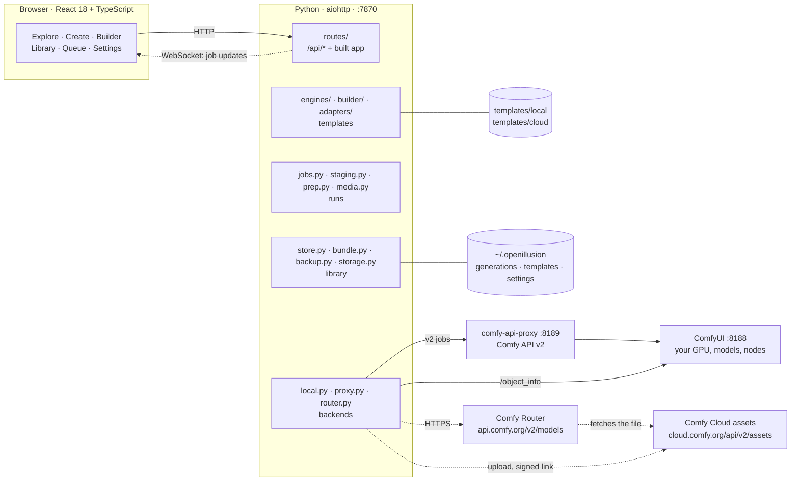
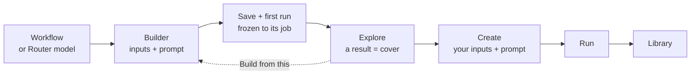
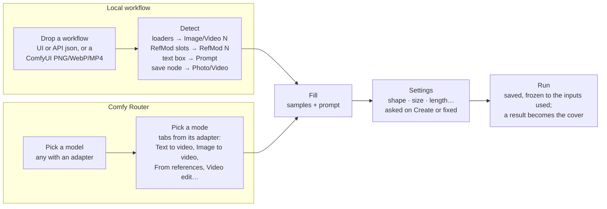
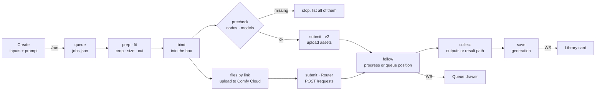
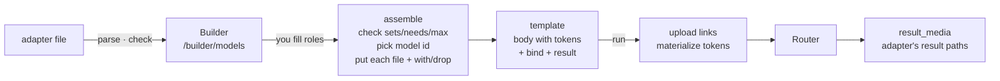

# OpenIllusion

A template studio for ComfyUI, made as simple as Higgsfield: pick a template, drop
in your images, videos or sounds, edit the prompt, press Run, get a result.

- **Local** runs a ComfyUI workflow on your own GPU through Comfy API v2.
- **Cloud** runs premium models that make video or photos on
  [Comfy Router](https://docs.comfy.org/development/comfy-router/reference.md),
  billed to your Comfy API key. A file a model only takes as a link is first
  uploaded to Comfy Cloud's asset store with the same key.

Open source under the [MIT license](LICENSE). Entered in Comfy's
[Open Source Higgsfield](https://comfy.org/open-source-higgsfield/) contest; see
[Contest entry](#contest-entry). To run it, see [Setup](#setup).

This README is the project's central document and its developer guide. It says
what the app does, how each part works, and how to extend it. It changes in the
same commit as the code it describes.

**Contents:** [Contest entry](#contest-entry) · [Setup](#setup) · [The idea](#the-idea) · [The app](#the-app-screen-by-screen) ·
[Design](#design-rules) · [System map](#system-map) · [Code map](#code-map) ·
[API](#api) · [A template's life](#a-templates-life) ·
[Builder](#making-a-template-builder) · [One run](#one-run-end-to-end) ·
[Template contract](#the-template-contract) · [Cloud](#cloud--comfy-router) ·
[Adapters](#adapters) · [Adding a model](#adding-a-model) ·
[Files by link](#files-by-link) · [Status](#status) ·
[Storage](#storage) · [Weak spots](#known-weak-spots) · [Develop](#develop) · [License](#license)

## Contest entry

| | |
| --- | --- |
| Contest | [Open Source Higgsfield](https://comfy.org/open-source-higgsfield/) by Comfy, build period 10/15 to 10/30/2026 |
| What it is | A working app on top of ComfyUI that lets anyone run, and make, their own Higgsfield-style templates: pick one, drop in photos, clips or sounds, press Run |
| License | MIT ([LICENSE](LICENSE)) |
| Setup | [Setup](#setup) below: install, the models each template needs, start |
| Model bonus | **Built with MiniMax H3** |
| Demo video | _link added at submission_ |

**MiniMax H3 is the core model.** Every video template the app ships runs MiniMax H3
locally through ComfyUI's built-in H3 nodes: Create a video (from words) and Animate a
photo (photo as first frame), both video with sound on H3 FL2VA with its 4-step turbo LoRA; Character swap (H3 Ref2VA with a character swap
LoRA), and Character swap with RefMod. Character Lab is built on H3 too: it turns a
person's photos into an H3 RefMod with H3's video VAE and feeds it to H3 runs. The
photo templates (Qwen Image 2.1) are there to make and fix the stills those videos start from.

**What's new in it:**

- **Templates as black boxes.** Any ComfyUI workflow becomes a template with only
  numbered inputs, one prompt and the output settings any generator has (shape, size,
  length); the app detects them, runs the workflow untouched and puts it on Explore at
  once; a result of its own becomes its cover. See [The idea](#the-idea).
- **Character Lab.** A person is kept once (photos plus an H3 RefMod made on your GPU in
  seconds, saved to your RefMod folder); any template with a RefMod input picks from that
  folder. See [Character Lab](#character-lab).
- **Files fitted to the model.** Each input card says whether the model takes the file
  as it is; one editor crops, cuts, resizes and resamples to fit before the run. See the
  Edit a file row in [The app](#the-app-screen-by-screen).
- **Recipes travel with results.** Every result keeps its inputs, workflow and settings;
  export, import, remix and whole-library backups carry them.

Built with ComfyUI, comfy-api-proxy (Comfy API v2), MiniMax H3 and Qwen Image 2.1 by
Comfy-Org, the [MiniMax H3 Character Swap LoRA](https://huggingface.co/akatz-ai/MiniMax-H3-Character-Swap-LoRA)
by akatz-ai, and [ComfyUI-MiniMaxH3Mod](https://github.com/Luisacaotica/ComfyUI-MiniMaxH3Mod) (MIT) for RefMods.

## Setup

Windows, macOS or Linux. Commands below are PowerShell; on macOS and Linux use
`python3` and `.venv/bin/python`.

**You need**

- Python 3.10 or newer, Node.js 18 or newer, git.
- [ComfyUI](https://github.com/comfyanonymous/ComfyUI) recent enough to have the MiniMax
  H3 and Qwen Image 2.1 nodes, running on `http://127.0.0.1:8188` (another address can be set
  in Settings → Your GPU). Built and tested with ComfyUI 0.42 on an RTX 4060 Ti 16 GB.
- Disk for the models of the templates you want (below). A Comfy API key only for cloud templates.

**1 · Install and start the app**

```powershell
git clone <this repo> OpenIllusion
cd OpenIllusion
py -m venv .venv
.venv\Scripts\python -m pip install -e .
npm --prefix ui install
npm --prefix ui run build
.venv\Scripts\python -m server --open
```

The app opens at http://127.0.0.1:7870. On first start it checks the ComfyUI on this
machine, then opens Explore. It starts comfy-api-proxy on `:8189` itself.

**2 · Put the models in ComfyUI.** Each template lists what it's missing (with download
links) before it runs; the app never downloads models. Into ComfyUI's `models/` folders:

| File | Folder | Size | Used by |
| --- | --- | --- | --- |
| [minimax_h3_fl2va_pruned_int8_convrot](https://huggingface.co/Comfy-Org/MiniMax-H3/resolve/main/diffusion_models/minimax_h3_fl2va_pruned_int8_convrot.safetensors) | `diffusion_models` | 21 GB | Create a video, Animate a photo |
| [minimax_h3_fl2v_turbo_4step_v1.0_768p_comfyui_bf16](https://huggingface.co/Comfy-Org/MiniMax-H3/resolve/main/loras/minimax_h3_fl2v_turbo_4step_v1.0_768p_comfyui_bf16.safetensors) | `loras` | 2 GB | Create a video, Animate a photo |
| [minimax_h3_ref2va_pruned_int8_convrot](https://huggingface.co/Comfy-Org/MiniMax-H3/resolve/main/diffusion_models/minimax_h3_ref2va_pruned_int8_convrot.safetensors) | `diffusion_models` | 21 GB | Character swap (both) |
| [h3_character_swap_pro4500_1000](https://huggingface.co/akatz-ai/MiniMax-H3-Character-Swap-LoRA/resolve/main/h3_character_swap_pro4500_1000.safetensors) | `loras` | 0.2 GB | Character swap (both) |
| [qwen3vl_32b_minimax_h3_int8_convrot](https://huggingface.co/Comfy-Org/MiniMax-H3/resolve/main/text_encoders/qwen3vl_32b_minimax_h3_int8_convrot.safetensors) | `text_encoders` | 27 GB | every H3 template |
| [minimax_h3_video_vae_int8_convrot](https://huggingface.co/Comfy-Org/MiniMax-H3/resolve/main/vae/minimax_h3_video_vae_int8_convrot.safetensors) | `vae` | 2.8 GB | every H3 template, Character Lab |
| [minimax_h3_audio_vae_fp32](https://huggingface.co/Comfy-Org/MiniMax-H3/resolve/main/vae/minimax_h3_audio_vae_fp32.safetensors) | `vae` | 0.6 GB | every H3 template |
| [qwen_image_2.1_int8_convrot](https://huggingface.co/Comfy-Org/Qwen-Image-2.1/resolve/main/diffusion_models/qwen_image_2.1_int8_convrot.safetensors) | `diffusion_models` | 7.3 GB | every photo template |
| [qwen3vl_8b_int8_convrot](https://huggingface.co/Comfy-Org/Qwen-Image-2.1/resolve/main/text_encoders/qwen3vl_8b_int8_convrot.safetensors) | `text_encoders` | 9.4 GB | every photo template |
| [qwen_image_2.1_vae_bf16](https://huggingface.co/Comfy-Org/Qwen-Image-2.1/resolve/main/vae/qwen_image_2.1_vae_bf16.safetensors) | `vae` | 0.7 GB | every photo template |

Restart ComfyUI (or press Check again in the app) after adding files.

**3 · Character Lab (optional).** Needs the [ComfyUI-MiniMaxH3Mod](https://github.com/Luisacaotica/ComfyUI-MiniMaxH3Mod)
node pack and a `refmods` folder line in ComfyUI's `extra_model_paths.yaml`:

```powershell
git clone https://github.com/Luisacaotica/ComfyUI-MiniMaxH3Mod <ComfyUI>\custom_nodes\ComfyUI-MiniMaxH3Mod
```

```yaml
openillusion:
    base_path: <ComfyUI>          # the folder holding ComfyUI's input and output
    refmods: |
        output/refmods
        input/refmods
```

Restart ComfyUI. Why both folders: see [Character Lab](#character-lab).

**4 · Cloud templates (optional).** Paste a Comfy API key in Settings → Cloud. The
browser keeps it; the server never saves it. A headless server can take it from `COMFY_API_KEY`.

## The idea

Three rules hold everywhere, local and cloud, in the Builder and on Create.

**1 · A template is a black box.** Behind every template sits one thing the app
never edits: a ComfyUI workflow, or a Router model's request. Sampler, steps,
LoRAs and the seed mode stay as their author saved them. A random seed is
re-rolled each run; a fixed seed stays fixed.

**2 · Inputs, a prompt and the result's settings go in.** Inputs have no names: they
are Image 1, Image 2, Video 1, Audio 1, and the prompt says what each one is for.
There is one prompt, sent exactly as written, with no hidden text added. Then the
settings every generator has, where no input already decides them: the result's
shape and size, its length, resolution, sound (see [Settings](#settings-what-people-choose-about-the-result)).
Anything else is the box's business.

**3 · A template is frozen to its job.** A built template asks for exactly the
inputs its first run used, all required, so it does the same job every time. It
is on Explore as soon as it's saved; a result of its own becomes its cover. Every
shipped template ships with its cover.

The two kinds differ only in where the box comes from and who knows its inputs:

| | Local | Cloud |
| --- | --- | --- |
| The box | A ComfyUI workflow (API format) | A Router model id plus its native JSON request |
| Its inputs come from | **Detection**: loaders, text boxes and save nodes in the workflow | **An adapter**: a hand-written JSON file per model |
| Which ones | Any workflow that runs in ComfyUI | Only models with an adapter |
| What it can do | Whatever the workflow does | Every mode the model has: text-only, first frame, first + last frame, references, edit… The inputs you fill pick the mode. |
| Freeze | Built in: the workflow's loaders are fixed and each needs a file | At save: the template keeps the mode its run used |
| Runs through | `local.py` → comfy-api-proxy `:8189` → your ComfyUI | `router.py` → `api.comfy.org/v2/models/{provider}/{model}`; files by link via `cloud.comfy.org/api/v2/assets` |
| Cost | Free, on your GPU | Paid; a price quote shows above Run |
| Progress | Live percentage | Queue position only |
| When it fails | Missing nodes and models are listed, never installed; ComfyUI's errors pass through | Router's errors pass through |

Detection works for workflows because ComfyUI's node types are one shared
vocabulary. Router has none: in its own words, "each model accepts its own native
request body and returns its own native result". Guessing inputs from schemas
breeds endless bugs, so every cloud model gets an adapter, written by hand from
its Router docs.

## The app, screen by screen

Hash routes keep the app one static page (`lib/route.ts`). The rail on the left
(a tab bar on phones) holds Explore, Create, Library, Characters, Build, Queue, and at the bottom Trash and Settings;
keys 1–5 jump between the first five, Ctrl K opens the palette.

Every page header ends with two status chips (`KeyStat`, `GpuStat` in
`components/oi.tsx`), each opening a card on click:

| Chip | Says | Card |
| --- | --- | --- |
| **Comfy API** | Connected · No key · Key refused · Can't reach · Checking | The key's last four characters and where it's from, what it's for (Comfy Router, per-run cost, files by link), Check again, Settings. |
| **GPU** (e.g. RTX 4060 Ti · ComfyUI 0.42) | Ready, or a progress ring while a local run goes; hidden when no ComfyUI answers | GPU memory, the run in flight, the queue, ComfyUI and Comfy API v2 addresses. |

| Screen | Route | What you do there | File |
| --- | --- | --- | --- |
| Explore | `#/explore` | Every published template on one wall, photos and videos together. Filter All / Local / Cloud and by tag. Tags sit in their own row under the filters; a long row scrolls sideways with the mouse wheel and fades at whichever edge has more. Click a card to run it in Create; (i) opens the inspector on the right, where name, blurb, prompt ideas and cover are edited in place. A template without a cover yet shows its name until a result is made its cover. | `screens/Explore.tsx`, `components/TemplateInspector.tsx` |
| Create | `#/create` (photo), `#/motion` (video) | One studio for both: pick a template, fill its inputs (a list of file cards, each with whether the model takes it), edit the one you pick right on the stage, edit the prompt, pick the result's settings (shape tiles, size steps with the pixels they make, length, resolution, sound), Run. Cloud templates show a price quote above Run. A template with no cover yet offers Use as cover on its results. | `screens/create/`, `components/Studio.tsx`, `MediaEditor.tsx`, `Trimmer.tsx` |
| Library | `#/library` | Every run, newest first, grouped by day. Shelves: My generations, Imported, Community. Tabs: All, Starred, Active, Failed. On phones (no rail) a link at the bottom leads to Trash. | `screens/Library.tsx` |
| Characters | `#/characters`, `#/characters/{id}` | Character Lab: people you keep for runs. Each has a name, notes, up to 16 photos (the starred one is the face) and a RefMod made from them on your ComfyUI into the RefMod folder, with its state (ready, photos changed since, failed and why). **Use in** opens a template with a RefMod input, this one's RefMod picked. See [Character Lab](#character-lab). | `screens/Characters.tsx`, `screens/create/RefModInput.tsx` |
| Trash | `#/trash` | Deleted generations grouped by the day they were deleted, each with days left of its 7. Restore or delete for good one at a time, or Select several; Restore all, Empty trash. | `screens/Trash.tsx` |
| Generation | `#/generation/{id}` | One result full screen: before/after player, variants, re-run, remix into Create, notes, export and share. Arrows step through the Library. | `screens/GenerationDetail.tsx`, `ShareSheet.tsx` |
| Build | `#/build`, `#/build?from={template}` | Make a template in three steps; see [Builder](#making-a-template-builder). | `screens/builder/` |
| Queue | drawer | Every run from both studios, grouped by what it needs from you. | `screens/QueueDrawer.tsx` |
| Settings | `#/settings` | Your GPU (ComfyUI and proxy URLs, RefMod folder), Output limits, Storage (disk use, clean working copies, back up and restore), Cloud (API key). | `screens/Settings.tsx` |
| Connect | `#/connect` | First run only: check the ComfyUI on this machine, then open Explore. No account. | `screens/Connect.tsx` |
| Import | dialog | A dropped bundle, PNG or MP4 with a recipe, or a link: review, then add to the Library. A dropped ComfyUI workflow goes to Build instead. | `screens/ImportReview.tsx` |
| Edit a file | Create's stage; a sheet in the Builder | One workbench for every photo, clip and sound: the model's limits as pills on top (green fits, orange a run changes it, red can't run; a pill opens its tool) with **Fit to spec**, tools on the left (crop, turn, size, cut, rate, sound), the file in the middle with what the model keeps outlined, the tool's settings on the right, a clip's timeline below (past the model's length is hatched: not sent), and what changes along the bottom. Hold for original. In Create the edits wait on the input and are made when it runs (crop and cut go through the run's own crop and trim; turn, size, rate and sound make a new file just before the run, or now with Apply now). In the Builder, Save makes the new file. The original always stays. | `components/MediaEditor.tsx`, `lib/edits.ts` |
| Restore | dialog | A dropped `.illusionbackup` (or Settings → Storage → Choose file): what it would add, then Restore, with progress. | `screens/RestoreReview.tsx` |

## Design rules

The current design is the settled one. Change it on purpose, and write the change
here in the same commit.

- **Higgsfield-simple.** Each screen has one main action (Use, Run, Save), in
  yellow. The box's own settings (sampler, steps, model flags) never show.
- **Say what it is, not how it's built.** Inputs read Image 1, Video 1, Audio 1;
  modes read Text to video, Image to video, Video edit. Node ids, field paths and
  model ids appear only as small mono text.
- **Show only what can be used.** A Router model's modes are a row of tabs, and a
  mode shows only its inputs, so you never fill two that can't go together. A
  model with one mode shows no tabs.
- **Status is always in sight.** Whether cloud and local can run is a chip in
  every header, in one or two words; details are a click away, never a page away.
- **Every gate says why.** Run is never greyed out without the reason next to it
  ("Video edit needs a Video to edit", "Give the template a name").
- **Steps you can walk back.** The Builder's steps show where you are; Back sits at
  the top and in the footer, and a finished step is clickable. Leaving asks first
  only when something of yours would be lost (a name, a dropped file).
- **One editor per file, everywhere.** A photo, clip or sound is the same card
  and opens the same editor wherever it sits (Create's input list, the Builder's
  samples); each card says in one line whether the model takes it, and the editor
  shows the model's limits as pills, never a separate tool.
- **Undo over confirm.** Deleting moves to Trash and the toast offers Undo; a
  confirm dialog is for losing work that can't come back.
- **Live, never polled by you.** Job progress arrives over the WebSocket into the
  Queue drawer and the Library card.
- **Look.** Dark and violet-tinted; one accent, `--yellow`, for the main action
  and the current step; `--mint` done, `--violet` cloud, `--orange` warning,
  `--rose` error. Unbounded for headings, Sora for text, Geist Mono for numbers and
  ids. All styling is plain CSS in `ui/src/styles/` (no utility framework):
  tokens and the reset in `base.css`, shared pieces (buttons, pills, fields,
  notices) in `common.css` and `fields.css`, one stylesheet per area beside them
  (`builder.css`, `studio.css`, `library.css`…), with phone layouts in
  `responsive.css`.

## System map

One Python process serves both the web app and its API on `:7870`. The browser
only ever talks to that port. The API key and the proxy token are never written
to disk by the server: the browser holds them (`localStorage`) and sends them with
each request; the server keeps them in memory until it stops and never sends them back.



`proxy.py` starts comfy-api-proxy as a child process when it isn't running. Your
own templates in `~/.openillusion/templates` override shipped templates with the
same id, so editing in the app never changes the repo.

## Code map

Where to look when you change something.

**Server** (`server/`, Python, `python -m server`):

| File | What it does |
| --- | --- |
| `server.py` · `__main__.py` | Start-up: `python -m server [--host] [--port] [--open]`. Claims the home folder (`server.lock`: a second server on the same home refuses to start, so no run is resumed twice), deletes secrets an older version wrote to disk, resumes interrupted jobs (a cloud run waits for the key until a browser sends it), keeps comfy-api-proxy up in front of a live ComfyUI (checked every 15 s), cleans scratch and old trash every 6 h, refuses cross-origin writes (`_same_origin`), sets nosniff, no-referrer, no framing and a strict CSP on every response (`_headers`), and takes the key and proxy token from the `X-Comfy-Key` and `X-Comfy-Proxy-Token` headers (`_secrets`). |
| `routes/` | Every `/api/*` route (see [API](#api)), the WebSocket, and the built app, one module per area: `system` (app, socket, status, settings, key, local check), `templates`, `builder`, `generations` (uploads, compose, estimate, run, jobs), `library` (generations, trash, storage, re-run, export, import), `backup` (back up, restore), `characters` (Character Lab); shared helpers in `common`. Thin: it checks input and calls the modules below. |
| `engines/` | Templates, in layers: `build` (fill a workflow or cloud body; `materialize` swaps media tokens for file data), `contract` (the `Engine` record; load and upgrade template files), `covers` (covers, samples, clip limits), `results` (`result_media` finds the image or video in an answer). `__init__` keeps the registry (`ENGINES`, `get`, `describe`), editing (edit/duplicate/delete/reset) and `compose` (the request a run sends), and re-exports the rest. |
| `builder/` | The Builder, in layers: `workflow` (read a dropped file, `read_workflow`; UI graph to API graph, `ui_to_api`), `analysis` (detect inputs, prompt, settings and result nodes, `analyze`), `assemble` (`assemble_local`, `assemble_cloud`, `preset`, `save`). `__init__` re-exports them. |
| `adapters/` | `__init__.py` reads and checks adapter files and puts a request together from one (`parse`, `check`, `assemble`, `pick_model`) and the result settings a job asks for (`settings_for`, `write_setting`, `setting_field`). One `*.json` per cloud model. |
| `staging.py` | A run before it starts: `prepare_generation` (spec → generation folder: inputs cropped, sized and copied, running manifest), `input_plans` (what prep will do, for Create), `resolve_asset`, and what a finished generation carries (`recipe_manifest`, `workflow_file`). |
| `jobs.py` | The queue: `_run_inner` (cloud: upload files by link, materialize, estimate, submit, poll, collect), `_run_local` (upload, precheck, submit, follow events), saving results. |
| `router.py` | Comfy Router client: estimate, submit, status, collect, sync run, cancel, download. |
| `local.py` | `ComfyV2` (Comfy API v2: upload assets, jobs, events; used for comfy-api-proxy and for Comfy Cloud assets) and `ComfyUI` (`/object_info`, precheck of nodes and models). |
| `proxy.py` | Starts and stops comfy-api-proxy. |
| `prep.py` · `media.py` | Crop and size inputs; turn a shape and a step into an output size (`canvas_size`, `fit_dims`); image/video/audio helpers (probe, transcode, poster, data URIs, recipes in PNG/MP4). Photos, clips and sounds (MP3, WAV, M4A, AAC, OGG, FLAC) upload alike; a run cuts a sound and writes it as MP3. |
| `edit.py` | The media editor's work: `edit` (turn, flip, crop, size, cut, frame rate, mute → a new upload) and `normalize` (TIFF, BMP, AVIF, GIF, MKV, AVI, WMV, MPEG, WMA, AIFF, OPUS… become PNG, MP4 or MP3 on upload; an animated GIF becomes a clip). |
| `fit.py` | What a model takes in each file (`fit`: sides, shape, MB, seconds, total, fps) and how a photo or clip's plan and a clip's span change to meet it. `staging.fitted` applies it to a run. |
| `store.py` · `generation.py` | The library: one folder per generation with `generation.json` (pydantic `Manifest`), indexed in SQLite with full-text search; trash. |
| `bundle.py` · `archive.py` | Export a generation as a zip, import one back; the checks every zip from outside passes first (`archive.files`: paths stay inside, allowed types, count and size caps). |
| `characters.py` | Character Lab: a character is a folder (`character.json`, `photos/`); `start_refmod` runs `templates/lab/make-refmod.json` on ComfyUI and fetches the RefMod back like a result, into the RefMod folder; `list_refmods` / `refmod_file` are what RefMod inputs pick from; `stage` uploads a run's RefMod where the loader looks. See [Character Lab](#character-lab). |
| `backup.py` | Whole-library backups (`.illusionbackup`): `create`, `inspect` (what a restore would add), `restore` (merge). See [Backups](#backups). |
| `settings.py` · `storage.py` · `paths.py` | Settings (on disk) and the secrets (in memory, `remember`); disk usage and cleanup; home folder paths, what each entry is (`TIERS`), and `write_atomic`. See [Storage](#storage). |

**UI** (`ui/src/`, React + Vite):

| File | What it does |
| --- | --- |
| `lib/api.ts` | Every API call and its types. Start here. |
| `lib/store.ts` | App state (zustand): the open studio's inputs, prompt and sounds, one unsent draft per template, remix (`loadGeneration`). |
| `lib/characters.ts` | A character's RefMod state in words; `withRefmod` (pick a RefMod into a RefMod input and, when a Lab character made it, their face into the paired photo input). |
| `lib/spec.ts` · `fields.ts` | Studio state → the run spec the server composes (`toSpec`); which inputs a template shows. |
| `lib/route.ts` · `live.ts` · `query.ts` | Hash routes; the WebSocket feed of job updates; React Query setup. |
| `App.tsx` · `components/Shell.tsx` · `Palette.tsx` | Layout, rail and tab bar, drops anywhere on the page, Ctrl K palette. |
| `screens/*` | One file per screen; see [The app](#the-app-screen-by-screen). |
| `screens/builder/` | Builder: Local workflow and Comfy Router tabs, three steps with Back, save and first run (`Builder.tsx`); the start step (`Start.tsx`), the template's sections (`Sections.tsx`), output size and settings (`Settings.tsx`), row state from a workflow or preset (`model.ts`). On Router: job cards built from the adapter's sets or `models` (`modes.ts`), inputs grouped by role (each role's limits as pills counted across its files, **Fit all to spec**, a card per sample with Edit, Replace, Remove), a sentence on what the run makes, and the same `set`/`needs`/`models` checks as the server. |
| `screens/create/` | Create: the page (`CreateStudio.tsx`; the stage shows the picked input in the editor, or the run), input cards, the inline editor and the edits made just before Run (`Inputs.tsx`), RefMod cards and the RefMod folder picker (`RefModInput.tsx`), the canvas (`Canvas.tsx`), prompt and Run (`Panel.tsx`), this template's runs (`History.tsx`). |
| `components/Studio.tsx` · `Refs.tsx` · `Trimmer.tsx` · `ABPlayer.tsx` | Create's parts: template seeding, `useRunner` (with a `prepare` step before the run), uploads, clip and sound trimming (filmstrip or wave; past the model's length hatched), before/after player. |
| `components/MediaEditor.tsx` | The one editor for photos, clips and sounds: `Editor` (inline on Create's stage), `MediaSheet` (the Builder's sheet, saves a new file), `MediaThumb` (a file as its edits leave it), `FitLine` ("Fits Kling", "Run crops it to 5:2"). |
| `lib/edits.ts` | The editor's logic, no UI: the `Edits` a file carries, what they make (`outOf`), the model's limits as checks and a file's one-line status, Fit to spec (a port of `fit.plan`), and the ops sent to `/api/media/edit`. |
| `components/ui.tsx` · `oi.tsx` · `bits.tsx` · `sprite.ts` | Shared pieces: buttons, segmented tabs, fields, spinners; page head, header chips (`KeyStat`, `GpuStat`), sideways-scrolling rows, media; cost pill; the icon sprite (`<I n>`). |
| `styles/` | The only styling: `base.css` tokens and reset, `common.css`/`fields.css` shared pieces, one stylesheet per area, `responsive.css` for phones. |

**Folders:**

| Path | What lives there |
| --- | --- |
| `templates/local/` | Shipped workflow templates, plus `media/` (samples and covers) |
| `templates/lab/` | Tool workflows the app runs itself, not templates: `make-refmod.json` (Character Lab) |
| `templates/cloud/` | Shipped Router templates, once one has run for real (none yet) |
| `tests/` | pytest suite; Router, Comfy Cloud and ComfyUI are faked with `httpx.MockTransport` |
| `schema/` | `generation.v1.json` (`python -m server.gen_schema`) |
| `~/.openillusion/` | The home folder; see [Storage](#storage) |

## Storage

**Rule: permanent data is files; SQLite only holds what can be rebuilt.** A generation
is a folder you can open, zip or drag into ComfyUI; the search index is rebuilt from
the folders whenever it's missing or its layout changes. Anything new the app keeps for
good (boards, collections, notes) goes in the home folder as files too, so a backup stays
a copy of known folders.

The home folder is `$OPENILLUSION_HOME`, or `~/.openillusion`. `paths.TIERS` says what
each entry is; a test fails when the app writes something it doesn't list.

| Tier | Entries | Backed up | Cleaned |
| --- | --- | --- | --- |
| library | `generations/`, `templates/`, `covers/`, `characters/`, `refmods/`, `trash/`, `settings.json` | yes (trash optional) | trash after 7 days |
| machine | `index.sqlite`, `jobs.json`, `proxy-state/`, `proxy.log`, `server.lock` | no | never |
| scratch | `uploads/`, `cache/` | no | on their own after 30 days unused (Builder drafts: 1 day), or from Settings → Storage |

`outputs/` is the default export folder: the user's files, not the app's. `refmods/` is
the default RefMod folder; Settings → `refmod_folder` moves it anywhere (`paths.refmods_dir`).

- **Whole or nothing.** Every JSON file the app keeps (`generation.json`, settings,
  templates, `.shelf`, the queue) goes through `paths.write_atomic`: temp file,
  fsync, rename. A crash leaves the old file, never half of one.
- **Secrets off the server's disk.** The server never writes the key or the proxy
  token. The browser keeps them in `localStorage` and sends them as headers; the server
  holds them in memory, so after a restart the first request from the app brings them
  back, and a resumed cloud run waits until then. Forget clears both.
  `COMFY_API_KEY` in the server's environment still works. `settings.migrate` deletes the `secrets.json` (and
  any key in `settings.json`) an older version wrote.
- **The queue file** (`jobs.json`) is written when a run changes state, not on progress:
  progress and previews only go to open pages over the WebSocket.
- **The index** carries `PRAGMA user_version` (`store.INDEX_VERSION`); a different
  version drops it and reindexes the folders.
- **Edited shipped templates** name the shipped samples and covers as
  `shipped:local/media/<file>`, not a path on this machine, so they work on any install.
- **Cleaning itself.** Every 6 hours (and at start-up) `storage.auto_clean` removes scratch
  nobody has used, and old trash goes. Showing an upload on a page or running it restarts
  its clock (`storage.touch`), so a draft left open in Create keeps its files.
- **One server per home** (`server.lock`, see `server.py`).

### Backups

Settings → Storage → **Back up** writes `OpenIllusion-<date>.illusionbackup` to
`<output folder>/backups/` (the Backups row in Storage; Download from there too): a zip of the library tier, laid out as `library/<entry>/…`,
with a `backup.json` (format, version, app, counts, and every file's size and sha256).

- **What's left out.** Every machine and scratch entry; the key never
  travels, so a restored install asks for it again. Trash only when asked. A generation a
  run is still writing is skipped and listed (`skipped`).
- **Written safely.** To `<name>.partial`, renamed when complete. Photos and clips are
  stored as they are (already compressed); JSON is deflated.
- **Checked before anything is read** (`backup._open`): it's a backup of a version this
  app understands (newer → refused), `archive.files` passes, every entry is under
  `library/` and one of the library entries, generation ids are real ids, every file has
  a checksum, and the disk has room.
- **Characters** travel whole (`library/characters/<id>/`: record and photos); one whose
  RefMod is being made is skipped. **RefMods** travel as `library/refmods/<name>`, from
  whichever folder Settings points at. Restore adds the characters and RefMod files
  missing here and keeps the rest.
- **Restore merges, never replaces.** Dropping a backup shows what it would add
  (`inspect`). Restoring then unpacks each generation to a staging folder, checks every
  checksum and the manifest, and moves it in whole; one that fails is listed in
  `damaged` and left out. Generations and templates already here are kept as they are; a
  template that differs from the backup's copy is listed in `kept`. Settings: only keys
  still at their default take the backup's value. Then the index is rebuilt.
- **Progress** goes to every open page over the WebSocket as `{"type": "backup" | "restore", "data": {done, total}}` (bytes).
- **Not while running.** Restore is refused while a run is in progress (409); one backup
  or restore at a time.

## API

Everything is under `/api` on `:7870`, same origin only. `lib/api.ts` has a
typed call for each.

| Area | Routes |
| --- | --- |
| Status and setup | `GET status` · `POST local/check` · `POST local/proxy/start` · `POST onboarded` · `GET ws` (job updates) |
| Settings and key | `GET/POST settings` · `POST key/test` · `POST key/forget` |
| Templates | `GET engines` · `PATCH/DELETE templates` · `POST templates/duplicate` · `GET templates/input` · `GET templates/workflow` · `GET/PUT/DELETE cover` |
| Builder | `POST builder/workflow` · `POST builder/from-template` · `GET builder/models` (every adapter) · `POST builder/save` · `DELETE builder/template` |
| Files | `POST upload` (photo, clip or sound; other formats converted) · `GET uploads/{asset}` · `POST frame` (a still from a clip) · `POST media/edit` (`{asset, ops: {rotate, flip, crop, width, height, start, end, fps, mute}}` → a new upload) |
| Runs | `POST compose` (the request, without running) · `POST estimate` (price) · `POST run` · `GET jobs` · `POST jobs/{id}/cancel` · `POST jobs/{id}/dismiss` · `POST jobs/cancel` · `POST jobs/clear` |
| Library | `GET generations` · `GET facets` · `GET/PATCH/DELETE generations/{id}` · `POST generations/trash` · `GET generations/{id}/file/…`, `/output`, `/workflow`, `/recipe` · `POST generations/{id}/rerun` |
| Trash and storage | `GET trash` · `POST trash/{id}/restore` · `POST trash/restore` · `DELETE trash/{id}` · `POST trash/purge` (picked, for good) · `DELETE trash` · `GET storage` · `POST storage/clean` |
| Characters | `GET/POST characters` · `GET/PATCH/DELETE characters/{id}` · `POST characters/{id}/photos` (`{asset}`) · `GET/DELETE characters/{id}/photos/{name}` · `POST characters/{id}/refmod` (make it; poll the character for `making`) · `GET refmods` (the RefMod folder: path and files, each with the Lab character that made it, if any) |
| Backups | `POST backup` (`{trash}`) · `GET backup/file/{name}` · `POST restore` (the file as the body; answers what it would add, with a `token`) · `POST restore/{token}` |
| Share | `GET generations/{id}/export/sizes` · `POST generations/{id}/export` · `GET exports/{name}` · `POST import` · `GET import/{token}/file/…` · `POST import/{token}/commit` · `GET community` |

## A template's life



The Builder's first run is a Create run (below): saving puts the template on
Explore and opens it in Create, running once.

## Making a template (Builder)

The Builder has two tabs, **Local workflow** and **Comfy Router**, and three
steps shown at the top: 1 bring a workflow or pick a model, 2 fill inputs, 3 run
it. The tabs differ only in step 1, where the input list comes from.



- **Detect** is `builder.analyze`: UI-format workflows are converted to API format
  and subgraphs flattened, then every loader becomes a required input. Step *Run*
  is `builder.assemble_local`.
- **RefMod slots.** A RefMod loader (class with `RefMod` and `Load`, e.g.
  `MiniMaxH3RefModsLoader`) shows each `mod_N` slot as a row. The author switches on the
  ones people fill (the first is on unless the workflow already names a RefMod there) and
  picks which photo input gets the face of a Lab-made RefMod. Each one on becomes a
  `refmod:N` input; the rest load nothing (`(none)`).
- **Picking a model**: each adapter is a card under *Make video* and *Make photos*.
  Each card says what the model **Does** (its mode names, `modeNames`) and what it
  **Takes** (its roles, with the most files each takes, e.g. Reference image ×9),
  both read off the adapter, so a new adapter gets its card for free.
- **An adapter** lists every input its model takes, by role (First frame, Video to
  edit…). The Builder turns its input `set`s (or its `models` routes) into **job
  cards** (`routerJobs`): Text to video, Animate a photo, From references, Edit a
  video, Extend a video, Match a style. A photo model with inputs gets two: Text to
  image and Edit or combine photos, so its mode is picked, never implied by an
  empty slot. A model with one job shows no cards. A job shows only its inputs,
  one group per role, each marked Required, Optional or One of these (a clip to
  work on and a first frame are required; a job's only input is too; otherwise at
  least one). Switching jobs drops files from inputs the new job doesn't take.
  Under the inputs, one line says what the run makes, or what's missing. Each
  filled tile shows the name Create gives it (Image 1, Image 2). Step *Run* is
  `builder.assemble_cloud`. Back (top, footer, or step 1) returns to the model or
  workflow list, asking first only if you named the template or dropped a file.
- **Output size** (local): a workflow with a node that sets width and height (an
  empty latent, a video node) can hand both to Create: pick the node, then the shape
  and step it opens at. It's picked for you when the workflow takes no file and has
  one such node; with an input photo or clip, the input sets the size.
- **Settings** (local): every widget value in the workflow can be one people change
  on Create. All start off; the likely ones (seed, steps, length, denoise) are listed
  first, the rest under *Show all*. Off, a value you change here is fixed into the
  saved workflow. A template opened with *Build from this* keeps its controls as
  they were (Duration stays 3/5/8/10/15 s, not a bare number box).
- **Settings** (Router): the model's own options the job asks for (below), each
  with a starting value and a switch: on, people pick it on Create; off, every run
  uses that value.
- **Run** saves the template (on Explore at once) and runs it once in Create.
  Samples you dropped become its defaults; make the result you like its cover.
  With a fixed seed, Create hides variants and Re-run, because every run would
  give the same result.

## One run, end to end

The generation id doubles as the job id and the idempotency key on both backends.
A run that was in flight when the server restarted is picked up again, not
submitted twice.



- **prep** crops and sizes each input once, in Python, for both kinds. Size is
  chosen per input on Create and defaults to the input's own size. Caps are 3 MP
  for photos and 1.5 MP for video; Settings can lift them.
- **fit** then makes every file one the model takes (`staging.fitted`, from the
  adapter's `fit`): the middle cropped to the shapes allowed, scaled up or down
  into the side and pixel limits, clips and sounds cut to the longest allowed
  (from where their trim starts, and to what a `total` leaves), frame rate
  resampled, photos re-encoded and clips given the bitrate that keeps each file
  under its MB limit and the request under its inline limit. Sounds always go as
  MP3. Too short is the one thing it can't fix: nothing is made up, the run is
  refused with the reason. Create lists every change before the run ("Image 2:
  cropped to 5:2, scaled up to 750×300 to fit Kling 3 Omni") and shows the sizes
  the model gets; the Builder shows each role's limits.
- **bind** writes files and the prompt where the template's inputs point: node
  inputs for local, media tokens in the request for cloud (`engines.materialize`).
  Seeds the box marks as random are re-rolled.
- **files by link** (cloud) uploads each input the request takes as a link, once
  per run; see [Files by link](#files-by-link).
- **precheck** (local) compares the workflow with ComfyUI's `/object_info` and
  lists every missing node and model at once. ComfyUI's own validation stops at
  the first one.
- **collect** takes the save node's outputs (local), or reads the template's
  result paths in Router's answer (cloud). Router results expire after 24 h, so
  they are downloaded straight away.

## The template contract

One contract for both kinds: `inputs` (Image N / Video N / Audio N, one prompt,
each with a `bind`), a `mode` (`edit` makes a photo, `motion` makes a video), a
required `label`, and a cover. Then the box.

A local template, trimmed:

```jsonc
{
  "format": "openillusion.template", "version": 2,
  "id": "local/qwen21-add-hat",
  "mode": "edit",
  "label": "Add a hat · Qwen Image 2.1",
  "inputs": [
    { "key": "image:1", "type": "image", "required": true,
      "default": "media/man-park.jpg", "bind": [["11", "image"]] },
    { "key": "prompt", "type": "text", "required": true,
      "default": "Put a hat on the person in <image1>…", "bind": [[ … ]] }
  ],
  "workflow": { /* API format, untouched */ }
}
```

A cloud template, trimmed (Kling 3 Omni, built as a video edit):

```jsonc
{
  "format": "openillusion.template", "version": 2,
  "kind": "cloud", "id": "cloud/rainy-rooftop",
  "mode": "motion",
  "label": "Rainy rooftop · Kling 3 Omni",
  "model": "kling/kling-v3-omni",
  "inputs": [
    { "key": "video:1", "type": "video", "required": true,
      "bind": [["video_list", 0]] },
    { "key": "prompt", "type": "text", "required": true,
      "default": "…", "bind": [["prompt"]] }
  ],
  "body": { "prompt": "…", "mode": "pro",
            "video_list": [{ "video_url": "{{video:1|url}}", "refer_type": "base",
                             "keep_original_sound": "yes" }] },
  "result": [["data", "task_result", "videos", "*", "url"]]
}
```

- **`refmod`** inputs (`refmod:N`, local only) take a RefMod file from the RefMod folder
  and bind to a RefMod loader's slot (`MiniMaxH3RefModsLoader.mod_1`); `photo` names the
  photo input that gets the face when a Lab character made the RefMod (if that input is
  empty, a sample or another character's face). See [Character Lab](#character-lab).
- **`model`** is the Router model the request goes to. For an adapter that
  spans several model ids (HappyHorse), it is the one the run's inputs picked.
- **`body`** is the cloud box: the adapter's starting request with the run's
  inputs put in and their side effects applied (`with`, `drop`). A template
  carries its own copy, the way a local template carries its workflow, so a later
  change to an adapter never changes a saved template.
- **Media tokens** say how a file goes into the body: `uri` (data URI), `b64`
  (bare base64), `mime` (its MIME type) or `url` (a signed link to the file,
  uploaded to Comfy Cloud's assets; see [Files by link](#files-by-link)).
- **`result`** lists paths into Router's answer; the first one holding a URL or
  base64 wins, and `*` stands for any list index. It comes from the adapter. If
  none of them holds one (an adapter written from the docs can miss), any image or
  video link in the answer is taken, then any long base64 string.

### Settings: what people choose about the result

Besides files and the prompt, a template can ask for the settings any generator has.
They are ordinary inputs after the prompt, drawn by Create under **Settings**:

- **`size`** (key `size`): a shape and a step that become width and height.
  `aspect` is the shape it opens at, `aspects` the shapes offered, `default` the step.
  Local: `bind` lists `[node, input, width|height]`; the steps are the mode's (photos
  0.5–3 MP, videos 0.4–1.5 MP, 1 MP = 10⁶ px). Cloud: `bind` lists `[path, width|height]`
  or `[path, text]` for one `"WxH"` field, and the field carries the model's own
  `steps` (MP, 1 MP = 1024² px), `multiple` and `sides`/`pixels` limits
  (`prep.fit_dims`). Create sends the pick as `params.aspect` and `params.out_size`.
- **`aspect`**: a model's own shape values as tiles (`16:9`, `1536x1024`, `auto`).
- **`segmented` / `select` / `int` / `bool`**: resolution, length, quality, sound.
  `options` are the model's values, numbers kept as numbers; `labels` says what
  people see (`"std": "720p"`); `unit` follows a value (`5 s`); a bool can be
  spelled `values: ["off", "on"]`. The value `""` means Auto: the field leaves the
  request and the model decides.

```jsonc
{ "key": "size", "type": "size", "label": "Output size", "aspect": "16:9", "default": "0.4 MP",
  "aspects": ["16:9", "9:16", "1:1", "4:3", "3:4", "21:9"],
  "bind": [["140:131", "width", "width"], ["140:131", "height", "height"]] },
{ "key": "duration", "type": "segmented", "label": "Duration", "options": [3, 5, 8, 10, 15],
  "default": 5, "unit": "s", "bind": [["140:133", "value", "float"]] }
```

The shipped templates made from words alone (Create a photo, Create a video) ask for
size; both MiniMax H3 templates ask for a length. A cloud template saved before
models had settings gets its job's settings at their defaults when it loads
(`contract._model_settings`).

## Character Lab

A character is someone you keep for runs: a name, a few photos, and the **RefMod**
made from them. **The Lab only makes RefMods; templates use them.** Nothing is made
on its own at run time: a template's RefMod input picks a file from the **RefMod
folder** (`~/.openillusion/refmods`, or Settings → RefMod folder), which holds what the
Lab saved and anything you put there yourself. A RefMod (from [ComfyUI-MiniMaxH3Mod](https://github.com/Luisacaotica/ComfyUI-MiniMaxH3Mod), MIT) is
a small `.safetensors` reference adapter for MiniMax H3: the photos encoded once by H3's
video VAE, loaded into any H3 run by `MiniMaxH3RefModsLoader` and applied to its
conditioning by `MiniMaxH3RefModApply`. One photo in a prompt shows a face; a RefMod
carries every photo's look into each frame.

```mermaid
flowchart LR
  PH["Photos<br/>characters/&lt;id&gt;/photos"] -- "/upload/image" --> MK["make-refmod.json<br/>Create H3 RefMod"]
  MK -- "saves to output/refmods" --> V["/view"] --> RM["RefMod folder<br/>&lt;name&gt;.safetensors"]
  RM -- "picked in a RefMod input,<br/>copied at Run" --> G["generation<br/>refs/refmod-1.safetensors"]
  G -- "/upload/image → input/refmods/openillusion/" --> LD["RefMods Loader<br/>openillusion/&lt;sha16&gt;"]
```



- **Making one** (`characters.start_refmod`) is a tool run, straight to ComfyUI's
  `/prompt`, not a job: photos up as `input/openillusion/<id>-p-NN`, one `LoadImage`
  per photo wired into `MiniMaxH3RefModExtract` (Full Reference, identity), poll
  `/history`, then fetch `refmods/openillusion/<id>.safetensors` from the output folder
  through `/view`, the way results come back, and save it in the RefMod folder as
  `<character name>.safetensors` (` 2`, ` 3` if taken; making it again overwrites its own
  file). About 2 s on the GPU. Missing nodes or the VAE are named first; a failure stays
  on the character with ComfyUI's reason.
- **Picking one** (Create): a RefMod input's card opens the folder as a grid; Lab-made
  ones show the character's face, others the file name. Deleting a character leaves its
  RefMod in the folder. A file gone from the folder is flagged on the card and blocks Run.
- **Using one.** A run copies the RefMod into the generation (`refs/refmod-N.safetensors`),
  so re-runs, remixes and exports keep it after the file leaves the folder. At run time
  it is uploaded by content (`input/refmods/openillusion/<sha256[:16]>.safetensors`) and
  the loader's `{{refmod:N}}` becomes that name (`engines.fill_refmods`).
- **Stale.** Photos added or removed after the RefMod was made: it still runs, and the
  Lab says to make it again.
- **ComfyUI needs** the node pack in `custom_nodes/` and a `refmods` folder that reaches
  both `output/refmods` (where Create saves first) and `input/refmods` (where runs upload).
  In `extra_model_paths.yaml`, with `base_path` the folder holding ComfyUI's `input` and `output`:

  ```yaml
  openillusion:
      base_path: /path/to/ComfyUI
      refmods: |
          output/refmods
          input/refmods
  ```

  The app never installs either (see Develop: nothing installs itself).
- **Template:** `local/minimax-h3-character-refmod` is the character swap with a RefMod
  loader and apply node before the guider; its `refmod:1` pairs with `image:1`. 4 steps take about 11 minutes on an RTX 4060 Ti.
- **Seedance omni reference** has no saved character on Comfy Router (references go
  inline with each request), so cloud characters are not built yet.

## Cloud = Comfy Router

Cloud means premium partner models called on Comfy Router and billed to your
Comfy key. **Comfy Cloud**, the hosted ComfyUI, is not a runner here: it would
bring a second node and model inventory, a second queue and a second billing
story. Only its asset store is used, to give Router a link to your file.

What makes Router hard to do generically:

- **Requests:** each model's own schema, not a unified one.
- **The mode is in the request.** A model has no "image to video" or "edit"
  endpoint: the inputs you send decide. GPT Image 2's docs say it outright:
  presence of `image` "selects the edit operation". Kling marks a video as the one
  to edit with `refer_type: base`; Seedance makes an edit from a reference video
  with `duration: -1`. Some families split modes over several model ids instead
  (HappyHorse `-t2v`, `-i2v`, `-r2v`, `-video-edit`).
- **Files:** some fields take a URL, some base64, some an item in a tagged list.
  Most video and audio fields take a link only. Requests are capped at 100 MiB,
  about 75 MB of media once base64-encoded.
- **Limits per file:** every model has its own sides, shapes, sizes, lengths and
  frame rates, and refuses a file outside them. Adapters carry them (`fit`); runs
  make files fit instead of failing.
- **Answers:** a rehosted URL (valid 12–24 h), a provider URL, inline base64
  (Veo), or raw bytes. There is no common envelope.

### Roles: one vocabulary for every model

Every adapter names its inputs from the same short list of roles, so the Builder,
the mode names and future models all speak one language. The Comfy hub does the
same internally (`source_videos`, `reference_images`, `first_frame`…).

| Role | Type | Means | Job | Its `set` |
| --- | --- | --- | --- | --- |
| *(nothing filled)* | | prompt only | Text to video · Text to image | |
| First frame | image | the clip starts on this picture | Animate a photo | `frames` |
| Last frame | image | the clip ends on it; needs a first frame | Animate a photo | `frames` |
| Reference image | image | a character, object or scene to keep | From references | `references` (+ `edit` where the model allows) |
| Style image | image | a look to copy | Match a style | `style` |
| Reference video | video | motion, camera or cuts to follow | From references | `references` |
| Reference audio | audio | a voice, sound or music to use | From references | `references` (+ `edit` on Seedance) |
| Video to edit | video | the clip to change, as the prompt says | Edit a video | `edit` |
| Video to extend | video | the clip to carry on from | Extend a video | `extend` |
| Photo | image | an image model's input | Edit or combine photos | none |

The names in the "Job" column are the Builder's job cards, the same on every
model: `SET_KIND` in `builder/modes.ts` maps each set name to a job, and a `models`
route is matched by the roles it takes. Each role's one-line hint is `ROLE_HINT`
there too. A set name not in `SET_KIND` is named by its roles.

A template is frozen to the roles its run used, so "Kling · edit video" and
"Kling · first–last frame" are two templates from one adapter.

### The models

Chosen from the October 2026 arena boards and creator round-ups, limited to
models Router serves. Nobody publishes usage counts.

| Adapter | Makes | Roles (max) | Files go in as |
| --- | --- | --- | --- |
| `kling/kling-v3-omni` · Kling 3 Omni | Video | First frame, Last frame, Reference image (7; 4 with a video), Reference video, Video to edit | images base64 in `image_list[]`; videos by link in `video_list[]` with `refer_type` `feature` or `base` |
| `byteplus/dreamina-seedance-2-5-260628` · Seedance 2.5 | Video + audio | First frame, Last frame, Reference image (30), Reference video (10), Reference audio (10), Video to edit | `content[]` items with a `role`; images and audio as data URIs, video by link |
| `veo/veo-3.1-fast-generate-001` · Veo 3.1 Fast | Video + audio | First frame, Last frame, Reference image (3), Style image, Video to extend | `instances[0]`, `{bytesBase64Encoded, mimeType}` |
| `wan/wan3.0-video` · Wan 3.0 | Video + audio | First frame, Last frame, Reference image (10), Reference video (5), Reference audio (5) | `input.media[]` items `{type, url}`; images as data URIs, video and audio by link |
| `wan/happyhorse-1.1` · HappyHorse | Video | First frame, Reference image (9; 5 when editing a video), Video to edit | `input.media[]`; the inputs pick the model id (`-t2v`, `-i2v`, `-r2v`, or `happyhorse-1.0-video-edit`) |
| `openai/gpt-image-2` · GPT Image 2 | Photo | Photo (16) | `image[]`, data URIs |
| `vertexai/gemini-nano-banana-2.1` · Nano Banana 2.1 | Photo | Photo (14) | `contents[0].parts[]`, `inlineData` |
| `byteplus/seedream-5-0-pro-260628` · Seedream 5.0 Pro | Photo | Photo (10) | `image[]`, data URIs |
| `bfl/flux-2-max` · FLUX 2 Max | Photo | Photo (9) | `input_image`, `input_image_2` … `input_image_9`, base64 |
| `xai/grok-imagine-image-2.0` · Grok Imagine Image 2.0 | Photo | none: text to image only | — |

Each max is the model's own published limit: Router's schema where it states one
(GPT Image 2's 16, Seedream's 10, Wan's per-type caps, Veo's 3, FLUX's nine
fields), else the provider's or Comfy's docs where the schema defers (Seedance 2.5:
30 images, 10 videos, 10 audio; Nano Banana 2.1: 14; Kling 3 Omni: 7, or 4 beside a
video). We never cap below it.

What each model takes in one file (`fit`); runs make every file fit:

| Model | Photos | Clips | Sounds | Per request |
| --- | --- | --- | --- | --- |
| Kling 3 Omni | ≥ 300 px, 2:5 to 5:2, ≤ 10 MB | 3–10 s, 24–60 fps, 720–2160 px, ≤ 200 MB | — | Router's |
| Seedance 2.5 | 300–6000 px, 2:5 to 5:2, ≤ 30 MB | 2–30 s (4–30 to edit), 30 s in all, 24–60 fps, 300–6000 px, 0.41–8.3 MP, ≤ 200 MB | 2–30 s, 30 s in all, ≤ 15 MB | Router's |
| Veo 3.1 Fast | — | to extend: 1–30 s at 24 fps | — | Router's |
| Wan 3.0 | 240–8000 px, 1:8 to 8:1, ≤ 20 MB | 15 s in all | 15 s in all | Router's |
| HappyHorse | first frame ≥ 300 px, 2:5 to 5:2; references ≥ 400 px; ≤ 20 MB | to edit: 3–60 s, 360–4096 px, 2:5 to 5:2, ≤ 100 MB | — | Router's |
| GPT Image 2 | ≤ 25 MB | — | — | 67 MB |
| Nano Banana 2.1 | ≤ 7 MB | — | — | 14 MB |
| Seedream 5.0 Pro | ≥ 15 px, ≤ 36 MP, 1:16 to 16:1, ≤ 30 MB | — | — | Router's |
| FLUX 2 Max | ≥ 256 px, ≤ 16 MP, ≤ 15 MB | — | — | Router's |

From Router's schemas, except Seedance's per-file limits (BytePlus's docs as
quoted in griptape-nodes issue 818; Router's schema defers to BytePlus) and
Nano Banana's 7 MB a photo (Vertex AI's inline limit). "Router's" is its 100 MiB
body, about 77 MB of files before base64.

Not yet: masks (GPT Image inpainting, Veo insert/remove), Kling `element_list`,
Seedance drafts, Wan effect templates.

## Adapters

An adapter is a hand-written JSON file in `server/adapters/`, named
`provider__model.json`, one per model (or model family). `adapters.parse` checks
it when the server starts; a broken adapter stops the server with a message that
names the file and the field.

### The file

```jsonc
{
  "model": "kling/kling-v3-omni",       // Router id; with "models" below, any id for the family
  "name": "Kling 3 Omni",                // shown in the Builder
  "makes": "video",                      // "video" or "photo"
  "body": {                              // the request every run starts from: the model's own
    "prompt": "", "mode": "pro",         //   settings, no file tokens
    "duration": "5", "aspect_ratio": "16:9"
  },
  "prompt": ["prompt"],                  // where the prompt goes
  "inputs": [ /* one per role, below */ ],
  "result": [["data", "task_result", "videos", "*", "url"]],   // where the output sits in the answer
  "models": [ /* optional: one adapter, several model ids, below */ ],
  "settings": [ /* what people choose about the result, below */ ]
}
```

Each input:

```jsonc
{
  "role": "Video to edit",               // from the roles table
  "type": "video",                       // image | video | audio
  "at": ["video_list", "+"],             // path into body; "+" appends to a list
  "value": { "video_url": "{{$|url}}", "refer_type": "base", "keep_original_sound": "yes" },
  "max": 1,                              // files this role takes: the model's published limit
                                         //   (above 1, "at" ends in "+" or lists one path per file)
  "max_with": { "roles": ["Reference video"], "max": 4 },  // a lower max while one of these is filled
  "set": ["edit"],                       // which modes it belongs to (below)
  "needs": "First frame",                // a role that must be filled too
  "with": [[["sound"], "off"]],          // when filled: set these paths in the body
  "drop": [["duration"], ["aspect_ratio"]],  // when filled: remove these paths
  "fit": { "short": [720, null], "long": [null, 2160], "seconds": [3, 10], "fps": [24, 60], "mb": 200 }
}
```

and at the top level, `"media_mb": 14` when the model caps how much a request
may carry inline (Nano Banana: Google's 20 MB, base64 included).

- **Paths** are lists of keys and list indexes. `"+"` as the last step appends to
  a list, made if missing. For a model that takes numbered fields instead of a
  list, `at` can list one path per file: FLUX's
  `[["input_image"], ["input_image_2"], …]`.
- **Tokens** in `value`: `{{$|uri}}` data URI, `{{$|b64}}` bare base64,
  `{{$|mime}}` the file's MIME type, `{{$|url}}` a link (uploaded first). Each
  token stands alone in its string. `$` becomes the input's slot (`image:1`) when
  a template is put together; the file goes in at run time.
- **`set`** says which inputs go together. Every filled input must share at least
  one set with every other; inputs without `set` go with anything. Kling: First
  and Last frame are `["frames"]`, Reference image is `["references", "edit"]`,
  Reference video `["references"]`, Video to edit `["edit"]`. So a reference image
  can join an edit, but a first frame can't. Each set name is also a job card in
  the Builder, named from `SET_KIND` (`frames` → Animate a photo).
- **`needs`**: Last frame needs First frame.
- **`with` / `drop`** are the request's side effects of a role. Seedance's Video
  to edit sets `duration` to `-1` (edits keep the clip's length); Kling's drops
  `duration` and `aspect_ratio`; Veo's Video to extend sets
  `parameters.task` to `extend`.
- **`fit`** (optional): what the model takes in one file. Ranges are
  `[least, most]`, `null` for an open end: `short` and `long` (sides in px),
  `pixels`, `aspect` (width / height), `seconds`, `fps`; numbers `mb` (one file)
  and `total` (seconds across all files of the role). Photos take no seconds,
  total or fps; sounds only seconds, total and mb. A run makes every file fit
  (see [One run](#one-run-end-to-end)); a template finds its inputs' fits from
  the adapter at run time, so a limit added later reaches templates built before.
  A local template can put the same `fit` on any photo, clip or sound input.
- **`models`** (optional): when a family splits its modes over several model ids,
  list them with the roles each takes. A run goes to the first one that takes
  every filled role; the template keeps that id.

  ```json
  "models": [
    { "model": "wan/happyhorse-1.1-t2v", "takes": [] },
    { "model": "wan/happyhorse-1.1-i2v", "takes": ["First frame"] },
    { "model": "wan/happyhorse-1.1-r2v", "takes": ["Reference image"] },
    { "model": "wan/happyhorse-1.0-video-edit", "takes": ["Video to edit", "Reference image"] }
  ]
  ```

Each setting (`settings`), from the model's Router schema and docs:

```jsonc
{ "key": "duration", "label": "Duration", "type": "select",   // aspect | select | segmented | int | bool | size
  "at": ["duration"],                                          // where it goes in the body
  "options": ["3", "5", "10"], "default": "5", "unit": "s",    // the model's own values
  "labels": { "std": "720p" },                                 // optional: what people see
  "off_with": ["Video to edit"],                               // roles that decide it instead: not asked, left out
  "only_with": ["Photo"] }                                     // roles it needs
{ "key": "size", "type": "size", "at": { "width": ["width"], "height": ["height"] },  // or { "text": ["size"] } for "WxH"
  "aspects": ["1:1", "16:9", …], "aspect": "1:1", "steps": [0.5, 1, 2, 4], "default": "1 MP",
  "sides": [256, 2048], "pixels": [1048576, 4194304], "multiple": 16 }
```

A setting an input decides is `off_with` that role: a first frame sets the shape,
a clip to edit sets shape and length, a clip to extend sets everything. The Builder
lists the settings the filled roles leave, each with its start value and whether
Create asks for it; `assemble_cloud` writes them all into the body and adds an input
for each one asked.

| Model | Settings |
| --- | --- |
| Kling 3 Omni | Aspect 16:9 / 9:16 / 1:1 · Resolution 720p (`std`) / 1080p (`pro`) · Duration 3–15 s · Sound |
| Seedance 2.5 | Aspect (8, Auto = `adaptive`) · Resolution 480p–4K · Duration 4–30 s · Sound |
| Veo 3.1 Fast | Aspect 16:9 / 9:16 · Resolution 720p / 1080p / 4K · Duration 4 / 6 / 8 s · Sound |
| Wan 3.0 | Aspect (5, Auto) · Resolution 480p–1080p · Duration 2–30 s · Sound |
| HappyHorse 1.1 | Resolution 720p / 1080p · Duration 5 / 10 s |
| FLUX 2 Max | Size 0.5–4 MP, sides 256–2048 (none when editing a photo) |
| Seedream 5 Pro | Size 1–4 MP as `"WxH"`; editing a photo: Resolution 1K / 2K |
| GPT Image 2 | Aspect Auto / 1:1 / 3:2 / 2:3 · Quality |
| Nano Banana 2.1 | Aspect (10, Auto) · Resolution 1K / 2K / 4K |
| Grok Imagine 2 | Aspect (13, Auto) · Resolution 1K / 2K · Quality |

### What happens to it



`adapters.assemble(adapter, files, prompt, values)` does the work: it checks the roles
(`check`), picks the model id (`pick_model`), copies `body`, writes the prompt and
the settings (each at its value; one an input decides leaves the body), then for each file fills its `value` with the slot's tokens and puts it at `at`,
and applies `with` and `drop`. It returns the body and where each file went,
which becomes the template's `bind`. The run itself has no per-model code: it
only fills tokens and reads `result` paths.

## Adding a model

1. **Read its Router docs.** The model's page,
   `docs.comfy.org/development/comfy-router/models/{provider}/{model}/code.md`,
   and its schema, `docs.comfy.org/router-schemas/{provider}/{model}.json`. Note
   every file field: what it takes (URL, base64, data URI), how many, what it
   can't go with, and what changes when it's used (duration, ratio, a mode flag).
2. **Write `server/adapters/{provider}__{model}.json`.** Start `body` from the
   docs' example request. One input per role from the roles table; if a field
   doesn't fit a role, add a role to the table in this README first. Group the
   inputs into `set`s by mode; a set name the app hasn't seen goes in `SET_KIND`
   (`ui/src/screens/builder/modes.ts`), or its job is guessed from its roles. A new
   role gets a hint in `ROLE_HINT` there. Copy every per-file limit the docs state
   into the input's `fit`, and a per-request one into `media_mb`; don't invent any.
3. **Set `result`** from the docs' example answer. Several paths are fine; the
   first that holds media wins.
4. **Test.** `pytest -q` checks every adapter parses and that each role assembles
   (`tests/test_cloud_templates.py`). Add a case for any `with`/`drop`/`models`
   rule you wrote.
5. **Run it for real** in the Builder with your key, once per mode tab. Fix what
   Router refuses; its validation errors name the field.
6. **Update the model table** in this README.

A model's fast, lite or pro variant reuses an adapter only after its schema is
checked to match; until then it gets its own file.

## Files by link

A local file has no link, and most video and audio fields take nothing else
(Router's docs list file uploads as outside its contract). The Comfy hub's own
API samples (`comfy-sdk` 0.2.0, `client.assets.from_file(…).get_download_url()`)
close the gap with the same key, and `jobs.py` does the same:

1. `POST cloud.comfy.org/api/v2/assets` (multipart: `file`, `content_type`,
   `file_path`), with `Authorization: Bearer <key>`. Answer: the asset's `id`.
2. `GET /api/v2/assets/{id}/content` without following the redirect: its
   `Location` header is a short-lived signed link anyone can read. If there is no
   redirect, the asset's own `url` is used.
3. The link replaces the `{{video:1|url}}` token, and the request is sent at once.

Each run uploads its files once; a resumed run uploads again rather than trust an
old link. Nothing runs on Comfy Cloud; it only holds the file. The base URL is
`cloud_base` in settings (default `https://cloud.comfy.org`). `ComfyV2` in
`local.py` is the client, the same one that talks to comfy-api-proxy.

### Partner nodes

Your ComfyUI also has around 300 **partner nodes** (`api_node: true`), which call
the same paid models from inside a workflow using your key. `jobs.py` passes the
key in `extra_data`, so a local workflow template can use premium models today,
with no adapter: the workflow is the box. Router templates are for when you want
the model on its own, with no workflow around it. Comfy Cloud speaks the same
Comfy API v2 as comfy-api-proxy, so running workflow templates there would be a
second base URL plus the key; not planned yet.

## Status

| # | Phase | State |
| --- | --- | --- |
| — | Local: shipped workflow templates (Qwen Image 2.1, MiniMax H3 so far), every one run on the GPU | done |
| 0 | Comfy Cloud removed as a runner; Router is the cloud | done |
| 1 | Cloud contract: inputs + prompt, file form per input, result paths, base64 and byte results | done |
| 2 | Cloud badge, key gate, Local/Cloud filter on Explore | done |
| 3 | Builder Router tab, first run, a result as cover | done |
| 4 | Adapters for five models; saving freezes the inputs; generic schema detection removed | done |
| 5 | Every mode of every model: roles, adapter format v2 (`set` lists, `with`/`drop`, `models`, path lists, audio), files by link | built, tested against fakes |
| 5b | Settled design: mode tabs per Router model, Back through the Builder's steps, design rules written down | done |
| 6 | First real run of each model and mode with a key; fix what Router refuses; switch on checked variants | yours to run |
| 7 | Storage: safe writes, secrets off disk, one server per home, scratch that cleans itself, `.illusionbackup` back up and merge-restore | built, tested on throwaway homes |
| 8 | Inputs fitted to each model: published per-file limits in adapters (`fit`, `media_mb`); runs crop, scale, cut, resample and re-encode to them; Create lists the changes | built, tested against fakes |
| 9 | Dataset prep, per file: one workbench editor for every photo, clip and sound (inline on Create's stage, a sheet in the Builder), file cards that say whether the model takes each file, the model's limits as pills with Fit to spec and the Builder's Fit all; any common format converted on upload | built, tested; batch editing next |
| 10 | Character Lab: characters as folders, RefMod made on ComfyUI into the RefMod folder, `refmod` inputs picked from it, Builder RefMod slots, the RefMod swap template, backups | built, tested; RefMod made and a swap run on the GPU |
| 11 | Result settings: shape, size, length, resolution, sound and quality for every Router model (adapter `settings`) and the shipped create templates; Create's shape tiles and size steps; the Builder's Output size and Settings for both tabs; no drafts, a saved template is on Explore at once | built, tested; cloud values unchecked against real runs |

## Known weak spots

| | Area | What | Fix |
| --- | --- | --- | --- |
| high | Cloud | Router and Comfy Cloud have only run against fakes. Adapters are written from the docs and schemas, never checked against a real answer. Combination rules (`set`) the docs don't state are guesses on the safe side. | Phase 6 |
| med | Files by link | Unknown until a real key tries it: whether uploading needs a Comfy Cloud subscription, and how long the signed link lives. | Phase 6 |
| med | Backups | Only run on small throwaway libraries. Time, disk room and progress on a library of many GB, and a restore across machines, are untested. | Back up and restore a real library into a fresh `OPENILLUSION_HOME` |
| low | Proxy | The proxy token is passed to comfy-api-proxy on the command line (`--token`), so it shows in the process list to anyone on the machine. | Pass it by environment or a private file |
| med | Settings | Settings values come from Router's schemas and docs, never a real run. HappyHorse's durations (5 / 10 s) are a guess from other Wan models; its aspect isn't offered (not documented). Veo's aspect still applies with a first frame. A Builder's size readout uses a 16 px grid, so a template based on a 32 px one can open a few pixels off. | Phase 6 |
| med | Limits | Fits are read from docs, never from a refusal. Seedance's per-file numbers come second-hand; Kling's "720–2160 px" for clips is read as both sides; HappyHorse's 2:5–5:2 for references when editing isn't applied (it would crop reference-only runs too). | Phase 6: correct any fit a real refusal disagrees with |

## Develop

```powershell
.venv\Scripts\python -m server --port 7870      # backend
npm --prefix ui run dev                          # Vite on :5178, HMR, proxies /api to :7870
.venv\Scripts\python -m pytest -q                # tests
npx --prefix ui tsc -p ui/tsconfig.json --noEmit # typecheck
.venv\Scripts\python -m server.gen_schema        # regenerate schema/generation.v1.json
```

Conventions:

- **README first.** When a change alters the architecture, the contract, the
  roles, an adapter's model or a phase, update this README in the same commit.
- **No guessing from schemas at run time.** A model's behaviour lives in its
  adapter file, written from its docs.
- **Secrets stay off the server's disk.** The API key and proxy token live in the
  browser's storage and the server's memory; the server never sends them back, and
  never writes them into a settings file, a generation or a backup. A CSP runs only
  the app's own bundle, so a script that got in couldn't send the key anywhere.
- **Networking is the deployer's.** https, reverse proxies, logins and who can reach
  the port are left to whoever runs it; the app only refuses cross-origin writes.
- **Nothing installs itself.** Missing ComfyUI nodes and models are listed, never
  installed.
- **Tests fake the network.** Router, Comfy Cloud and ComfyUI are `httpx`
  mock transports; no test needs a key or a GPU.

## License

[MIT](LICENSE), © 2026 GETHUK-BIGEMPEROR. Models, LoRAs and node packs the templates use are not
part of this repo and keep their own licenses.
