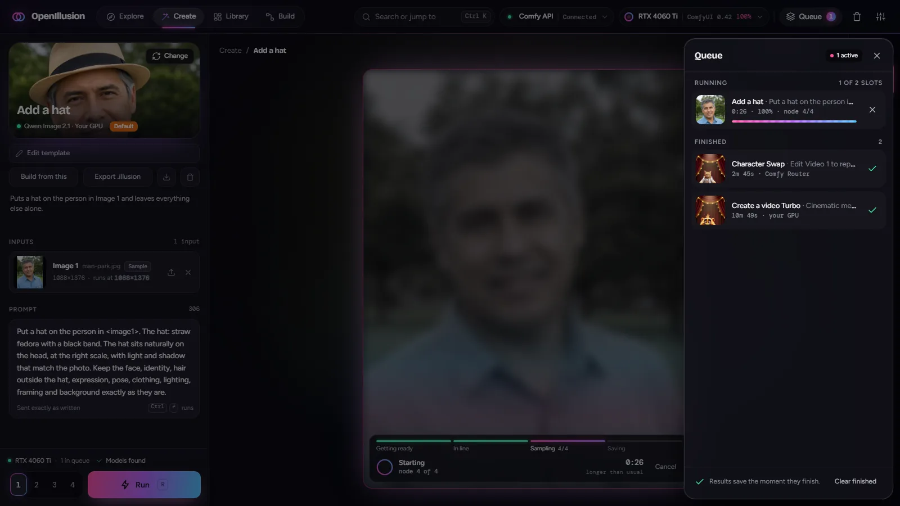

# The app

What each screen does and the rules the design keeps. How it's built is in
[ARCHITECTURE.md](../ARCHITECTURE.md).

## The app, screen by screen

Hash routes keep the app one static page (`lib/route.ts`). The top bar holds the
logo, Explore, Create, Library and Build, then on the right search (opens the
palette), the two status chips, Queue, Trash and Settings. As the window narrows,
search keeps only its icon and the nav keeps only icons. On phones there is no top
bar: a tab bar (Explore, Library, Create, Queue, More) where More opens Build, Trash
and Settings, and search and the chips ride in each page header instead, with the page's filters on a line of their own under them. Keys 1–4
jump between the first four, Ctrl K opens the palette.

The two status chips (`KeyStat`, `GpuStat` in `components/oi.tsx`) each open a card
on click:

| Chip | Says | Card |
| --- | --- | --- |
| **Comfy API** | Connected · No key · Key refused · Can't reach · Checking | The key's last four characters and where it's from, what it's for (Comfy Router, usage in the Comfy dashboard, files by link), Check again, Settings. |
| **GPU** (e.g. RTX 4060 Ti · ComfyUI 0.42) | Ready, or a progress ring while a local run goes; an amber dot when ComfyUI runs on CPU; hidden when no ComfyUI answers | GPU memory, the run in flight, the queue, ComfyUI and Comfy API v2 addresses. On CPU: "CPU only", no memory bar, and a note to start ComfyUI without `--cpu` or use cloud templates. |

| Screen | Route | What you do there | File |
| --- | --- | --- | --- |
| Explore | `#/explore` | Every published template on one wall: photos and videos, your GPU and cloud together. Drafts (saved in Build, not published yet) are not on Explore: they wait in the Queue. It opens with a headline: how many templates and where they run, up to four to **Try** (one click opens it in Create), and beside it a mosaic of the three you ran last (Pick up where you left off), else three featured ones. Under it, **Browse by model**: one card per model (a template's cover, where it runs, how many templates use it), drifting slowly left in an endless loop (paused under the mouse or focus; still, and scrolled by hand, with reduced motion); picking one sets the Model filter, picking it again clears it. A filter or search changed while the wall is out of view scrolls it into view. Then the sticky header: one search field (`/` jumps to it, Esc clears; it reads the name, model, blurb and prompts, best matches first) with how many match. Under it the filters: All / Photo / Video, **Runs on** (Local, Cloud), **Ready to run** (only what your setup can run now; see the readiness rule below), Model (each says Your GPU or Cloud; that is where it runs), Input (a photo, a clip, a sound, words only), Clear, and Sort on the right (Recently used, the default, then Featured, Newest (by when a template joined the app: `added` in the template file, for a shipped one the day it shipped, for yours when you made, copied or added it; stripped on export; an older file of yours without it falls back to the file's time), Most used, A to Z; used = runs you started, kept in `usage.json` so deleting a result doesn't forget them). Each card's caption says what it is sorted by, after the model: when it last ran, how many runs, or when it joined (Not run yet when it never ran); ties keep featured order. The wall puts each card in its shortest column, so a sorted wall reads in order, top to bottom; every card sits in one parent, placed by position, so a filter or sort slides cards instead of rebuilding them (`components/Masonry.tsx`). The neon edge (a masked layer) exists only on the card hovered or picked. Every cover loop on screen plays and pauses once scrolled away (`settle` in `components/oi.tsx`); none with reduced motion. Nothing over the wall is blurred (pills, the sticky header, the Add a template bar): a blur over a playing loop is redrawn every frame. Each filter's counts follow the others. There are no tags: search and the filters find templates. Cards on the wall have no before/after wipe: while the wall scrolls under a resting mouse, hover set it off on every card passing by (a full-size photo decoded each time); the details panel still shows the cover against its input. Under a card's name is its model: a Router template's comes from its model (Wan 3.0, Seedance 2.5), whatever you name it; a workflow's is the model its author named in Build or the inspector (`model_name`). Under the model, one quiet line says where it runs (a mint dot for Local, violet for Cloud) and, on a template built or imported here, **Yours**; the caption's tooltip says whether it shipped. Create's header carries the orange tag: **Default** (ships with OpenIllusion) or **Created by you**; the inspector says the same in words. Click a card to run it in Create; (i) opens the inspector on the right, where name, blurb, prompt and cover (and a workflow's model) are edited in place. Its trash button deletes a template you built or copied, or takes a shipped one off Explore (its file stays; Settings → Templates puts it back); the card's hover buttons end with the same trash (right of (i)), and Create's header has it too, with Export .illusion. A bar stuck to the bottom of the wall (see-through, at most 820 px wide), **Add a template**, is the one place on Explore to add one: it takes a template's `.illusion` (drop or Choose file; dropping one anywhere does the same), which lands on Explore as yours, opened in the inspector, and on its right **New template** opens Build. After the first visit its line is shorter. A template without a cover yet shows its name until a result is made its cover. The inspector shows the cover beside its input as a slider you drag across, photos or clips (two clips loop in step). | `screens/Explore.tsx`, `components/TemplateInspector.tsx` |
| Create | `#/create` (photo), `#/motion` (video) | One studio for both: pick a template, fill its inputs (a list of file cards, each with whether the model takes it), edit the one you pick right on the stage, edit the prompt (on cloud templates, chips put each filled file's name, Image 1 or Video 1, at the cursor), pick the result's settings (shape tiles, size steps with the pixels they make, length, resolution, sound), Run (on a ComfyUI started with `--cpu`, the bar warns it could take hours and the header says Your CPU). The stage has two tabs, Inputs and Result, and the header always names the template. Opening a template shows Result as after Run: your latest run of it, else the template's example (the cover beside the input it was made from, marked Example on the frame and in the bar; a clip's cover keeps its sound, which plays here while cards play it muted); Inputs flips to editing. Every result, photo or clip, sits over one bar: what it is on the left (Example, Your run or Earlier run, with when, size and seed), Side by side or Wipe on the right (side by side each time the app opens; a pick holds run to run and on a run's page until the page is closed: `abView` in `lib/store.ts`), and for clips play and the timeline. The result is set against its lead input (Wipe, Side by side) only when it's made over that input: the photo edited, a first frame, the clip edited; a template whose files are references (photos or a clip guiding a new video) shows the result alone, and its card has no before. A run's frame has a download button at its top right: the photo or clip itself, named after the run (Export makes a `.illusion` instead). A finished run's buttons, always in this order: All N (variants), Re-run (only when the workflow re-rolls its seed), Export, Use as cover (any finished run of this template, a draft's too; primary while it has no cover, quiet once it has one; a draft's cover stays with it when published. When the run used other inputs than the template opens with, it asks which, naming them: **Set as cover and reuse its inputs** makes the run's prompt, settings and files the template's defaults, written into its workflow or request body too, so Create and the downloaded workflow make what the cover shows; **Cover only** takes just the result. A shipped template becomes an edited copy, and Reset in its details brings the shipped defaults back), Open in Library. Picking an older run in the Runs column (or the strip at medium widths) puts **Use these inputs** in the bar: its files, prompt and settings go back on the left (`loadGeneration`). There is no Remix in Create; Open in Create on the Library and Generation pages does the same from there. A draft shows a bar under the cover first: Draft, Not on Explore yet, whether it has been tested, and **Publish** (off until a run of it has finished; with no cover set, Publish makes the run on stage, else the latest, its cover). Under the cover, **Edit template** (opens it in Build on its saved defaults; see the editing rule below), then one row: Build from this (every template; a cloud one opens on its model with its inputs, prompt and settings), Export .illusion, the ComfyUI workflow (local ones, an icon) and delete. Each input card has one line under its name: the file's size, then whether the model takes it or the size it runs at. The run bar says where it runs and, for a local template whose nodes and models are all there, Models found (what's missing is listed under the template). The 1–4 variants control is always there; a fixed-seed workflow shows it locked at 1. Behind the stage, the shown result's colours (else the template's cover) glow, blurred and breathing slowly; still with reduced motion. | `screens/create/`, `components/Studio.tsx`, `MediaEditor.tsx`, `Trimmer.tsx` |
| Library | `#/library` | Every run, newest first, grouped by day. It opens with a headline and the shelf's counts: generations, videos, starred and templates used (`stats` in `GET /facets`, counted per shelf over every run, not just the loaded page). Shelves: My generations, Imported, Community. Tabs: All, Starred, Running, Failed, each with its count, then a template picker (Every template). On the right Import, Clear (everything the tab shows, to Trash; starred and running ones can stay) and Select for several at once. On phones (no top bar) a link at the bottom leads to Trash. | `screens/Library.tsx` |
| Trash | `#/trash` | Deleted generations grouped by the day they were deleted, each with days left of its 7. Restore or delete for good one at a time, or Select several; Restore all, Empty trash. | `screens/Trash.tsx` |
| Generation | `#/generation/{id}` | One result full screen: the result against its input in Create's player, side by side or the wipe as last picked (a photo run can also show Input or Result alone), variants, re-run, Open in Create, notes, download (the result file itself), export and share. Arrows step through the Library. | `screens/GenerationDetail.tsx`, `ShareSheet.tsx` |
| Build | `#/build`, `#/build?from={template}`, `#/build?track=cloud` (opens on Comfy Router) | Make a template in three steps; see [Builder](TEMPLATES.md#making-a-template-builder). | `screens/builder/` |
| Queue | drawer | Every run from both studios, grouped by what it needs from you: Running, Up next, Needs attention, then **Drafts** (templates saved in Build and not published: a Draft pill, orange until a run of it finishes, then mint Ready; click one to open it in Create, run it and publish it; its trash deletes it, held to confirm), then Finished (a finished run's check turns into a remove button under the pointer: off the queue, still in the Library; Clear finished takes them all). A run deleted from the Library leaves the queue too, and a row whose picture is gone shows the plain image icon. | `screens/QueueDrawer.tsx` |
| Settings | `#/settings` | Your GPU (ComfyUI and proxy URLs), Output limits, Templates (shipped ones taken off Explore, each with Put back), Storage (disk use, clean working copies, back up and restore, the output folder: typed, or **Choose…** for the folder picker), Cloud (API key, and under Cloud runs how many run at once). | `screens/Settings.tsx` |
| Connect | `#/connect` | Choose Use my GPU (ComfyUI checks and template requirements) or Use cloud (test a Comfy key, no local setup). Either can be skipped to browse. Completion opens Explore filtered to Local or Cloud. CPU-only ComfyUI remains supported with a warning. | `screens/Connect.tsx` |
| Export template | Create's header, the inspector | **Export .illusion**: one template with its samples and the cover you set, to share, as it is: no export date, no Builder state, no use history, files without their own dates (see [What leaves without dates](../ARCHITECTURE.md#what-leaves-without-dates)). The other OpenIllusion drops it on Explore's Add a template (or anywhere) and it's theirs: deletable, under a new id if theirs is taken. Local templates also keep **ComfyUI workflow**, a `.json` for ComfyUI itself (dropped back here it starts a new template in Build). | `server/template_pack.py`, `components/TemplateCard.tsx` |
| Export | sheet | Export on a finished run (Create, the Generation page): a `.illusion` file (Light, Full, or Recipe only), the recipe as JSON, or a link. It says what the file is for: drop it on any OpenIllusion page or press Library → Import; it opens under Imported, and Open in Create loads it to run again. | `screens/ShareSheet.tsx` |
| Import | dialog | Library → Import, a drop anywhere, or a link: a bundle, PNG or MP4 with a recipe. Review, then add to the Library. A dropped ComfyUI workflow goes to Build instead. | `screens/ImportReview.tsx` |
| Edit a file | Create's stage; a sheet in the Builder | One workbench for every photo, clip and sound: the model's limits as pills on top (green fits, orange a run changes it, red can't run; a pill opens its tool) with **Fit to spec**, tools on the left (crop, turn, size, cut, rate, sound), the file in the middle with what the model keeps outlined, the tool's settings on the right, a clip's timeline below (past the model's length is hatched: not sent), and what changes along the bottom. Hold for original. In Create the edits wait on the input and are made when it runs (crop and cut go through the run's own crop and trim; turn, size, rate and sound make a new file just before the run, or now with Apply now). In the Builder, Save makes the new file. The original always stays. On a local template the size tool is **Size it runs at**: the template's steps (0.5 MP, 1 MP…, each with the pixels it makes at the crop's shape) or Custom, which opens width and height; picking a step drops a typed size. Every "Runs at" sizes the file as its edits will make it (`runInput`). | `components/MediaEditor.tsx`, `lib/edits.ts` |
| Restore | dialog | A dropped `.illusionbackup` (or Settings → Storage → Choose file): what it would add, then Restore, with progress. | `screens/RestoreReview.tsx` |

   
  The Queue over Create: Add a hat sampling on the GPU (its stage track and time below the photo), two finished runs under it. More screens in the <a href="../README.md#screenshots">README</a>.

## Design rules

The current design is the settled one. Change it on purpose, and write the change
here in the same commit.

- **Choose a connection, not a prerequisite.** First run offers Use my GPU and
  Use cloud equally. Cloud setup accepts and tests a Comfy key without requiring
  ComfyUI. Either path can be skipped to browse; completing setup opens Explore
  filtered to that path. Failure to save onboarding stays visible and retryable.
- **Editing and copying are different actions.** Create's Edit template opens
  `#/build?edit={id}` with the saved template's defaults, not the unsent Create
  draft. All saved templates offer Save template, Save as copy, and
  Save and test. Saving a shipped template writes a local override under the same
  id, leaving its bundled file intact and recoverable with Reset. Saving never generates unless
  the test action is explicitly chosen. Cancelling preserves the Create draft;
  saving opens Create fresh with the saved defaults. Unsaved edits are guarded
  on navigation and reload. Build from this remains a new-template operation.
  Existing generations keep their own recipes; saving an edit preserves the
  template id, cover and published/draft state. Active runs prevent replacement.
- **Builder separates saving from testing.** Save template is the primary action
  for new templates and edits; saving a new template creates an untested draft.
  Save as copy stays secondary. The optional test section contains the checklist,
  test action and any cloud billing notice. Create preview is expanded on desktop
  and collapsed on narrow layouts. The sidebar moves before the form on narrow
  layouts in DOM as well as visual order, preserving entered values when resized.
  Compact details and numbered section cards replace the full-width title and edit
  notice. Source choices use native pressed buttons, model search has empty-state
  recovery, and locked Builder values remain visibly editable.
- **Readiness is checked, never assumed.** Explore combines Runs on (Local/Cloud)
  and Ready to run with its existing filters. Local readiness checks all declared
  inputs against one ComfyUI node/model snapshot, excludes drafts and hidden
  templates, and respects proxy availability and upstream mismatch. A failed
  check is unknown, not ready. Cloud readiness requires a working key/connection.
  This is not an assurance of sufficient VRAM, valid user inputs or provider funds.
- **Let the result lead.** Explore cards show the outcome, model and a quiet
  Local/Cloud line. Only user-owned templates get Yours; shipped origin and
  sorting timestamps remain in tooltips/details instead of repeated orange badges.
  Setup warnings stay visible. Shipped names describe outcomes; model names stay
  underneath. Existing user-renamed templates are not rewritten.
- **No invented prices.** Cloud Run says cost is unavailable and how many paid
  requests the selected variants represent. No numeric quote is shown until the
  app has a reliable pricing source. Cloud onboarding explains billing and which
  files leave the machine.
- **Keyboard and touch share the same actions.** Cards have a semantic primary
  button with separate tools. Phone controls retain accessible names, and coarse
  pointers get at least 44 px targets. Free crop offers percentage fields as well
  as draggable handles. More identifies the current secondary section and opens
  a keyboard-navigable menu; Settings keeps the active section in view.
- **Details keep their context.** Explore's inspector overlays the wall without
  resizing it. A closed inspector cannot receive focus; the phone sheet contains
  focus and returns it to its trigger. On touch, card tools expand from More.
  The shared-template import panel becomes compact after its first exposure.
- **Motion serves feedback.** Shared durations are 120 ms for presses, 160 ms for
  compact feedback, 200 ms for entrances, 240 ms for layout, and 130 ms for exits.
  Hover movement requires a fine pointer; the command palette opens immediately.
  Reduced motion reacts without a reload, stops decorative video loops and spatial
  effects, and preserves short color/opacity feedback. Run's gradient drifts slowly and stops with it;
  generation effects and progress favor transform/opacity. Comparison drags capture
  their pointer, and toasts have an explicit exit state.
- **Recipes never change templates silently.** A missing template keeps its recipe
  intact and names what must be installed. Import and generation actions explain
  the missing template instead of starting an unrelated studio or failed rerun.
- **Finished files stay yours.** Repeated generation exports receive numbered
  suffixes and never overwrite an earlier export. Active templates cannot be
  deleted or replaced until their runs finish. Restore temporarily blocks new
  runs and template changes.
- **One-click simple.** Each screen has one main action (Use, Run, Save), in
  the neon gradient. The box's own settings (sampler, steps, model flags) never show.
- **Say what it is, not how it's built.** Inputs read Image 1, Video 1, Audio 1;
  modes read Text to video, Image to video, Video edit. Node ids, field paths and
  model ids appear only as small mono text.
- **Show only what can be used.** A Router model's modes are a row of tabs, and a
  mode shows only its inputs, so you never fill two that can't go together. A
  model with one mode shows no tabs.
- **Status is always in sight.** Whether cloud and local can run is a chip in
  every header, in one or two words; details are a click away, never a page away.
- **Every gate says why.** Run is never greyed out without the reason next to it
  ("Video edit needs a Video to edit", "Give the template a name").
- **Steps you can walk back.** The Builder's steps show where you are; Back sits at
  the top, and a finished step is clickable. Leaving asks first
  only when something of yours would be lost (a name, a dropped file).
- **One editor per file, everywhere.** A photo, clip or sound is the same card
  and opens the same editor wherever it sits (Create's input list, the Builder's
  samples); each card says in one line whether the model takes it, and the editor
  shows the model's limits as pills, never a separate tool.
- **Undo over confirm.** Deleting moves to Trash and the toast offers Undo; a
  confirm dialog is for losing work that can't come back.
- **Live, never polled by you.** Job progress arrives over the WebSocket into the
  Queue drawer and the Library card.
- **A run says what it's doing.** `components/RunStatus.tsx` draws every live run
  (Create's stage, the Library card, the detail page): a stage track (Getting
  ready, In line, Sampling or Generating, Saving), what it's on in words, time
  spent and time left. A local run shows its sampler step, node and the sampler's
  own preview frames (ComfyUI sends them when started with `--preview-method auto`),
  and its time left comes from its pace. Comfy Router sends no progress, so a cloud
  run shows an indeterminate bar and counts against `typical`: the median time of
  the template's last finished runs (`store.typical`, set on the job at start;
  none until two have finished).
- **No page titles.** The top bar already names the section, so a page never
  repeats it; each keeps a hidden `<h1>` for screen readers. Explore and Library
  open with a headline that says what's there instead. The sticky header row is
  filters and actions (on phones also search and the status chips).
- **Look ("Studio").** Neutral near-black ink (`--bg #06060A`, no purple cast)
  under a slow aurora of pink, violet and cyan along the top edge; floating panels
  (menus, the queue, dialogs, the top bar, the sticky header) are glass with a lit
  top edge. The accent is one neon gradient, `--neon` (pink `#FF4FA3` → violet
  `#B36BFF` → cyan `#4FC3FF`), for the main action, the current nav item, focus
  rings and progress; icon strokes take it through the shared SVG gradient `#ng` in
  the sprite. `--accent` is the pink alone where a flat colour is needed; `--mint`
  done, `--violet` cloud, `--orange` warning, `--rose` error. Buttons are 32px, the
  top bar 60px, cards 10px apart. Bricolage Grotesque for headings, Figtree for
  text, a Fraunces italic for the one accented word in a headline (`em.accent`, the
  gradient drifting through it), DM Mono for numbers and ids; all bundled through
  `@fontsource`, so nothing loads from the web. The mark is two overlapping rings in
  the gradient (`LogoMark` in `components/Shell.tsx`); the favicon and
  `docs/media/logo.svg` are the same drawing.
- **Motion, kept quiet.** `glow.css`, last in the cascade, only adds: the main
  action's gradient drifts and a sheen passes every few seconds, hover lifts it;
  buttons and chips get a soft violet rim on hover, picked choices a neon edge;
  live status dots send out a slow ring; progress bars are striped and moving;
  cards lift with a neon rim and a slow zoom; headlines rise in on arrival.
  Everything that moves stops under `prefers-reduced-motion`. All styling is plain CSS in `ui/src/styles/` (no utility framework):
  tokens, the aurora and the reset in `base.css`, shared pieces (buttons, pills, fields,
  notices) in `common.css` and `fields.css`, one stylesheet per area beside them
  (`builder.css`, `studio.css`, `library.css`…), with phone layouts in
  `responsive.css` and the motion and glow layer in `glow.css`.
