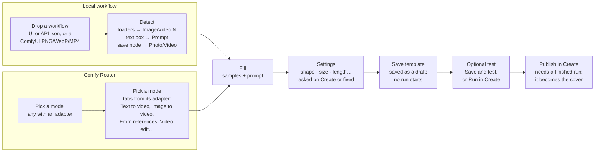
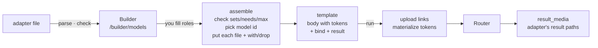

# Templates, the Builder and cloud models

What a template file holds, how the Builder makes one, and how cloud models are
described to the app (adapters). The rest of the system is in [ARCHITECTURE.md](../ARCHITECTURE.md).

## The template contract

The supported contract is version 2. Versionless and version-1 templates migrate
through the legacy conversion; non-positive, malformed and future versions are
refused. Loading, Builder save and `.illusion` installation validate executable
bindings before registration: local target nodes/inputs and declared outputs must
exist, cloud paths must be writable, and media bindings must hold their declared
tokens. Version-2 cloud templates must declare result paths.

Build from this uses the request's role discriminators as well as its media token
shape. In particular, Seedance's `duration: -1` preserves Video to edit when the
same token representation is also used by Reference video.

One contract for both kinds: `inputs` (Image N / Video N / Audio N, one prompt,
each with a `bind`), a `mode` (`edit` makes a photo, `motion` makes a video), a
required `label`, and a cover. Then the box.

A local template, trimmed:

```jsonc
{
  "format": "openillusion.template", "version": 2,
  "id": "local/qwen21-add-hat",
  "mode": "edit",
  "label": "Add a hat",
  "model_name": "Qwen Image 2.1",
  "inputs": [
    { "key": "image:1", "type": "image", "required": true,
      "default": "media/man-park.jpg", "bind": [["11", "image"]] },
    { "key": "prompt", "type": "text", "required": true,
      "default": "Put a hat on the person in <image1>…", "bind": [[ … ]] }
  ],
  "workflow": { /* API format, untouched */ }
}
```

A cloud template, trimmed (Kling 3 Omni, built as a video edit):

```jsonc
{
  "format": "openillusion.template", "version": 2,
  "kind": "cloud", "id": "cloud/rainy-rooftop",
  "mode": "motion",
  "label": "Rainy rooftop",
  "model": "kling/kling-v3-omni",
  "inputs": [
    { "key": "video:1", "type": "video", "required": true,
      "bind": [["video_list", 0]] },
    { "key": "prompt", "type": "text", "required": true,
      "default": "…", "bind": [["prompt"]] }
  ],
  "body": { "prompt": "…", "mode": "pro",
            "video_list": [{ "video_url": "{{video:1|url}}", "refer_type": "base",
                             "keep_original_sound": "yes" }] },
  "result": [["data", "task_result", "videos", "*", "url"]]
}
```

- **`label`** is the name alone. Under it Explore and Create show the model: a cloud
  template's is its Router model's own name (from the adapter), a local one's is
  **`model_name`**, as its author typed it in Build or the inspector ("ComfyUI
  workflow" when left empty). Files that once wrote `"Name · Model"` into the label
  are split when they load. In Build the name starts empty, for local and cloud alike
  (a hint says what to write); the model sits beside it, never in it.
- **`model`** is the Router model the request goes to. For an adapter that
  spans several model ids (`models`), it is the one the run's inputs picked.
- **`body`** is the cloud box: the adapter's starting request with the run's
  inputs put in and their side effects applied (`with`, `drop`). A template
  carries its own copy, the way a local template carries its workflow, so a later
  change to an adapter never changes a saved template.
- **Media tokens** say how a file goes into the body: `uri` (data URI), `b64`
  (bare base64), `mime` (its MIME type) or `url` (a signed link to the file,
  uploaded to Comfy Cloud's assets; see [Files by link](#files-by-link)).
- **`result`** lists paths into Router's answer; the first one holding a URL or
  base64 wins, and `*` stands for any list index. It comes from the adapter. If
  none of them holds one (an adapter written from the docs can miss), any image or
  video link in the answer is taken, then any long base64 string.

### Settings: what people choose about the result

Besides files and the prompt, a template can ask for the settings any generator has.
They are ordinary inputs after the prompt, drawn by Create under **Settings**:

- **`size`** (key `size`): a shape and a step that become width and height.
  `aspect` is the shape it opens at, `aspects` the shapes offered, `default` the step.
  Local: `bind` lists `[node, input, width|height]`; the steps are the mode's (photos
  0.5–3 MP, videos 0.4–1.5 MP, 1 MP = 10⁶ px). Cloud: `bind` lists `[path, width|height]`
  or `[path, text]` for one `"WxH"` field, and the field carries the model's own
  `steps` (MP, 1 MP = 1024² px), `multiple` and `sides`/`pixels` limits
  (`prep.fit_dims`). Create sends the pick as `params.aspect` and `params.out_size`.
- **`aspect`**: a model's own shape values as tiles (`16:9`, `1536x1024`, `auto`).
- **`segmented` / `select` / `int` / `bool`**: resolution, length, quality, sound.
  `options` are the model's values, numbers kept as numbers; `labels` says what
  people see (`"std": "720p"`); `unit` follows a value (`5 s`); a bool can be
  spelled `values: ["off", "on"]`. The value `""` means Auto: the field leaves the
  request and the model decides. `send` maps an option to what the request gets when
  that isn't the option itself (`"clip": false`).
- **Keeping a clip's own sound** (`keep_sound: {option, slot}` on a setting): picking
  that option gives the result the sound of the clip in `slot`. The model is asked for
  none; once the result is downloaded the app puts the clip's sound on it (`media.put_sound`:
  the picture copied as it is, the sound from the clip's start, cut to the result's length).
  A setting fixed in the Builder at that option leaves no input; the template says
  `"keep_sound": "video:1"` at the top instead. Seedance's Sound is Make new / Keep the clip's
  / None, the middle one only when it edits a clip (Kling keeps the clip's sound itself).
  The local MiniMax H3 Character swap says it the same way, by hand in the template: Sound
  is Make new (H3's own) / Keep the clip's (Video 1's).

```jsonc
{ "key": "size", "type": "size", "label": "Output size", "aspect": "16:9", "default": "0.4 MP",
  "aspects": ["16:9", "9:16", "1:1", "4:3", "3:4", "21:9"],
  "bind": [["140:131", "width", "width"], ["140:131", "height", "height"]] },
{ "key": "duration", "type": "segmented", "label": "Duration", "options": [3, 5, 8, 10, 15],
  "default": 5, "unit": "s", "bind": [["140:133", "value", "float"]] }
```

The shipped templates made from words alone (Create a photo, Create a video and its Turbo,
H3 T2V Turbo) ask for size; Create a video, its Turbo and Animate a photo ask for a length;
Character swap takes its size and length from the clip. A cloud template saved before
models had settings gets its job's settings at their defaults when it loads
(`contract._model_settings`).

A template that starts from a photo or clip renders at that input's frame, as prepared:
its own shape (or the crop), at the size step picked in Create (Original keeps it, under
the cap). An input can name the step it opens at (`"size": "0.4 MP"` on the input); the
character swap does, so a clip of any shape runs at H3's usual 0.4 MP budget. Its
workflow reads the frame from the clip (`GetImageSize` on `GetVideoComponents`), the way
Animate a photo reads it from the photo, so no shape is fixed in the graph.

## Making a template (Builder)

### Editing an existing template

Create's **Edit template** opens `#/build?edit={id}`, prefilled with the saved
template's name, description, samples, prompt and Ask/Lock settings. The unsent
Create draft is not used as the template's defaults.

**Save template** updates the same id. For a shipped template, it creates a local
override in the user's home, never changing bundled files; Reset restores the
bundled version. **Save as copy** creates a separate draft under a new id.
**Save and test** is a separate action:
normal saving never starts a job and does not require a filled test prompt or
local sample. Cloud testing uses a paid provider run, with no cost quote available.

Replacement preserves the cover, added date and published/draft state. Past
generation manifests and request snapshots are untouched. Local templates still
require a reachable ComfyUI to inspect and validate their workflow. Replacement
is refused while that template has active runs. Samples use content-addressed
filenames and atomic copies, so a failed save cannot overwrite the old sample.

Back to Create preserves the unsent draft when edits are discarded. Saving
returns to Create with the saved defaults. Navigation/reload warns about unsaved
edits. **Build from this** (`?from={id}`) continues to create a new template.

### Creating a new template

The Builder offers two source choices, **Local workflow** and **Comfy Router**,
with three steps: bring a workflow or pick a model, set defaults, save the template.
The choices differ in where the input list comes from. Cloud models can be
searched by model name, id, role or supported action.

Step 2 groups template details, inputs, prompt and settings into compact cards.
The desktop save panel stays beside the form; on narrow layouts it appears before
the form, in the same keyboard order as its visual order:

- **Save template** saves a new draft without generating. Missing test samples or
  an empty starting prompt do not block saving an otherwise valid template.
- **Create preview**: the template as Create will show it, its name, model,
  the files it asks for by the names Create gives them, the prompt, the settings
  asked on Create with their starting values, and the locked ones in one line.
- **Test this template**, an optional section: a checklist (named, inputs fit the model, every asked
  setting named, result picked, prompt written, every input has a sample), each
  met or with what's missing.
- **Save and test**, inside that section, starts one run. The first unmet item
  explains why testing is blocked, independently of the save action. New drafts
  still require a finished test run before publication.



- **Detect** is `builder.analyze`: UI-format workflows are converted to API format
  and subgraphs flattened, then every loader becomes a required input. Step *Save*
  is `builder.assemble_local`.
- **Picking a model**: each adapter is a card under *Make video* and *Make photos*.
  Each card says what the model **Does** (its mode names, `modeNames`) and what it
  **Takes** (its roles, with the most files each takes, e.g. Reference image ×9),
  both read off the adapter, so a new adapter gets its card for free. A third row,
  **Reads**, says how it reads a file named in the prompt: Image 1 → `<<<image_1>>>`
  (Kling), → `@Image 1` (Seedance), as written, or no names at all (Veo: describe
  each file in words).
- **Prompt names** (Router): under the prompt, a chip per filled file inserts its
  name at the cursor; each chip also shows the token the model gets when it differs.
  Below, *{model} gets* shows the prompt as sent, names swapped for tokens
  (`sentAs`, the same swap as the server's `engines.name_files`). Create's chips
  show the tokens too.
- **An adapter** lists every input its model takes, by role (First frame, Video to
  edit…). The Builder turns its input `set`s (or its `models` routes) into **job
  cards** (`routerJobs`): Text to video, Animate a photo, From references, Edit a
  video, Extend a video, Match a style. A photo model with inputs gets two: Text to
  image and Edit or combine photos, so its mode is picked, never implied by an
  empty slot. A model with one job shows no cards. A job shows only its inputs,
  one group per role, each marked Required, Optional or One of these (a clip to
  work on and a first frame are required; a job's only input is too; otherwise at
  least one). Switching jobs drops files from inputs the new job doesn't take.
  Under the inputs, one line says what the run makes, or what's missing. Each
  filled tile shows the name Create gives it (Image 1, Image 2). Step *Run* is
  `builder.assemble_cloud`. Back (top, or step 1) returns to the model or
  workflow list, asking first only if you named the template or dropped a file.
- **Output size** (local): a workflow with a node that sets width and height (an
  empty latent, a video node) can hand both to Create: pick the node, then the shape
  and step it opens at. It's picked for you when the workflow takes no file and has
  one such node; with an input photo or clip, the input sets the size.
- **Settings** (local): every widget value in the workflow can be one people change
  on Create. Each row has **Ask on Create | Lock**; all start locked, the likely ones
  (seed, steps, length, denoise) are listed first, the rest under *Show all*. Locked,
  a value you change here is fixed into the saved workflow; asked, it gets the name
  Create shows. A template opened with *Build from this* keeps its controls as
  they were (Duration stays 3/5/8/10/15 s, not a bare number box).
- **Build from this, cloud.** A Router template opens on the Comfy Router tab with its
  model, each sample in the model input it fills (read off where the template's request
  holds it), its prompt and its settings; one the template fixed comes back fixed at its
  value (`builder.cloud_preset`). There are no prompt ideas or variants: the
  template's one default prompt is the start, and anyone edits it on Create.
- **Settings** (Router): the model's own options the job asks for (below), each
  with a value and **Ask on Create | Lock**: asked, people pick it on Create,
  starting at your value; locked, every run uses it.
- **Dropping samples:** a file dropped on an input becomes its sample; drop several
  and the rest fill the empty inputs of their kind (that role first, then what the
  job must have), and a Router role takes more up to its cap. Files dropped anywhere
  else on the page do the same (`placeFiles`); a dropped ComfyUI workflow starts over.
- **Save and test** saves the template as a draft and runs it once in Create, as soon as
  Create can run it (`autorun` waits for Run to unblock; after 30 s it gives up and
  a toast says why). Samples you dropped become its defaults. When a result looks right, **Publish** (in the
  draft bar under the cover) puts it on Explore with that result as its cover.
  With a fixed seed, Create locks variants at 1 and hides Re-run, because every run
  would give the same result.

## Cloud = Comfy Router

Cloud means premium partner models called on Comfy Router and billed to your
Comfy key. **Comfy Cloud**, the hosted ComfyUI, is not a runner here: it would
bring a second node and model inventory, a second queue and a second billing
story. Only its asset store is used, to give Router a link to your file.

What makes Router hard to do generically:

- **Requests:** each model's own schema, not a unified one.
- **The mode is in the request.** A model has no "image to video" or "edit"
  endpoint: the inputs you send decide. GPT Image 2's docs say it outright:
  presence of `image` "selects the edit operation". Kling marks a video as the one
  to edit with `refer_type: base`; Seedance makes an edit from a reference video
  with `duration: -1`. A family that splits its modes over several model ids
  (`-t2v`, `-i2v`, ...) lists them in the adapter's `models`.
- **Files:** some fields take a URL, some base64, some an item in a tagged list.
  Most video and audio fields take a link only. Requests are capped at 100 MiB,
  about 75 MB of media once base64-encoded.
- **Limits per file:** every model has its own sides, shapes, sizes, lengths and
  frame rates, and refuses a file outside them. Adapters carry them (`fit`); runs
  make files fit instead of failing.
- **Answers:** a rehosted URL (valid 12–24 h), a provider URL, inline base64
  (Veo), or raw bytes. There is no common envelope.

### Roles: one vocabulary for every model

Every adapter names its inputs from the same short list of roles, so the Builder,
the mode names and future models all speak one language. The Comfy hub does the
same internally (`source_videos`, `reference_images`, `first_frame`…).

| Role | Type | Means | Job | Its `set` |
| --- | --- | --- | --- | --- |
| *(nothing filled)* | | prompt only | Text to video · Text to image | |
| First frame | image | the clip starts on this picture | Animate a photo | `frames` |
| Last frame | image | the clip ends on it; needs a first frame | Animate a photo | `frames` |
| Reference image | image | a character, object or scene to keep | From references | `references` (+ `edit` where the model allows) |
| Style image | image | a look to copy | Match a style | `style` |
| Reference video | video | motion, camera or cuts to follow | From references | `references` |
| Reference audio | audio | a voice, sound or music to use | From references | `references` (+ `edit` on Seedance) |
| Video to edit | video | the clip to change, as the prompt says | Edit a video | `edit` |
| Video to extend | video | the clip to carry on from | Extend a video | `extend` |
| Photo | image | an image model's input | Edit or combine photos | none |

The names in the "Job" column are the Builder's job cards, the same on every
model: `SET_KIND` in `builder/modes.ts` maps each set name to a job, and a `models`
route is matched by the roles it takes. Each role's one-line hint is `ROLE_HINT`
there too. A set name not in `SET_KIND` is named by its roles.

A template is frozen to the roles its run used, so "Kling · edit video" and
"Kling · first–last frame" are two templates from one adapter.

### The models

Chosen from the October 2026 arena boards and creator round-ups, limited to
models Router serves. Nobody publishes usage counts.

| Adapter | Makes | Roles (max) | Files go in as |
| --- | --- | --- | --- |
| `kling/kling-v3-omni` · Kling 3 Omni | Video | First frame, Last frame, Reference image (7; 4 with a video), Reference video, Video to edit | images base64 in `image_list[]`; videos by link in `video_list[]` with `refer_type` `feature` or `base` |
| `byteplus/dreamina-seedance-2-5-260628` · Seedance 2.5 | Video + audio | First frame, Last frame, Reference image (30), Reference video (10), Reference audio (10), Video to edit | `content[]` items with a `role`; images and audio as data URIs, video by link |
| `veo/veo-3.1-fast-generate-001` · Veo 3.1 Fast | Video + audio | First frame, Last frame, Reference image (3), Style image, Video to extend | `instances[0]`, `{bytesBase64Encoded, mimeType}` |
| `wan/wan3.0-video` · Wan 3.0 | Video + audio | First frame, Last frame, Reference image (10), Reference video (5), Reference audio (5) | `input.media[]` items `{type, url}`; images as data URIs, video and audio by link |
| `openai/gpt-image-2` · GPT Image 2 | Photo | Photo (16) | `image[]`, data URIs |
| `vertexai/gemini-nano-banana-2.1` · Nano Banana 2.1 | Photo | Photo (14) | `contents[0].parts[]`, `inlineData` |
| `byteplus/seedream-5-0-pro-260628` · Seedream 5.0 Pro | Photo | Photo (10) | `image[]`, data URIs |
| `bfl/flux-2-max` · FLUX 2 Max | Photo | Photo (9) | `input_image`, `input_image_2` … `input_image_9`, base64 |
| `xai/grok-imagine-image-2.0` · Grok Imagine Image 2.0 | Photo | none: text to image only | — |

Each max is the model's own published limit: Router's schema where it states one
(GPT Image 2's 16, Seedream's 10, Wan's per-type caps, Veo's 3, FLUX's nine
fields), else the provider's or Comfy's docs where the schema defers (Seedance 2.5:
30 images, 10 videos, 10 audio; Nano Banana 2.1: 14; Kling 3 Omni: 7, or 4 beside a
video). We never cap below it.

What each model takes in one file (`fit`); runs make every file fit:

| Model | Photos | Clips | Sounds | Per request |
| --- | --- | --- | --- | --- |
| Kling 3 Omni | ≥ 300 px, 2:5 to 5:2, ≤ 10 MB | 3–10 s, 24–60 fps, 720–2160 px, ≤ 200 MB | — | Router's |
| Seedance 2.5 | 300–6000 px, 2:5 to 5:2, ≤ 30 MB | 2–30 s (4–30 to edit), 30 s in all, 24–60 fps, 300–6000 px, 0.41–8.3 MP, ≤ 200 MB | 2–30 s, 30 s in all, ≤ 15 MB | Router's |
| Veo 3.1 Fast | — | to extend: 1–30 s at 24 fps | — | Router's |
| Wan 3.0 | 240–8000 px, 1:8 to 8:1, ≤ 20 MB | 15 s in all | 15 s in all | Router's |
| GPT Image 2 | ≤ 25 MB | — | — | 67 MB |
| Nano Banana 2.1 | ≤ 7 MB | — | — | 14 MB |
| Seedream 5.0 Pro | ≥ 15 px, ≤ 36 MP, 1:16 to 16:1, ≤ 30 MB | — | — | Router's |
| FLUX 2 Max | ≥ 256 px, ≤ 16 MP, ≤ 15 MB | — | — | Router's |

From Router's schemas, except Seedance's per-file limits (BytePlus's docs as
quoted in griptape-nodes issue 818; Router's schema defers to BytePlus) and
Nano Banana's 7 MB a photo (Vertex AI's inline limit). "Router's" is its 100 MiB
body, about 77 MB of files before base64.

Not yet: masks (GPT Image inpainting, Veo insert/remove), Kling `element_list`,
Seedance drafts, Wan effect templates.

## Adapters

An adapter is a hand-written JSON file in `server/adapters/`, named
`provider__model.json`, one per model (or model family). `adapters.parse` checks
it when the server starts; a broken adapter stops the server with a message that
names the file and the field.

### The file

```jsonc
{
  "model": "kling/kling-v3-omni",       // Router id; with "models" below, any id for the family
  "name": "Kling 3 Omni",                // shown in the Builder
  "makes": "video",                      // "video" or "photo"
  "body": {                              // the request every run starts from: the model's own
    "prompt": "", "mode": "pro",         //   settings, no file tokens
    "duration": "5", "aspect_ratio": "16:9"
  },
  "prompt": ["prompt"],                  // where the prompt goes
  "inputs": [ /* one per role, below */ ],
  "result": [["data", "task_result", "videos", "*", "url"]],   // where the output sits in the answer
  "models": [ /* optional: one adapter, several model ids, below */ ],
  "settings": [ /* what people choose about the result, below */ ]
}
```

Each input:

```jsonc
{
  "role": "Video to edit",               // from the roles table
  "type": "video",                       // image | video | audio
  "at": ["video_list", "+"],             // path into body; "+" appends to a list
  "value": { "video_url": "{{$|url}}", "refer_type": "base", "keep_original_sound": "yes" },
  "max": 1,                              // files this role takes: the model's published limit
                                         //   (above 1, "at" ends in "+" or lists one path per file)
  "max_with": { "roles": ["Reference video"], "max": 4 },  // a lower max while one of these is filled
  "set": ["edit"],                       // which modes it belongs to (below)
  "needs": "First frame",                // a role that must be filled too
  "with": [[["sound"], "off"]],          // when filled: set these paths in the body
  "drop": [["duration"], ["aspect_ratio"]],  // when filled: remove these paths
  "fit": { "short": [720, null], "long": [null, 2160], "seconds": [3, 10], "fps": [24, 60], "mb": 200 }
}
```

and at the top level, `"media_mb": 14` when the model caps how much a request
may carry inline (Nano Banana: Google's 20 MB, base64 included).

- **Paths** are lists of keys and list indexes. `"+"` as the last step appends to
  a list, made if missing. For a model that takes numbered fields instead of a
  list, `at` can list one path per file: FLUX's
  `[["input_image"], ["input_image_2"], …]`.
- **Tokens** in `value`: `{{$|uri}}` data URI, `{{$|b64}}` bare base64,
  `{{$|mime}}` the file's MIME type, `{{$|url}}` a link (uploaded first). Each
  token stands alone in its string. `$` becomes the input's slot (`image:1`) when
  a template is put together; the file goes in at run time.
- **`set`** says which inputs go together. Every filled input must share at least
  one set with every other; inputs without `set` go with anything. Kling: First
  and Last frame are `["frames"]`, Reference image is `["references", "edit"]`,
  Reference video `["references"]`, Video to edit `["edit"]`. So a reference image
  can join an edit, but a first frame can't. Each set name is also a job card in
  the Builder, named from `SET_KIND` (`frames` → Animate a photo).
- **`needs`**: Last frame needs First frame.
- **`with` / `drop`** are the request's side effects of a role. Seedance's Video
  to edit sets `duration` to `-1` (edits keep the clip's length); Kling's drops
  `duration` and `aspect_ratio`; Veo's Video to extend sets
  `parameters.task` to `extend`.
- **`fit`** (optional): what the model takes in one file. Ranges are
  `[least, most]`, `null` for an open end: `short` and `long` (sides in px),
  `pixels`, `aspect` (width / height), `seconds`, `fps`; numbers `mb` (one file)
  and `total` (seconds across all files of the role). Photos take no seconds,
  total or fps; sounds only seconds, total and mb. A run makes every file fit
  (see [One run](../ARCHITECTURE.md#one-run-end-to-end)); a template finds its inputs' fits from
  the adapter at run time, so a limit added later reaches templates built before.
  A local template can put the same `fit` on any photo, clip or sound input.
- **`models`** (optional): when a family splits its modes over several model ids,
  list them with the roles each takes. A run goes to the first one that takes
  every filled role; the template keeps that id. No shipped model needs it; the
  tests' made-up family (`tests/fixtures/adapters/acme__family.json`) shows it.

  ```json
  "models": [
    { "model": "acme/family-t2v", "takes": [] },
    { "model": "acme/family-i2v", "takes": ["First frame"] },
    { "model": "acme/family-r2v", "takes": ["Reference image"] },
    { "model": "acme/family-edit", "takes": ["Video to edit", "Reference image"] }
  ]
  ```

Each setting (`settings`), from the model's Router schema and docs:

```jsonc
{ "key": "duration", "label": "Duration", "type": "select",   // aspect | select | segmented | int | bool | size
  "at": ["duration"],                                          // where it goes in the body
  "options": ["3", "5", "10"], "default": "5", "unit": "s",    // the model's own values
  "labels": { "std": "720p" },                                 // optional: what people see
  "off_with": ["Video to edit"],                               // roles that decide it instead: not asked, left out
  "only_with": ["Photo"] }                                     // roles it needs
{ "key": "sound", "type": "segmented", "at": ["generate_audio"], "options": ["new", "clip", "none"],
  "send": { "new": true, "clip": false, "none": false },       // optional: what the request gets for each option
  "keep_sound": { "option": "clip", "role": "Video to edit" }, // optional: that option keeps the role's own sound;
  "default": "new" }                                           //   offered only when the role is filled
{ "key": "size", "type": "size", "at": { "width": ["width"], "height": ["height"] },  // or { "text": ["size"] } for "WxH"
  "aspects": ["1:1", "16:9", …], "aspect": "1:1", "steps": [0.5, 1, 2, 4], "default": "1 MP",
  "sides": [256, 2048], "pixels": [1048576, 4194304], "multiple": 16 }
```

A setting an input decides is `off_with` that role: a first frame sets the shape,
a clip to edit sets shape and length, a clip to extend sets everything. The Builder
lists the settings the filled roles leave, each with its start value and whether
Create asks for it; `assemble_cloud` writes them all into the body and adds an input
for each one asked. The fixed ones are listed in the template's `locked`, so a template
that fixes every setting isn't taken for one saved before models had settings (those
get the model's settings as inputs, at its defaults, when loaded).

| Model | Settings |
| --- | --- |
| Kling 3 Omni | Aspect 16:9 / 9:16 / 1:1 · Resolution 720p (`std`) / 1080p (`pro`) · Duration 3–15 s · Sound |
| Seedance 2.5 | Aspect (8, Auto = `adaptive`) · Resolution 480p–4K · Duration 4–30 s · Sound: Make new / Keep the clip's (editing a clip) / None |
| Veo 3.1 Fast | Aspect 16:9 / 9:16 · Resolution 720p / 1080p / 4K · Duration 4 / 6 / 8 s · Sound |
| Wan 3.0 | Aspect (5, Auto) · Resolution 480p–1080p · Duration 2–30 s · Sound |
| FLUX 2 Max | Size 0.5–4 MP, sides 256–2048 (none when editing a photo) |
| Seedream 5 Pro | Size 1–4 MP as `"WxH"`; editing a photo: Resolution 1K / 2K |
| GPT Image 2 | Aspect Auto / 1:1 / 3:2 / 2:3 · Quality |
| Nano Banana 2.1 | Aspect (10, Auto) · Resolution 1K / 2K / 4K |
| Grok Imagine 2 | Aspect (13, Auto) · Resolution 1K / 2K · Quality |

### Naming files in the prompt

Some models want the prompt to say which file is which: "the jacket from Image 2".
`mentions` in the adapter says how the model writes that name, by kind, with `{n}`
for the file's place among the run's files of that kind, in the order the request
carries them (the template's input order):

```jsonc
"mentions": { "image": "<<<image_{n}>>>", "video": "<<<video_{n}>>>" }   // Kling
```

You write the names Create shows on the cards: Image 1, Video 2, Audio 1. Under a
cloud prompt, Create and the Builder show one chip per filled photo, clip or sound
(its thumbnail and that name); a click puts the name at the cursor. At run time
`engines.name_files` swaps each name of a file the run sends for the model's form:
"Put Image 2 into Video 1" reaches Kling as "Put `<<<image_2>>>` into `<<<video_1>>>`".
A name the run doesn't send, a longer word ("Images 1") and text already in the
model's form (`@Image 1`, `<<<image_1>>>`) stay as written; the generation keeps the
prompt as you wrote it. A model with no names (Veo) gets the prompt untouched. Local
workflows name their own inputs (H3 reads `<Picture 1>`), so local templates show no
chips and nothing is swapped.

| Model | Names | Source |
| --- | --- | --- |
| Kling 3 Omni | `<<<image_1>>>`, `<<<video_1>>>`: the nth entry of `image_list` / `video_list` (frames count) | ComfyUI's Kling nodes turn `@image1` into these before sending |
| Seedance 2.5 | `@Image 1`, `@Video 1`, `@Audio 1`, per kind in upload order | ByteDance's Seedance prompt skill (`@图片N` in Chinese) |
| Wan 3.0 | `Image 1`, `Video 1`, `Audio 1`, per kind in `media` order | Alibaba's Wan 3.0 API reference |
| FLUX 2 Max, Seedream 5 Pro, GPT Image 2, Nano Banana 2.1, Grok Imagine 2 | `Image 1`: plain words the model reads, by input order | the default; none publishes a token |
| Veo 3.1 Fast | none (`{}`): describe each reference in words | Veo has no names for its files |

### What happens to it



`adapters.assemble(adapter, files, prompt, values)` does the work: it checks the roles
(`check`), picks the model id (`pick_model`), copies `body`, writes the prompt and
the settings (each at its value; one an input decides leaves the body), then for each file fills its `value` with the slot's tokens and puts it at `at`,
and applies `with` and `drop`. It returns the body and where each file went,
which becomes the template's `bind`. The run itself has no per-model code: it
only fills tokens and reads `result` paths.

## Adding a model

1. **Read its Router docs.** The model's page,
   `docs.comfy.org/development/comfy-router/models/{provider}/{model}/code.md`,
   and its schema, `docs.comfy.org/router-schemas/{provider}/{model}.json`. Note
   every file field: what it takes (URL, base64, data URI), how many, what it
   can't go with, and what changes when it's used (duration, ratio, a mode flag).
2. **Write `server/adapters/{provider}__{model}.json`.** Start `body` from the
   docs' example request. One input per role from the roles table; if a field
   doesn't fit a role, add a role to the [roles table](#roles-one-vocabulary-for-every-model) first. Group the
   inputs into `set`s by mode; a set name the app hasn't seen goes in `SET_KIND`
   (`ui/src/screens/builder/modes.ts`), or its job is guessed from its roles. A new
   role gets a hint in `ROLE_HINT` there. Copy every per-file limit the docs state
   into the input's `fit`, and a per-request one into `media_mb`; don't invent any.
3. **Set `result`** from the docs' example answer. Several paths are fine; the
   first that holds media wins.
4. **Test.** `pytest -q` checks every adapter parses and that each role assembles
   (`tests/test_cloud_templates.py`). Add a case for any `with`/`drop`/`models`
   rule you wrote.
5. **Run it for real** in the Builder with your key, once per mode tab. Fix what
   Router refuses; its validation errors name the field.
6. **Update the model tables** above ([The models](#the-models), and its settings and names).

A model's fast, lite or pro variant reuses an adapter only after its schema is
checked to match; until then it gets its own file.

## Files by link

A local file has no link, and most video and audio fields take nothing else
(Router's docs list file uploads as outside its contract). The Comfy hub's own
API samples (`comfy-sdk` 0.2.0, `client.assets.from_file(…).get_download_url()`)
close the gap with the same key, and `jobs.py` does the same:

1. `POST cloud.comfy.org/api/v2/assets` (multipart: `file`, `content_type`,
   `file_path`), with `Authorization: Bearer <key>`. Answer: the asset's `id`.
2. `GET /api/v2/assets/{id}/content` without following the redirect: its
   `Location` header is a short-lived signed link anyone can read. If there is no
   redirect, the asset's own `url` is used.
3. The link replaces the `{{video:1|url}}` token, and the request is sent at once.

Each run uploads its files once; a resumed run uploads again rather than trust an
old link. Nothing runs on Comfy Cloud; it only holds the file. The base URL is
`cloud_base` in settings (default `https://cloud.comfy.org`). `ComfyV2` in
`local.py` is the client, the same one that talks to comfy-api-proxy.

### Partner nodes

Your ComfyUI also has around 300 **partner nodes** (`api_node: true`), which call
the same paid models from inside a workflow using your key. `jobs.py` passes the
key in `extra_data`, so a local workflow template can use premium models today,
with no adapter: the workflow is the box. Router templates are for when you want
the model on its own, with no workflow around it. Comfy Cloud speaks the same
Comfy API v2 as comfy-api-proxy, so running workflow templates there would be a
second base URL plus the key; not planned yet.
